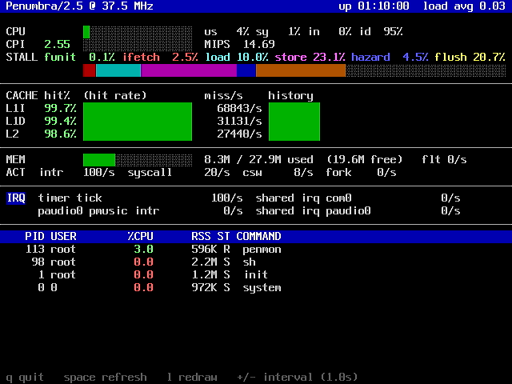

# Penumbra Minicomputer

A 32-bit RISC minicomputer designed from scratch and implemented on FPGA.
Inspired by classic machines like the Data General Eclipse and DEC VAX, but
with a clean load-store ISA. It boots NetBSD 10.1 to a full userland on real
hardware; the longer-term goal is to rebuild the design from discrete 74xx
logic chips.



*`penmon`, the machine's live system monitor, on the HDMI console.*

---

## 💡 Why Penumbra?

Penumbra is born from a desire to move beyond theory. While reading books on computer architecture provides a foundation, it is no substitute for the hands-on experience of making design choices and living with their consequences.

### Inspiration
The primary spark for this project was Bill Buzbee's [Magic-1](https://homebrewcpu.com), a homebrew CPU built from wire-wrapped TTL chips. Discovering it over a decade ago transformed a long-standing interest in ISA design into a concrete goal: to build a complete, functional system from the ground up.

### Design Philosophy
- **Modular for Experimentation:** The architecture is intentionally modular to facilitate learning. It is designed to allow swapping and comparing different components—such as varying cache geometries or TLB designs—to empirically observe their trade-offs.
- **Software-Driven Discovery:** System register interfaces are designed for autodetection. This allows software to dynamically adapt to hardware variations, supporting the project's role as an experimental platform for architectural exploration.
- **Vertical Integration:** By building everything from the RTL and microcode up through the LLVM backend and a NetBSD port, the project provides a comprehensive view of the entire hardware-software contract.

---

## ⚡ Quick Start

From a checkout:

```sh
# 1. The ISA conformance suite on the instruction-set simulator
#    (Python and a C++ compiler; no Docker, no LLVM)
make test-iss

# 2. The same suite and the default core's own on its RTL, in
#    Verilator (needs Docker)
make test

# 3. Build the boot ROM and run the machine on the simulator
#    (needs the LLVM toolchain, see DEVELOP.md)
make simulate
```

---

## 🏗️ Architecture

One ISA, several cores, two boards.

- **ISA:** 32-bit load-store RISC, little-endian. 16 GPRs, 4
  instruction formats, NZCV condition flags.
- **Arithmetic:** MUL/DIV in hardware. Floating point in software.
- **MMU:** software-managed TLB with ASIDs: a set-associative main
  TLB, its geometry each core's own, plus 8 pinned entries.
- **Caches:** split VIPT L1s, write-through, and a shared 4-way L2.
  Each build chooses the sizes; software reads them from the
  hardware.
- **Bus:** the Penumbra Bus, an asynchronous 4-phase handshake with a
  synchronous form, which the FPGA builds use. Zorro-style
  autoconfig.
- **Memory:** on its own clock domain: SDRAM on the ULX3S, DDR3 on the
  Nexys Video.

Cores:

- **Penumbra/1:** microcoded, 3-bus datapath. The 74xx
  discrete-logic reference. 1 KB direct-mapped L1s.
- **Penumbra/2 and /2.5:** a 6-stage hardwired pipeline with 4 KB
  2-way L1s; /2.5 adds forwarding and a BTB. Superseded by
  Penumbra/3.
- **Penumbra/3:** a 7-stage in-order pipeline with full forwarding,
  branch prediction at fetch, a store buffer, and stream prefetch
  beside the L2. 8 KB 2-way L1s and a 256×2 main TLB. The default
  core, and the fastest.
- **Penumbra/4:** an in-order core issuing two instructions a cycle.
  Ideas and measurements; nothing is built.

How fast each one is, beside the machines of its era: the
**[Dhrystone Comparison](doc/dhrystone-comparison.md)**. Specs live in
the **[Documentation Index](doc/README.md)**.

---

## 📈 Status

Runs on two FPGA boards. Also runs in a fast instruction-level
simulator and in cycle-accurate Verilator.

| | Radiona ULX3S | Digilent Nexys Video |
|---|---|---|
| FPGA | Lattice ECP5-85F | AMD Artix-7 200T |
| Cores | Penumbra/1 at 25 MHz; /2, /2.5 and /3 at 37.5 MHz | Penumbra/2 and /2.5 at 60 MHz; /3 at 80 MHz |
| Memory | 32 MB SDRAM | 512 MiB DDR3 |
| Penumbra/3's L2 | 64 KB | 256 KB |
| Keyboard | USB | PS/2 |
| Network | USB Ethernet adapters | on-board Ethernet, 10/100 |
| Audio | the 3.5 mm jack | the ADAU1761 codec's jacks |

**Hardware**, all built from scratch but the DDR3 controller
(UberDDR3):

- CPU, MMU, caches, SDRAM controller.
- UART console.
- SD card over SPI.
- USB 1.1 host controller, down to the PHY. Drives real flash
  drives, keyboards, hubs and Ethernet adapters.
- Ethernet adapter on the Nexys Video's RTL8211E PHY.
- PS/2 port.
- HDMI display: text console plus a framebuffer.
- 4-channel audio mixer.
- Performance counters: stalls, cache hits and misses.

**Software:**

- LLVM backend: clang, lld, llvm-mc. PIE, TLS, C++ exceptions.
- Boot ROM in C: FAT32, ELF loader, monitor.
- NetBSD 10.1 with its full userland, on Penumbra/1, /2 and /3:
  - Root filesystem on SD card.
  - USB disks and keyboards on the ULX3S, with hot-plug.
  - Networking over USB Ethernet (`ure(4)`) or the Nexys Video's own
    adapter (`peth`): ping, ssh.
  - Local console on HDMI, with a USB or PS/2 keyboard.
  - Audio through `audio(4)` and a multi-voice `/dev/pmusic`.
  - Dynamic linking, fork/exec, signals, core dumps.
- Runs Doom, graphics demos and a ProTracker MOD player.
- SD images: single-user, multiuser, an unattended exhibit kiosk, and
  a guest machine others log into over the network.

---

## 📁 Repository Layout

- `hw/` — RTL design (SystemVerilog), testbenches, microcode, and boot ROM.
- `sw/` — Instruction set simulator (ISS), assembler tools, and
  programs for NetBSD: demos, Doom, the MOD player, the kiosk
  launcher.
- `llvm/` — Penumbra backend for the LLVM compiler infrastructure.
- `doc/` — Comprehensive architecture and system documentation.
- `netbsd/` — NetBSD kernel and userland source tree.
- `benchmark/` — Bare-metal benchmarks (Dhrystone, CoreMark, membench, memspeed, memtest) and the NetBSD-hosted `pbench` microbenchmark suite.

---

## 🛠️ Development

For instructions on building the LLVM toolchain, compiling the NetBSD kernel, and running the full test suite, see **[DEVELOP.md](DEVELOP.md)**.

## 📜 License

This project is open source, licensed under the **BSD 2-Clause License**. See [LICENSE](LICENSE) for details and third-party component licenses.
