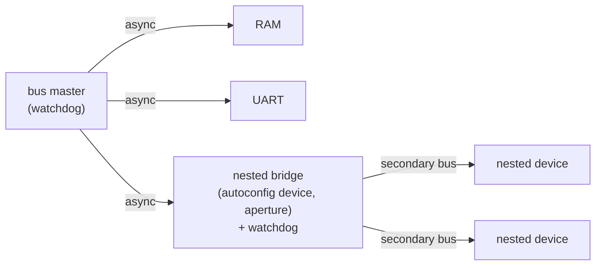

# Penumbra Bus — Protocol

## Overview

The Penumbra Bus is the protocol that connects the CPU to memory
and I/O devices.  It is one protocol expressed in two equivalent
forms:

- **Sync form** — clock-aligned levels (`re`/`we`/`ack`/`rdata`).
  Spoken everywhere inside the FPGA — between the system-bus master
  (the L2 cache's back side, or a core's own bus master), the bus
  device-select layer, and every memory-mapped device.
- **Async form** — self-timed 4-phase handshake (`req`/`ack`).  Spoken
  across the discrete-build pin boundary.  Currently exists only as
  a specification; the FPGA build never uses it.

The two forms have identical causal semantics; only the signaling
differs.  RTL modules are written against the sync form (that's what
FPGA simulation and synthesis consume); the future discrete-build
form factor drives the async form from the same modules via a thin
sync-to-async wrapper at the pin boundary.

This document specifies the async form first (the original
signal-level specification), then maps it to the sync form in the
[Sync-Bus Mapping](#sync-bus-mapping) section.

## Terminology

These terms are used consistently throughout Penumbra's docs and
RTL.  Other docs reference them by this canonical naming.

| Term | Definition |
|---|---|
| **Penumbra Bus** | The protocol — both forms. |
| **Sync form** | Clock-aligned implementation; used everywhere inside the FPGA. |
| **Async form** | Self-timed 4-phase implementation; future discrete-build form, no live instance today. |
| **CPU memory port** | The Penumbra/1 and Penumbra/2 port between the core's caches and the L2 (`cpu_core`'s `o_mem_*` / `i_mem_*`).  Not a Penumbra Bus port: it speaks the core-side stall handshake specified in [`cpu-bus.md`](../internals/cpu-bus.md#cpu-memory-port), and the L2 bridges it onto the system bus. |
| **System bus** | The shared interconnect below the CPU's memory hierarchy — the bus master (L2 back side, or a core's own bus master), the bus device-select layer (`bus_devsel`), and all memory-mapped devices.  Always sync form. |
| **External bus** | The portion of the system bus that crosses the FPGA pin boundary.  Currently doesn't physically exist; this is the future discrete-build target where the async form is used. |
| **Cache front-side** | A cache's upstream (CPU-facing) port. |
| **Cache back-side** | A cache's downstream (memory-facing) port. |

*Note:* "front" and "back" are from each cache's perspective, not
the CPU's.  L1's front-side talks to the core; L1's back-side talks
to the arbiter (which merges the I- and D-cache back-sides into the
CPU memory port).  L2's front-side talks to the CPU memory port;
L2's back-side talks to the system bus.

## One Master

The bus has exactly one master, on the CPU's side: the port below the
CPU's memory hierarchy. Every device, memory included, only responds.
A device never starts a transaction, so it never reads or writes RAM
or another device. The protocol carries no request or grant, so
nothing could arbitrate ownership of the bus between two masters.

Hardware that moves data does so from one of two places. A device
that moves data in bulk holds it in its own memory, which the CPU
reads and writes as device accesses. Anything that needs to reach RAM
itself, such as a copy engine, sits on the master's side and issues
its transactions through the same port, in turn with the CPU's, one
transaction at a time.

## Bus Signals (async form)

These are the signal names of the async / 4-phase form documented in
this section.  The sync form renames two of them (`req` →
`re`/`we`, `bus_error` → `bus_fault`) and keeps `ack`; the
[Sync-Bus Mapping](#sync-bus-mapping) section below has the
correspondence table.

| Signal | Width | Direction | Description |
|--------|-------|-----------|-------------|
| `addr[31:0]` | 32 | Master → Slave | Physical address |
| `data[31:0]` | 32 | Bidirectional | Read/write data |
| `we` | 1 | Master → Slave | Write enable |
| `byte_en[3:0]` | 4 | Master → Slave | Byte lane enables |
| `data_dir` | 1 | Master → all | Tri-state turnaround signal: 0=master drives data, 1=slave drives.  Async-form only — the sync form's separate `wdata`/`rdata` ports are inherently directional and need no equivalent. |
| `req` | 1 | Master → Slave | Request active |
| `ack` | 1 | Slave → Master | Acknowledge / completion |
| `bus_error` | 1 | Slave → Master | Access fault (sync-form name: `bus_fault`) |
| `rst` | 1 | Master → Slave | Bus reset |

## Four-Phase Handshake

### Read Cycle
1. Master asserts `req`, drives `addr`, `we=0`, `data_dir=1`.
2. Slave drives `data`, asserts `ack`.
3. Master deasserts `req` (captures data).
4. Slave deasserts `ack`.

### Write Cycle
1. Master asserts `req`, drives `addr`, `data`, `we=1`, `byte_en`, `data_dir=0`.
2. Slave commits write, asserts `ack`.
3. Master deasserts `req`.
4. Slave deasserts `ack`.

## Burst Transfers (Cache Line Fill)
The master performs back-to-back transfers by keeping `req` asserted and changing `addr` after each `ack`.

```
req:       ___/‾‾‾‾‾‾‾‾‾‾‾‾‾‾‾‾‾‾‾‾‾‾‾‾\___
addr:      ---[A+0 ][A+4 ][A+8 ][A+C ]-------
ack:       ______/‾‾\/‾‾‾\/‾‾‾\/‾‾‾\________
data:      ------[W0 ][W1  ][W2  ][W3  ]-----
```
The slave responds to each address independently.

## Access Width

The bus protocol permits sub-word access. A master may drive any
combination of `byte_en[3:0]` together with a byte-granular `addr`,
and the slave is expected to act on the indicated byte lanes.

### Default contract

Unless the device's own documentation says otherwise, the following
apply:

- **Writes.** The slave commits only the byte lanes whose `byte_en`
  bit is set. Lanes with `byte_en=0` are left unchanged.
- **Reads.** `byte_en` is advisory; the slave drives all 32 bits of
  `rdata` with each byte positioned at its natural lane (the byte at
  byte address `A+N` lives in `rdata[8N+7:8N]`, `N∈{0..3}`). The
  master extracts the requested lane(s) using `addr[1:0]` and the
  access size — the slave is not required to repack data based on
  `addr[1:0]`.

This is the contract that `simple_mem`, the boot ROM and the SDRAM
stack implement. It is also the contract any general-
purpose memory-like slave should implement.

### Device-specific restrictions

An individual device's documentation MAY narrow the contract. The
most common restriction in Penumbra today is *word-strided access
only* — the device's registers occupy word slots in the address
map and the device handles only 32-bit transactions. The UART,
SPI and autoconfig config-space window are all of this kind; see
the per-device docs and the autoconfig section of
[bus.md](../system/bus.md) for the specifics.

When a device documents a restriction, software is responsible for
following it. The bus itself does not enforce per-device access
rules — adding runtime checks in every slave is exactly the cost
this layered contract is designed to avoid.

Violating a device restriction such as doing a full word read across
multiple sub-word MMIO registers or a sub-word partial read of a larger
device register results in undefined behavior and must not be relied
upon when implementing drivers. Devices are allowed to protect against
such misuse and assert `bus_fault` but that behavior is not required.

### Examples

- `LDW R1, [ram_addr]` against any RAM slave: returns the full word
  starting at `ram_addr`.
- `LDB R1, [ram_addr + 2]` against any RAM slave: slave drives the
  full word at `ram_addr & ~3`; the CPU's `byte_ext` selects
  `rdata[23:16]`. Correct under the default contract.
- `LDW R1, [uart_base + 4]` (read of UART register 1): supported,
  per the UART's word-strided contract.
- `LDB R1, [uart_base + 5]` (sub-word read of a word-strided
  register): not supported by the UART; result is governed by the
  rule defined in the section above.

### Access faults (`bus_fault`)

`bus_fault` (async `bus_error`) signals that an access did not
complete normally.  It has two sources:

- **No device at the address — the canonical source.**  The fault is
  the *absence of any slave's response*, not a verdict from a central
  decoder.  Each slave knows only its own range — it claims
  (acknowledges) the addresses it backs
  and is silent otherwise — and the bus raises `bus_fault` when an
  access goes unclaimed.  This matters because on the external async
  bus the address layout is discovered at boot (autoconfig assigns
  device ranges), so no master- or fabric-side decoder can hold a
  static map of "what is where": the no-device fault is a bus-protocol
  property — a watchdog / no-acknowledge timeout, in both forms.
  No slave acknowledges, so the bus completes the access itself: it
  acknowledges on the slaves' behalf with `bus_fault=1` alongside.
  This is what makes RAM sizing and optional-device probing work:
  software touches an address and catches the fault when nothing
  answers.  The sync form runs the watchdog in its
  [response fabric](#the-response-fabric), so no part of the bus needs
  to know which devices exist; a slave's select is its *own* decode
  (RAM sized to its DRAM, a device its register window), never a
  separate map the master keeps.

- **A slave rejecting an access it does claim** (optional, per the
  device restrictions above).  The responding slave asserts
  `bus_fault` alongside its own `ack`.  A nested bridge is the
  structural instance of this form — see
  [No-device faults and nested bridges](#no-device-faults-and-nested-bridges).

Either way the rule is the same: `bus_fault` rides the access's
**completion** — the cycle `ack` is asserted.  On a faulting
completion `rdata` is undefined and the master commits no
architectural effect.

A master separated from the responder by intermediate layers (caches,
an arbiter, a fill sequencer) cannot sample the fault as a sideband —
the faulting cycle has passed by the time the master's own access
completes — so each layer carries the fault inward as a companion to
the completion it already forwards: the `ack` of a single beat, or
the fill-done of a line transfer it was unrolling (a faulting beat
mid-line aborts the line and forwards the fault on its done event).

### No-device faults and nested bridges

The top-level system bus is the **async bus** itself.  In the discrete
build essentially every device sits on it directly, and they *must*
appear in the top-level autoconfig pass — otherwise the boot ROM can't
find the RAM and console it needs to come up.  Nothing enumerable
stands in front of them, and there is no aperture: the whole address
space is autoconfig space, and the no-device fault is the async
watchdog from the [first form above](#access-faults-bus_fault), run by
the bus master.  (In an FPGA realization the transparent sync→async
adapter at the chip edge is that master and hosts the watchdog; it is
plumbing, not an autoconfig device.)

A **nested bridge** is the one place the aperture model applies.  It
sits on the async bus *as a device* — autoconfig enumerates it and
assigns it a *base* for a fixed-size aperture `[base, base+size)` — and
fronts a secondary bus of its own.



Making the nested bridge an ordinary autoconfig device is what lets it
coexist with software-assigned, topology-blind base addresses:

- Autoconfig reserves the bridge's whole window as one device-sized
  allocation, so the free-pointer steps over it.  A top-level device is
  never handed an address inside the aperture, and the bridge never
  shadows one — the "device inside the window" hazard cannot arise.
- Devices *behind* the bridge are not seen by the top-level pass —
  autoconfig enumerates the bridge, not what is past it.  Discovering
  them and assigning their bases *within* the aperture is bridge-aware
  software's job, out of band for the bus protocol.  Because that
  allocation draws from the aperture, a nested device is never placed
  outside the window that reaches it.

The bridge resolves accesses to its window the way the top-level master
resolves the async bus: it claims the address, withholds `ack` across
its secondary-bus round-trip, and acknowledges when the secondary bus
answers — or, on a no-acknowledge timeout, acknowledges with
`bus_fault` asserted, surfacing an empty nested slot to its parent as
the [claimed-slave-reject form](#access-faults-bus_fault).  The
watchdog deadline is the bridge's own parameter.

| Phase | `re` | `ack` | `rdata` | `bus_fault` |
|---|:-:|:-:|:-:|:-:|
| Presentation | 1 | 0 | — | 0 |
| Secondary round-trip | 1 | 0 | — | 0 |
| Secondary bus answers | 1 | 1 | D | 0 |
| *or* watchdog expires | 1 | 1 | undefined | 1 |

The master is unaffected by the depth: its contract is unchanged —
`bus_fault` rides the completion at the `ack` — so a fault from two
buses down is sampled the same way a top-level watchdog fault is.

An on-chip sync fabric runs the same watchdog, so its no-device fault
needs no knowledge of which devices it hosts; any slave that can reject
an access it claims (a nested bridge, a device guarding its registers)
raises `bus_fault` with its own `ack`.
[The response fabric](#the-response-fabric) gives the sync form of
both.

Several bridges compose with no added machinery — each is just another
autoconfig device with its own aperture.  The price is that discovering
the devices nested behind each is the software's responsibility, not an
automatic recursive enumeration.

## Sync-Bus Mapping

The sync form expresses the same protocol with clock-aligned levels
instead of self-timed edges.  Causal semantics are identical to the
async form above: the master requests, the slave acknowledges when the
access is done, and silence means *wait*.  The table below maps
signals between the two forms.

| Async signal | Sync signal | Direction | Notes |
|--------------|-------------|-----------|-------|
| `req` | `re` (read) / `we` (write) | master → slave | Held from presentation through the `ack` cycle |
| `ack` rising | `ack` | slave → master | One-cycle pulse on the cycle the access completes |
| `ack` falling | *(none)* | — | The pulse ends by itself; there is no release phase |
| `addr`, `data`, `byte_en` | `addr`, `wdata` (master→slave), `rdata` (slave→master), `byte_en` | — | Driven while `re`/`we` is held; sync form's separate wdata/rdata ports remove the need for `data_dir` |
| `bus_error` | `bus_fault` | responder → master | Same semantics, valid only in the `ack` cycle. See [Access faults](#access-faults-bus_fault). |

### Sync handshake

| Cycle | `re` | `addr` | `ack` | `rdata` |
|------:|:----:|:------:|:-----:|:-------:|
| 0     | 1    | A      | 0     | —       |
| 1     | 1    | A      | 1     | **D**   |
| 2     | 0    | —      | 0     | —       |

A write has the same shape with `we` and `wdata`.  The table shows
the fastest access; a slave may take any number of cycles between
presentation and `ack`.

1. **Presentation.** The master raises `re` or `we` and drives `addr`
   (with `wdata` and `byte_en` for a write).  Every slave sees the
   request; the one whose select claims `addr` acts on it and every
   other slave ignores it.  A select is the slave's own decode — a
   board may compute it beside a device and hand the device a
   pre-qualified strobe, but the decoder belongs to the slave, never
   to the master.
2. **Hold until `ack`.** The master holds the strobe and every request
   field stable through the `ack` cycle inclusive, and may not abandon
   an access: the slave may already have started it, and nothing on
   the bus can recall it.
3. **`ack` is a registered one-cycle pulse.** A slave raises `ack` for
   exactly one cycle per access, from a flop, and never in the
   presentation cycle.  Every access therefore takes at least one wait
   cycle, and no path runs from a master's request to its own
   completion within a cycle.
4. **Completion.** In the `ack` cycle `rdata` carries the read data
   and `bus_fault` is valid; neither is defined in any other cycle.  A
   write is committed no later than the end of its `ack` cycle, so
   every later access sees it.
5. **Next access.** A strobe still held in the cycle after `ack` is a
   new access.  A strobe in the `ack` cycle itself still belongs to
   the access being completed — the master has not yet seen the `ack`.
6. **Every claimed access is acknowledged,** including a write the
   slave ignores (a read-only register, a ROM).  A slave that claims an
   access and never acknowledges it leaves it to the watchdog, which
   faults it exactly as if no device were there.

As in the async form, a slave that does nothing holds the master
rather than completing its access.  Stale read data takes an `ack`
raised before the data is ready — an active mistake, never an
omission.

### Slave obligations

The strobe is held for at least two cycles — presentation and `ack` —
so a slave never keys a side effect on the bare strobe:

- **Exactly-once side effects.** Each state change an access causes —
  a register or memory write, a FIFO push or pop, a write-one-to-clear,
  a start pulse — is keyed on an event that occurs once per access:
  its first cycle (`strobe & ~pending`) or its `ack` cycle
  (`strobe & ack`).  A read that consumes what it returns (a FIFO pop)
  captures the data and consumes it on the same edge, at the end of
  the first cycle.
- **Claim stability.** A slave keeps claiming an access — its select
  stays asserted — from presentation through its `ack` cycle.  A write
  that moves the slave's own decode (autoconfig's `CFG_BASE`) takes
  effect in the `ack` cycle, so the claim moves only once the access
  has completed.

A *simple device* — one that resolves every access in one cycle —
needs one flop:

```systemverilog
// Pulses the cycle after each access is presented; the strobe seen
// in the ack cycle belongs to the access being completed.
always_ff @(posedge i_clk)
    if (i_rst) ack_q <= 1'b0;
    else       ack_q <= (i_re | i_we) & ~ack_q;
```

`strobe & ~ack_q` is then the access's first cycle and `strobe & ack_q`
its `ack` cycle.  A slave whose latency varies replaces the flop with
its own sequencer, under the same rules.

### The response fabric

The fabric merges the slaves' responses into the master's.  Three rules
keep every response path starting at a flop:

- **`ack` is the OR of the slaves' `ack`s**, never gated by the live
  selects.  A slave's `ack` arises only from an access it claimed;
  gating it again by the select would put the address decode back on
  the response path.
- **`rdata` is gated per slave by that slave's own `ack`**, then OR'd.
  A slave's `rdata` need be valid only in its `ack` cycle, and nothing
  selects read data by the live address.
- **A watchdog answers what nothing else does.** An access no slave
  acknowledges within the fabric's deadline is acknowledged by the
  fabric itself, with `bus_fault`, from a flop.  The deadline sits well
  above the slowest legitimate access on the segment, so it fires only
  when no device answers — absent or stuck — and the fabric needs no
  knowledge of which slaves exist.  A slave that answers in the very
  cycle the watchdog fires wins: its access completes without a fault.

```
ack       = timeout | (OR of slaves' ack)
bus_fault = (timeout & ~(OR of slaves' ack)) | (OR of slaves' bus_fault)
rdata     = OR over slaves of (ack_i ? rdata_i : 0)
```

`bus_fault` is sampled only together with `ack`.  A request crosses the
fabric to a slave's flops in one cycle and the answer crosses back in
another; no cycle carries both.  That is what keeps the distance
between the masters and the slaves from doubling up on one clock
period.

### Sync burst

| Cycle | `re` | `addr` | `ack` | `rdata` |
|------:|:----:|:------:|:-----:|:-------:|
| 0     | 1    | A+0    | 0     | —       |
| 1     | 1    | A+0    | 1     | **D0**  |
| 2     | 1    | A+4    | 0     | —       |
| 3     | 1    | A+4    | 1     | **D4**  |
| 4     | 0    | —      | 0     | —       |

`re` held across word boundaries; `addr` advances in the cycle after
each `ack`.  Same shape as the async burst, and with a one-wait slave
one word moves every two cycles.

The bus carries no burst length and no line shape: every transfer is
one word.  A slave that gains from sequential access (SDRAM) infers it
from the held strobe and the advancing address and optimises inside
itself; every other slave sees independent accesses.

The core-side interfaces above the system bus are not the Penumbra
Bus: the CPU memory port is specified in
[`cpu-bus.md`](../internals/cpu-bus.md#cpu-memory-port), and
Penumbra/1's split-L1 `req_accepted` handshake in
[`penumbra1/l1-cache.md`](../internals/penumbra1/l1-cache.md#line-fill-and-the-split-l1-arbiter).

## Reset Timing

The `rst` line resets **autoconfig state** (the `configured` and
`cfg_seen_low` flip-flops in each device). It does not initialize
device-specific hardware (SDRAM controllers, SD cards, …) — each
device driver performs its own initialization after autoconfig
assigns a base address.

Two pulse sources drive the same line:

| Source                | Minimum duration | Rationale |
|-----------------------|------------------|-----------|
| Hardware (power-on)   | **10 ms**        | Covers PLL lock, power rail stabilization, crystal oscillator startup. Board implementations must meet this regardless of clock frequency. |
| Software (`BUSCTL.RST`)| **100 µs**      | Propagation through the async external bus: worst case is 74xx gate delays + backplane trace delays + RC settling. 74HC async clear is <100 ns, but the spec allows for long backplanes and slow LS/ALS parts. |

**Board implementation.** The hardware reset counter width must satisfy
`2^N / f_clk >= 10 ms` at the board's system clock. The ULX3S top
holds reset for `2^18` cycles (`ulx3s_penumbra1_top.sv`), which
satisfies the 10 ms minimum only for clocks up to ≈26 MHz — with
no margin to spare. Re-verify the inequality whenever the system
clock changes, and widen the counter rather than shave the
requirement.

**Software implementation.** The boot ROM delay loop between asserting
and deasserting `BUSCTL.RST` must hold the pulse for at least 100 µs.
The current ROM uses a calibrated iteration count based on the system
clock frequency (`BUS_RESET_DELAY_ITERS` in `boot_rom.c`).
