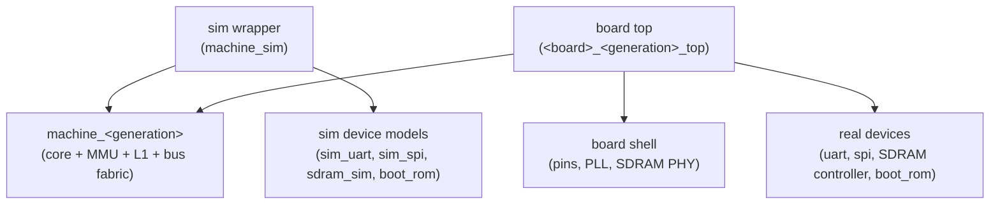

# Build & Test Structure

> **Applies to:** all generations · build infrastructure.

How the repository's build targets, RTL directory layout, and hardware
test suites are organized so that multiple CPU core generations,
multiple FPGA boards, and multiple execution platforms compose without
per-combination special cases. The Makefile implements this structure;
this document is its source of truth.

## The four axes

Every buildable or runnable hardware artifact is a point in a
four-axis matrix:

| Axis | Values | What it owns |
|------|--------|--------------|
| **Core generation** | `penumbra1`, `penumbra2`, … | `hw/rtl/<generation>/` — the CPU core modules |
| **Integration level** | core · machine | how much of the system surrounds the core |
| **Execution platform** | ISS · Verilator · FPGA | how the design executes |
| **Board** | `ulx3s`, `nexysvideo`, … | constraints, pins, clocks, board-specific PHYs, and its device family's flow |

The axes are orthogonal by construction: adding a board must not touch
core directories, and adding a core generation must not touch board
directories. The ISA is the contract that makes this hold — every
generation runs the same binaries, so the ISS (which models the ISA,
not any core) and the conformance test programs are
generation-independent.

The two integration levels:

- **core** — the bare pipeline against a memory stand-in. Runs
  programs that need only the CPU and memory; used for bring-up and
  for synthesis timing probes that isolate core logic cones from
  system paths.
- **machine** — the core plus its generation-bound memory system and
  the shared bus fabric (see
  [the machine layer](#the-machine-layer)). Runs the full test suite.

## Directory layout

```
hw/rtl/
├── common/        ISA constants (penumbra_pkg) + generation-shared modules
├── penumbra1/     gen1 core (microcoded)
├── penumbra2/     gen2 core (pipelined)
├── mmu/ soc/ io/ bus/   generation-neutral fabric and devices
├── machine/       machine integrations: machine_<generation>.sv
├── sim/           simulation-only models (sim_uart, unified_mem, …)
└── fpga/
    └── <board>/   board shell + per-(board, generation) top modules
```

A core generation directory contains only that core's modules, all
prefixed with the generation name. The fabric directories are shared
and must remain generation-neutral: a fabric module that needs
generation-specific behavior takes it through ports or parameters,
never by knowing which core is attached.

## The machine layer

`hw/rtl/machine/` hosts one integration module per generation,
`machine_<generation>`: the board-independent computer. It binds the
CPU core to its memory system (MMU, L1 caches, and the structures
between them) and the shared bus fabric, and exposes:

- the external Penumbra Bus, where devices attach;
- interrupt request inputs;
- commit/retire observability and the trace port;
- a **program-end pulse** for test runners.

Devices live *outside* the machine. Two kinds of wrapper instantiate
it:



Because both wrappers attach devices to the same bus the machine
exposes, what simulates is what synthesizes — the sim and FPGA
configurations differ only in device models and the board shell.

**The program-end contract.** Test programs end in `BREAK` and report
pass/fail in R1. Each machine exposes a program-end pulse whose
realization is generation-defined (a microcoded core may halt on
BREAK; a pipelined core that treats BREAK as a trap pulses on the
retiring BREAK op-class instead). In-order commit guarantees
architectural state is final when the pulse fires. A program runner
keys on this contract — clock, reset, program-end, R1 readback, trace
— and therefore serves any generation's machine unchanged.

## Test program taxonomy

Hardware test programs live in `hw/sim/programs/`, split by what they
verify — the directory is the contract, not the filename:

```
hw/sim/programs/
├── isa/           ISA conformance — must pass on the ISS and on
│                  every core generation's machine, unchanged
├── penumbra1/     gen1 microarchitecture regressions
└── penumbra2/     gen2 microarchitecture regressions
```

- **`isa/`** is the conformance suite. A new core generation is
  ISA-complete exactly when `isa/` passes on it unchanged. Programs
  here exercise architectural behavior (instructions, exceptions,
  traps, interrupts, MMU semantics) and never depend on
  implementation timing, cache or TLB geometry, or counter values.
  A program that touches the TLB includes `mmu.inc` and calls its
  `tlb_init` first: the TLB is undefined after reset, and the
  helpers there name slots from `MMU_CONFIG`, so one program serves
  every MMU version and any TLB of 32 sets or more.
- **`penumbra<N>/`** holds programs pinned to one implementation:
  pipeline-shaped hazard regressions, cache/arbiter timing, perfctr
  counts. These run only on their generation.

All programs keep the `test_` filename prefix, and basenames are
unique across suites — build artifacts and `make test-prog` are keyed
by basename, so the test driver rejects duplicates loudly rather than
let one program's results shadow another's. Per-program metadata goes
in the header comment as lit-style tags the test driver scans:

- `; RUNNER: tb_<name>` — run under a bespoke testbench instead of
  the generation's default program runner. Used when the testbench is
  part of the stimulus (e.g. driving an IRQ line at a precise point).
  `isa/` programs always use the default runner — a program that
  needs bespoke stimulus is implementation-pinned by definition and
  belongs in its generation directory.
- `; REQUIRES: <capability> …` — capabilities the executing
  integration must provide (lowercase tokens, e.g. `mmu`, `uart`).
  Each runner declares the set it provides in the test driver; a
  program whose requirements aren't met is reported as skipped, never
  silently dropped. Programs with no tag need only CPU + memory.

A microarchitecture sub-variant (`CORE=penumbra<n>_<sub>`, e.g.
`penumbra2_5`) runs on its base generation's runner and inherits the
base's program suite plus any programs in its own `<core>/` directory.
When the variant changes behavior a base program pins — e.g. an exact
stall count a forwarding variant no longer incurs — that program guards
with a capability the base provides and the variant drops (such as
`pinned-stalls`), so it skips on the variant instead of failing.

## Make targets

| Target | Meaning |
|--------|---------|
| `make test [CORE=<generation>] [SIM_MEM=sdram\|ddr3]` | `isa/` + `<generation>/` programs on that generation's RTL runner (default `CORE=penumbra3`) |
| `make test-iss` | `isa/` on the ISS — the generation-independent ISA reference |
| `make test-prog CORE=<generation> PROG=<name>` | one program, porcelain for iteration |
| `make test-modules` | per-module Verilator testbenches (all generations registered in `MODULE_TESTS`) |
| `make test-all` | everything above |
| `make fpga BOARD=<board> CORE=<generation> [VARIANT=<v>]` | synthesize + PnR + bitstream |
| `make flash` / `make timing` | same variables as `fpga` |

`make sim MOD=<m> TB=<tb> PROG=<p>` remains the low-level escape
hatch beneath the porcelain, as `TOP=<module>` does for the FPGA flow.

`SIM_MEM` picks the memory system the gen2 sim machine's RAM goes
through, for `test`, `test-prog`, `simulate-rtl` and `benchmark-rtl`
alike: `sdram` (the default) is the ULX3S's SDR stack at 32 MiB, and
`ddr3` the Nexys Video's DDR3 stack on a model of its controller at
512 MiB. The ddr3 wrapper is a fork of the gen2 one in
`hw/rtl/sim/ddr3/`, found first on the `-I` path as a core variant's
forks are, so the runner testbenches drive either unchanged; the
binaries carry the choice in their names.

The program-run loop lives in a script (`hw/tools/run-prog-tests.py`),
not in Makefile shell blocks: the Makefile resolves *which* programs
and *which* runner binary, the script owns tag scanning, execution,
and the pass/fail report.

## FPGA top naming and source composition

`BOARD` and `CORE` (plus optional `VARIANT`) expand mechanically to a
top:

```
TOP = <board>_<core>[_<variant>]_top      e.g. ulx3s_penumbra2_top
file: hw/rtl/fpga/<board>/<top>.sv
```

Each top file is thin: it instantiates the board shell (pins, PLL,
PHYs — shared per board) and one machine plus its devices. Two kinds
of variant exist, and they compose differently:

- **Integration variants** change the board wiring — e.g. a `probe`
  variant wraps the bare core for timing work without the fabric.
  These are genuinely different schematics, so each is its own
  greppable top file with its own module, keeping "which machine this
  is" a schematic fact rather than a flag (the discrete-logic
  principle).

- **Microarchitecture sub-variants** name a `penumbra<n>_<sub>` core
  (e.g. `penumbra2_5`): the *same* board top and machine as the base, but
  a different core fileset built by **composition** (see gen2.5
  organization in `penumbra2/overview.md`) — the base's shared leaf cells
  plus a forked integration chain, not a parameterized re-elaboration of
  the base RTL. A separate board top would mean duplicating the pin map,
  so the sub-variant reuses its base top; `TOP` then names the
  **artifact** — every `make fpga` / `make timing` output (`.bit`,
  `.json`, `_timing.json`, …) is `TOP`-keyed, so sub-variants never share
  a bitstream or report — while `TOP_MODULE`
  (`<board>_<core-base>[_<variant>]_top`) names the shared module yosys
  synthesizes. The `PENUMBRA_CPU_VARIANT` build-time define (sv2v `-D`,
  the same mechanism as `SDRAM_PHASE_DEG`) now selects only **identity**
  (the cpuid name); the microarchitecture comes from the forked fileset,
  not the parameter. Each choice is fixed at build time, so it still
  collapses to one definite schematic in a discrete rebuild.

The source set composes from per-axis variables; computed variable
names keep it table-driven:

```make
FPGA_SRC = $(SRC_COMMON) $(SRC_CORE_$(CORE)) $(SRC_FABRIC) $(SRC_BOARD_$(BOARD))
```

An integration variant may override the composition (the probe variant
drops `$(SRC_FABRIC)` and adds the memory stand-in). A microarch
sub-variant supplies its **own** core set, `SRC_CORE_<sub>` — its base's
leaf cells minus the forked integration files, plus the sub-variant's
fork directory (e.g. `SRC_CORE_penumbra2_5` = `SRC_CORE_penumbra2` with
`core`/`spine`/`id_stage`/`ex_stage` filtered out, plus
`hw/rtl/penumbra2_5/`). The fpga build selects this via a `CORE`-aware
`SRC_CORE` that prefers `SRC_CORE_<sub>` and falls back to the base; the
sim build instead resolves modules from the `-I` library path with the
variant directory prepended, so the forks shadow their base namesakes by
search order. The Makefile carries one registry table (`FPGA_TOPS`) of
every valid artifact — sub-variant artifacts included — so an invalid
tuple is a hard error, not a silently empty source list.

### Pinning a default placement seed

A board/core/variant combination that only closes timing on a particular
nextpnr placement seed can pin it as `DEFAULT_SEED_<top>` next to the other
per-top metadata (keyed by the artifact `TOP` name, like `FPGA_ROM_TOPS`):

```make
DEFAULT_SEED_ulx3s_penumbra2_top := <good seed>
```

A plain `make fpga BOARD=… CORE=…` then reproduces that placement with no
one having to remember the number, and the resolved seed is echoed at the
start of place-and-route. The effective seed is `NEXTPNR_SEED ?=
$(DEFAULT_SEED_$(TOP))`, so an explicit `NEXTPNR_SEED=<n>` on the command
line or in the environment still wins, `NEXTPNR_SEED=` forces a random
placement, and a top with no pinned default behaves as before (no `--seed`
passed). Keying by `TOP` lets a microarch variant pin a seed distinct from
its base. (Seed is still outside the build dependency graph — rebuilding
the normal artifact under a different seed needs `rm build/<top>.config`
first.)

### Sweeping seeds in parallel

`hw/tools/seed-sweep.sh BOARD=… CORE=… [SEEDS="0 1 …"] [JOBS=4]` builds
the shared synthesis JSON once, then places it under every requested
seed concurrently — the seed-sweep pattern rule gives each seed its own
artifacts (`build/<top>.s<seed>.config` plus a seed-tagged timing
report), so the fan-out runs under one `make -jN` — and prints each
seed's achieved CPU-clock fmax. Finished seeds survive re-runs:
widening a sweep places only the new ones. `JOBS` is bounded by memory
rather than cores (each nextpnr holds the whole design). Pin the winner
as `DEFAULT_SEED_<top>` and rebuild through the normal `fpga` target.

## Device families

Each board belongs to a device family (`FAMILY_<board>` in the
Makefile), and the family picks the flow behind `make fpga` and
`timing`:

| Family | Boards | Synthesis to bitstream | `make timing` reads |
|--------|--------|------------------------|---------------------|
| `ecp5` | `ulx3s` | yosys `synth_ecp5`, nextpnr-ecp5, ecppack | nextpnr's JSON report (`hw/tools/timing-report.sh`) |
| `xc7` | `nexysvideo` | one Vivado batch run (`hw/tools/vivado/build.tcl`) | Vivado's timing summary |

`make flash` is the same for every family: openFPGALoader, which
opens a board's FTDI chip by USB ID alone, so with several boards on
one host it programs only the one named.

Both flows synthesize the same Verilog. The synthesis step is one rule
whose front half is shared (hex images, sv2v, `inline_hex.py`) and whose
last command is the family's synthesizer, `FPGA_SYNTH_CMD_<family>`,
writing `FPGA_SYNTH_OUT_<family>`: the netlist JSON nextpnr places, or
for xc7 the bitstream itself. The sv2v output is not a target of its
own, because `inline_hex.py` rewrites it in place: as a target, a failed
inline could leave it looking up to date, and the next build would
synthesize a boot ROM with no contents.

The board is `BOARD`, or under the `TOP=` escape hatch the `<board>_`
prefix of the top's name. A name with no known board prefix is one of
the bare `fpga/*.sv` tests, which are all ECP5. Per-board facts sit
beside the family: `LPF_<board>` for ecp5, `XDC_MASTER_<board>` and
`PART_<board>` for xc7, and for every board `OFL_BOARD_<board>`
(openFPGALoader's name for it). Seed pinning and seed sweeps are
nextpnr features, so they apply to ecp5 boards only.

Constraints differ by family because the tools treat unused ones
differently. nextpnr ignores LPF entries for pins a design lacks, so an
ecp5 board has one board file shared by every top. Vivado raises a
critical warning for each constraint naming a missing port, so an xc7
top's XDC files (`XDC_<top>`) hold only its pins. Constraints a set
of tops shares sit in one file they all list: the ports every machine
top has, whatever its core (`XDC_MACHINE_nexysvideo`), or a board's
DRAM (`XDC_DDR3_nexysvideo`). Those lines
are copied, uncommented and otherwise unchanged, from the board's
master XDC, which is vendored verbatim under `hw/third_party/` and
never edited. A board whose DRAM pins the master XDC leaves out has
them from its memory interface generator project, vendored the same
way; each of its pins stands for the one XDC line that states it.
`hw/tools/xdc_check.py` holds every pin and board-clock line of a
top's XDC files to those masters before each build, so a mistyped pin
or I/O standard stops the build before Vivado runs.

An xc7 build ends in signoff gates (`hw/tools/vivado/gates.tcl`),
because Vivado reports a design that fails timing and writes its
bitstream anyway. The routed design gets a bitstream only when:

- setup, hold and pulse width are met on every clock;
- `check_timing` finds every flop clocked, every endpoint constrained,
  and every I/O port either given a delay or explicitly false-pathed;
- `report_cdc` finds no unsafe or unknown crossing and no synchronizer
  flop without `ASYNC_REG`;
- methodology and DRC checks find nothing at critical-warning severity
  or above, and the run logs no critical warning at all;
- every memory is built the way its `ram_style` declares. yosys fails
  a build it cannot honor; Vivado only warns and falls back to another
  kind of storage, so without this gate the same RTL could map
  differently on the two families;
- the design carries the thermal guard (`xc7_thermal_guard.sv`), one
  XADC with its over-temperature shutdown armed, and the bitstream
  allows the shutdown (`build.tcl` sets
  `BITSTREAM.CONFIG.OVERTEMPPOWERDOWN`). The shutdown is off unless
  both ask for it, and a board top that forgot the guard would leave
  the part free to run past its rated junction temperature. The build
  log prints the thresholds it armed (`Thermal:`).

The timing floor is zero slack. Vivado times setup at the slow corner
(85 °C, minimum voltage) and hold at the fast one, with each clock's
jitter charged to every path, so a met constraint already holds across
the device's operating range. A design that wants margin states it in
its XDC as clock uncertainty, which the tools then optimize against.
The coverage and crossing gates carry the weight: slack says nothing
about a path Vivado was never asked to time. On failure the reports
and routed checkpoint are still written and any older bitstream is
deleted, so `make flash` has nothing stale to program. Pass or fail,
the build prints each clock's worst slack and the frequency its worst
path would allow.
