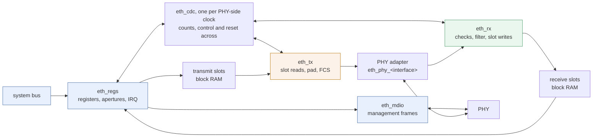

# Penumbra Ethernet Adapter — FPGA Microarchitecture

How the `CLASS_ETHERNET` device is built. The programming interface is
[`doc/system/devices/ethernet.md`](../system/devices/ethernet.md); this
document covers the RTL behind it: the module split, the clock domains
and what crosses between them, and the seam at which a board's PHY
attaches. A board's own side (pins, clocks, delays) is in that board's
directory, as [`nexysvideo/ethernet.md`](nexysvideo/ethernet.md) is.

## Overview

The device is a MAC between the system bus and a PHY. Its work divides
by clock: the registers and the software side of both slot rings run
on the bus clock, the receiver on the PHY's receive clock, and the
transmitter on a transmit clock the board supplies. The slot memories
are where the domains meet. Each is a block RAM with a port in two
domains, so frame bytes never pass through a synchronizer; only the
four frame counts and a few slow control values do.

Everything above the PHY's data interface is board-neutral, as the USB
host controller is above its PHY
([`usb-host-controller.md`](usb-host-controller.md)). A board supplies
a PHY adapter that turns its PHY's interface (RGMII, RMII, MII) into
one byte-wide seam, and the device above that seam does not change.

## Block Diagram

The receive slots are written in the receive domain and read on the
bus clock; the transmit slots are written on the bus clock and read in
the transmit domain. `eth_cdc` belongs to no one domain: it is the
crossing, one instance for the receive clock and one for the transmit
clock.

## Module Decomposition

| Module | Domain | Role |
|--------|--------|------|
| `eth` | all | The device: instantiates the rest, and the one place the three clocks meet |
| `eth_slot_ram` | crossing | One ring's slots: a block RAM written on one clock and read on another. One for each ring |
| `eth_regs` | bus | Register block, aperture decode, interrupt output |
| `eth_cdc` | crossing | The bus clock joined to one PHY-side clock: that side's two frame counts, what software wrote for it, and its reset. One instance for each of the two clocks |
| `eth_rx` | receive | Preamble strip, length and FCS check, address filter, slot writes, commit |
| `eth_tx` | transmit | Slot reads, preamble, padding, FCS, the gap between frames |
| `eth_crc32` | either | The frame check sequence, a byte at a time; one instance each way |
| `eth_mdio` | bus | One clause-22 management frame per write of `MDIO` |
| `eth_phy_<interface>` | PHY side | A board's PHY interface, presented as the seam |
| `eth_phy_loop` | sim | Transmit seam wired to the receive seam, for testbenches |

`eth` takes its slot counts as parameters and reports them in
`RX_GEOM` and `TX_GEOM`. The device's capabilities come from what it is
given, not from parameters that restate it: the speeds from the PHY
adapter, and the factory address as an input with its valid bit, which
a board ties off or drives.

## The MAC–PHY Seam

Byte-wide in both directions, with an enable beside each clock so that
one clock serves every speed. The seam is shaped after GMII: an
adapter for a GMII PHY is wires, and one for RGMII or RMII gathers
nibbles or bit pairs into bytes and pulses the enable when a byte is
whole.

| Signal | Dir (adapter) | Meaning |
|--------|:---:|---------|
| `o_rx_clk` | out | Receive clock, the PHY's |
| `o_rx_ce` | out | A received byte is presented this cycle |
| `o_rxd[7:0]`, `o_rx_dv`, `o_rx_er` | out | The byte, frame in progress, error |
| `o_tx_clk` | out | Transmit clock |
| `o_tx_ce` | out | The adapter takes a byte this cycle |
| `i_txd[7:0]`, `i_tx_en` | in | The byte, frame in progress |
| `i_rx_speed[1:0]`, `i_tx_speed[1:0]` | in | `CTRL.SPEED` in each clock's domain, held while frames flow |
| `o_speeds[2:0]` | out | The speeds the adapter carries, constant |

The receiver and transmitter advance only on their enables, so they
are the same logic at 10, 100 and 1000 Mbit/s. What differs by speed is
confined to the adapter: how many pin cycles make a byte, and what the
pins' own clocks do.

## Clock Domains and What Crosses

| What | Direction | How |
|------|-----------|-----|
| Frame bytes | receive → bus, bus → transmit | The slot memories' two ports |
| `RX_PROD`, `TX_CONS` | device → bus | Gray code, two flip-flops |
| `RX_CONS`, `TX_PROD` | bus → device | The value held still, a toggle saying it is new |
| `CTRL` bits, station address, speed | bus → device | In the same held bundle as that side's count |
| Frames dropped | receive → bus | A toggle per frame, counted on the bus side |
| Reset | bus → device | A request held until the far side answers |

The counts cross in two ways because they change in two ways. A gray
code survives being sampled by another clock only while successive
values differ in one bit. `RX_PROD` and `TX_CONS` are the device's and
step by one, so they cross as gray codes, as the audio queues' pointers
do. `RX_CONS` and `TX_PROD` are software's, and software may release or
queue several frames in one write: those jump, so the register side
holds the new value still and flips a toggle, and the far side takes
the value once it has seen the toggle change. The toggle comes back
before the next value is sent, so the scheme asks nothing of how the
two clocks compare.

Everything else software writes for a side rides in that bundle with
its count: the enables, the filter settings, the speed and the station
address. The device side takes a bundle whole, so it never acts on
half of a new address or on an enable ahead of the count written with
it.

One step in the contract would make a device count jump: clearing
`TX_EN` moves `TX_CONS` to `TX_PROD`. The transmitter does that one
count a cycle, passing over the queued slots as it passes over one
with a bad `LEN`, so the gray code holds.

Every crossing is late by a few clocks of the reading domain, and each
is late in the safe direction. The bus side sees a `RX_PROD` that
trails the receiver, so software reads only slots that are complete.
The receiver sees a `RX_CONS` that trails software, so it may count a
ring as full a moment after a slot was released, and never writes a
slot software still holds.

## Reset

The machine's reset clears the registers and software's two counts at
once, on the bus clock. The receiver and the transmitter hold state of
their own, the device's two counts among it, and clear it on their own
clocks. The receive clock is the PHY's, and a board that resets its
PHY with the machine may leave that clock stopped for longer than the
machine's reset lasts. So the reset crosses to each side as a request
that stays up until that side has answered it, however long its clock
takes to return, and until then the bus side reads that side's count
as zero. The machine's reset lasts far longer than the request takes
to cross and be taken, so with that side's clock running it is always
taken within the reset.

## Receive

`eth_rx` runs on the receive clock. From the start delimiter it
gathers bytes into words, two bytes out of step with the frame, since
a slot keeps its frame from byte 2. It holds the first word back: that
word carries `LEN`, which is not known until the frame ends.

A frame is committed in the gap after it: if the check sequence is
right, the length is in range and the address filter passed, the
receiver writes the held word with `LEN` and then steps `RX_PROD`.
Otherwise it does nothing, and the next frame starts in the same slot.
Nothing needs undoing, because the bus side reads no slot `RX_PROD`
has not counted.

A frame that arrives while the ring is full is still checked, though
not stored, since the contract counts in `RX_DROP` only frames that
would otherwise have been received.

## Transmit

`eth_tx` runs on the transmit clock. With `TX_EN` set and a frame
queued, it reads the slot's first word for `LEN`, then sends the
preamble, the slot's bytes, zeros up to 60 where the frame is shorter,
and the check sequence, and steps `TX_CONS` when the last byte has
gone. It then holds off for the gap between frames before looking at
the ring again.

The slot memory's read is registered, so the transmitter asks for each
word a cycle before it needs the first byte of it.

## Bus Side

`eth_regs` is a simple bus device: every access does its work in its
first cycle and is acknowledged in the next. A slot memory's read is
registered, which is that same one cycle, so a read of the receive
aperture answers as a register does and holds the bus no longer. A
write to the transmit aperture commits the enabled byte lanes, which
is what lets a driver store the odd ends of an mbuf chain as they lie.

The register block holds what software writes as plain registers and
knows nothing of the other clocks. The values for each side leave it
for that side's crossing, and each side's own count comes back from
there.

Both interrupt sources are comparisons on counts already in the bus
domain, so the interrupt output is combinational from registers there
and nothing about it crosses a clock.

## PHY Management

`eth_mdio` runs on the bus clock and divides it for the management
clock, which stays under the 2.5 MHz clause 22 allows. A write of
`MDIO` shifts out one frame of 64 bits and, for a read, shifts the
answer into `DATA`; `BUSY` covers the frame. The data pin is the one
bidirectional signal the device has, and its tri-state belongs to the
board top.
