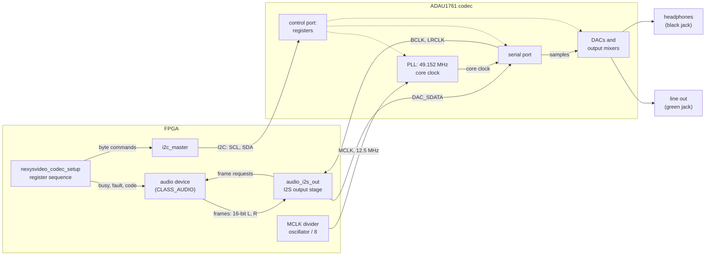

# Nexys Video Audio

> **Applies to:** the Nexys Video board · every core generation (the
> audio device sits on the system bus, outside the machine). What
> software sees is the device class,
> [`CLASS_AUDIO`](../../system/devices/audio.md).

The Nexys Video's four audio jacks all belong to one chip, an Analog
Devices ADAU1761 codec (IC4). The FPGA reaches it over two separate
interfaces: I2C, which only writes the codec's registers, and a serial
audio port (I2S), which only carries samples. Software sees neither.
It plays through the same `CLASS_AUDIO` device as on the ULX3S, with
the same kernel and image: the board sets the codec up by itself after
every reset and reports how that went in the device's `STATUS`.

## Structure



Every wire between the two chips, and who drives it:

| Signal | Pin | Driven by | Rate | Carries |
|--------|-----|-----------|------|---------|
| `ac_mclk` | U6 | FPGA | 12.5 MHz | the reference the codec's PLL makes its core clock from |
| `scl` | W5 | FPGA (open drain) | 100 kHz | the I2C clock |
| `sda` | V5 | either (open drain) | | I2C data: register writes, and reads of the PLL's lock bit |
| `ac_bclk` | T5 | codec, once set up | 3.072 MHz | the serial port's bit clock, one cycle a bit |
| `ac_lrclk` | U5 | codec, once set up | 48 kHz | the frame clock: low for the left channel, high for the right |
| `ac_dac_sdata` | W6 | FPGA | | the samples, one bit per BCLK |
| `ac_adc_sdata` | T4 | codec | | recorded samples; playback does not use them |

| Piece | Where | Role |
|-------|-------|------|
| audio device | `hw/rtl/io/audio/` | queues, rate, gain and mixing, down to one stereo frame per request; the same on every board |
| `audio_i2s_out` | `hw/rtl/io/audio/` | follows BCLK and LRCLK, requests each frame, shifts it out |
| `i2c_master` | `hw/rtl/io/i2c/` | the I2C bus, one byte per command |
| `nexysvideo_codec_setup` | `hw/rtl/fpga/nexysvideo/` | the register sequence, and its progress as `STATUS` |
| `nexysvideo_codec_mclk` | `hw/rtl/fpga/nexysvideo/` | MCLK, divided from the oscillator |

The device is the third in the machine top's autoconfig chain, after
the SD slot and the display, built with the same number of channels as
on the ULX3S. Both of its clock domains are the CPU clock here: the
codec sets the sample rate, so the output side needs no clock that
divides to it.

## Three clocks, and who drives each

"Master" means a different chip on each interface, so this page names
the driver of each clock instead.

- **SCL: the FPGA.** On I2C the FPGA is the master and the codec a
  slave at address 0x3B, on a bus it shares with the MAC-address
  EEPROM (0x57). The codec never stretches the clock.
- **MCLK: the FPGA.** A steady 12.5 MHz reference, the board's
  100 MHz oscillator divided by eight in a counter. The codec's PLL
  multiplies it by 3 + 2913/3125 to exactly 49.152 MHz, which is
  1024 × 48 kHz. The setup's PLL words depend on MCLK's frequency, so
  it has to come from a clock nothing retunes, and the oscillator is
  the one that is: the CPU clock is a one-number edit. A counter also
  needs no clock manager, adds no jitter to the oscillator's own, and
  runs from configuration on, whatever resets the machine. The codec
  needs that: it answers no I2C without MCLK, and it plays on through
  a reset.
- **BCLK and LRCLK: the codec.** It divides them from its core clock:
  LRCLK at the sample rate, 48 kHz, and BCLK at 64 times that. The
  FPGA follows both and takes its frame timing from LRCLK, so the
  sample rate depends on no FPGA clock. The datasheet calls this the
  serial port's master mode.

The codec drives BCLK and LRCLK only once the setup has told it to.
From power-on until then, both pins are inputs on the codec and
nothing drives them, so the FPGA's pins pull them down.

The FPGA driving BCLK and LRCLK instead would need MCLK locked to its
own frame tick, and no clock on the board gives that: the display
MMCM's 1000 MHz VCO has no factor of 3, and the CPU clock is a
one-number edit.

## The frame on the wire

A frame is one left and one right sample, in two slots of 32 BCLKs.
The format is I2S:

```
LRCLK  ‾\___________________ … _________ … _/‾‾‾‾‾‾‾‾‾‾‾‾‾‾‾ … ‾‾‾‾‾‾‾‾‾
BCLK   ‾\_/‾\_/‾\_/‾\_/‾\_/‾ … ‾\_/‾\_/‾ … ‾\_/‾\_/‾\_/‾\_/‾ … ‾\_/‾\_/‾
SDATA   | 0 |L15|L14|L13|L12 …  | L0| 0  …  | 0 |R15|R14|R13 …  | R0| 0
        ^   ^
        |   the MSB, one BCLK after LRCLK changes
        LRCLK changes on a BCLK fall
```

- LRCLK changes on a BCLK falling edge and stays for the whole slot.
- The data changes after each BCLK falling edge, and the codec samples
  it on the rising edge, half a BCLK later.
- A word's MSB is the bit after the *second* fall of its slot: the bit
  sampled at a slot's first rise still belongs to the slot before.
- The 16 bits go MSB first, and zeros fill the slot's other 16
  positions.

The FPGA clocks nothing on BCLK. The output stage samples BCLK and
LRCLK on the audio clock (the CPU clock, 19.5 clocks to a BCLK at
60 MHz) and acts on the edges it sees, so the link adds no clock
domain. A BCLK edge takes at most three clocks to reach the data pin:
two synchroniser stages and the register that drives the pin. At
60 MHz the data moves within 50 ns of a falling edge and is stable for
the remaining 113 ns before the rising one. The stage's build check
holds any clock pairing to the same shape: half a BCLK has to span
those three clocks and one more.

LRCLK is read only at BCLK rises, where it is half a BCLK from either
of its changes. A slot begins at the first rise that sees LRCLK
changed since the rise before, and the falling edge after it sends the
MSB.

Frames are requested one ahead. As a left slot begins, the stage takes
the frame the device holds and asks for the next, which the device
then has a whole frame period to deliver. A device that delivers
nothing (disabled, underrun, or held by `STATUS`) leaves its last frame
playing.

The codec's clocks run whatever the FPGA does, and a reset of the
machine lasts hundreds of frames (10 ms at least,
[bus protocol](../../hardware/bus-protocol.md)). A word cut short
would still be taken as a whole sample, up to full scale whatever the
word was, so the stage takes no reset on anything it sends. The frame
in progress goes out whole, the frames after it carry what the device
holds in reset, and only the frame requests stop.

## Setup

`nexysvideo_codec_setup` runs after every reset of the machine and
writes every register playback depends on, never relying on a default.
MCLK has been running for the whole reset hold by then, 10 ms at
least. The codec
has no reset pin: it keeps its registers from board power-on until the
board loses power, through FPGA reloads and CPU resets, so it may
still be playing what an earlier bitstream set up.

The sequence, one register per step:

1. A codec found running is muted, so stopping its clock does not cut
   its output mid-sample.
2. The core clock goes off, the PLL is written for MCLK and enabled,
   and its lock bit is polled, for up to 20 ms.
3. The core clock comes on from the PLL, and the outputs are muted.
4. The serial port: the codec drives BCLK and LRCLK, 64 BCLKs a frame,
   I2S. The serial input goes straight to the DACs (`SINRT`), so the
   SigmaDSP stays off and needs no program.
5. The DACs and mixers: the DACs feed mixers 3 and 4, which drive the
   headphone outputs, and mixers 5 and 6 into the line outputs.
6. A 10 ms wait, covering the precharge the datasheet asks for between
   enabling the headphone outputs and unmuting them; then the unmute.

It takes about 30 ms, inside the 100 ms `STATUS` allows `BUSY`. The
device consumes no frames until it finishes, though the codec's clocks
may already be running and requesting them.

Levels are fixed here, since `MASTER_VOL` gives software its volume:
the line out at 0 dB (about 1 V rms full scale, under the 2 V rms a
line input takes), the headphones at −10 dB.

Once biased, the playback path is never powered down. The setup mutes
and unmutes instead, which leaves at worst one thump per board power
cycle, when the bias first comes up.

### Fault codes

A failed setup stops where it stands and sets `FAULT`, and `paudio`
prints the code at attach. `FAULT_CODE` is:

| Bits | Meaning |
|------|---------|
| `[7:6]` | what failed: 1 the codec did not acknowledge a byte, 2 the I2C bus would not move, 3 the PLL did not lock in time |
| `[5:0]` | the step it failed in, an index into the table in `nexysvideo_codec_setup.sv` |

`0x40` is no acknowledgement in the first step: the codec is absent,
or has no MCLK.

## The board

From the schematic (sheet 4, rev A.0):

- **Line out** (green, J5): LOUTP and ROUTP through 10 µF and 100 Ω,
  with 10 kΩ to ground on the jack side; LOUTN and ROUTN are not
  connected.
- **Headphones** (black; J4 on the schematic, J3 in the reference
  manual): LHP and RHP through 220 µF, the sleeve to ground. The
  capless option is not fitted (R102 from MONOOUT to the sleeve, and
  R103 and R105 across the capacitors, are all unloaded), so MONOOUT
  drives nothing.
- **Inputs**: line in (blue) to LAUX and RAUX, the microphone (pink)
  to LINN and RINN with mic bias. Playback uses neither.
- **Control**: ADR0 and ADR1 pulled up, 4.7 kΩ pull-ups to 3.3 V on
  SCL and SDA. No jack detect (JDET is pulled down).
- **Supplies**: IOVDD at 3.3 V, and AVDD at 3.3 V from a regulator of
  its own, so DAC full scale is 920 mV rms.

Amplified speakers go on the line out, which is built for them. Into
a 10 kΩ amplifier its coupling corner is about 2.6 Hz and it settles
in about 60 ms, and the bleed resistors hold the jack at 0 V with
nothing plugged in.

The headphone jack's 220 µF is sized for 16 to 32 Ω (a 45 Hz corner
at 16 Ω). Into 10 kΩ it is a 2.2 s time constant, so any move of the
codec's 1.65 V output bias reaches an amplifier as a thump lasting
seconds. With nothing plugged in, the jack side has no path to ground
and rises with the bias, so it pops into whatever is plugged in next.
