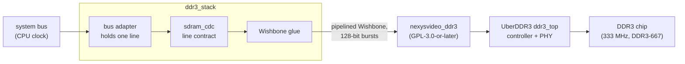

# Nexys Video DDR3 Memory

> **Applies to:** the Nexys Video board · every core generation (the
> memory sits on the system bus, outside the machine).

The Nexys Video's system RAM is its 512 MiB of DDR3, one Micron
MT41K256M16 (4 Gb, x16), behind UberDDR3, an open-source controller
vendored unmodified in `hw/third_party/uberddr3/`. The repository does
not implement a DDR3 controller: it owns the seam between that
controller and the Penumbra bus, and the seam is thin. Everything
above the clock crossing is the ULX3S's line stack, shared unchanged
([SDRAM Controller v2](../sdram-controller.md), "Line stack: a held
line").

## Structure

| Piece | Where | Role |
|-------|-------|------|
| `ddr3_stack` | `hw/rtl/io/ddr3/` | adapter → CDC → glue as one unit; drives any Wishbone memory of 16-byte bursts |
| `nexysvideo_ddr3` | `hw/rtl/fpga/nexysvideo/` | the controller at this board's configuration; the one file that names UberDDR3 |
| `nexysvideo_ddr3_clk` | `hw/rtl/fpga/nexysvideo/` | the controller's four clocks, from one PLL |
| DDR3 pins | `hw/constraints/nexysvideo_ddr3.xdc` | shared by every top with the memory |

## Why the line stack

A x16 DDR3 part always transfers a BL8 burst: 16 bytes, which is also
the cache line. The line stack already asks its controller for one
burst per line and holds the line on the system-clock side, so words
after the first come from the adapter at the bus's floor. On the word
stack, a line fill would fetch the same 16 bytes four times and use a
quarter of each. The 128-bit response is the natural unit on both
boards, not a width one memory imposes on the other, so the crossing
takes no per-board parameter.

## The glue

The crossing's controller side and UberDDR3's request port speak the
same handshake under different names: a request held until the port
stops stalling, then an acknowledgement. The glue adds no cycle, and
holds one piece of state, the epoch:

| Crossing, controller side | UberDDR3 Wishbone port |
|---|---|
| request valid | `stb`, held while `stall` |
| request ready | `!stall` |
| address | the burst holding the byte address (16-byte units) |
| write data | the word, replicated across the 128-bit line |
| byte enables | `sel`: the word's four enables, shifted to its lane |
| (request kind) | `aux` bit 0 carries `we` out and back with the ack |
| (which reset) | the rest of `aux` carries the epoch out and back |
| done | `ack` in the current epoch, for reads and writes, in request order |
| read response | such an `ack` whose `aux` says read; the line is `data` |

A write is one word: it goes out across the whole line, and its byte
enables pick the lanes, so the controller writes only the bytes the bus
asked for, with the chip's data masks. There is no read-modify-write.

The port has no cycle signal (`cyc`), because the stack never cancels
a request: the controller answers every one it has taken, whatever
resets the stack meanwhile. UberDDR3 has a cancel, a dropped `cyc`,
and it is not safe to use (`hw/third_party/uberddr3/README.md`, "Known
defects"), so the wrapper ties `cyc` high.

A reset of the stack therefore leaves the controller owing an ack for
any request it had taken. That ack arrives during the reset or after
it, where the crossing would take it for the answer to a later
request. To tell them apart, each request carries the epoch out in
`aux`: the count of stack resets so far. An ack that brings back
another epoch answers a request the reset abandoned, and the glue
drops it. The count is three bits and wraps, so the rule holds for
fewer than eight resets in the time the controller takes over one
request; a machine reset lasts 10 ms at least, and a request
microseconds.

Writes are posted (the adapter acknowledges a write once the crossing
takes it), so a stack reset discards a write still in the crossing, as
on the SDR stacks. One the controller has taken is written.

## The controller

**Why UberDDR3.** Its calibration is self-contained and reports
completion; its request port is Wishbone with byte strobes; and it can
self-test the whole chip, masked writes included. MIG is Vivado-only
under Xilinx's IP terms and speaks its own `app_*` interface; LiteDRAM
wants a CPU (or a generated one) to calibrate. Because the glue speaks
plain Wishbone, another controller behind a Wishbone port would replace
only `nexysvideo_ddr3`. If that is ever MIG, commit its configuration
(`.prj`/`.xci`) and generate it at build time, never the generated RTL.

**The configuration that matters.** Most of it is the chip's: two byte
lanes and 15 row bits address all 4 Gb (upstream's Nexys Video demo
configures one lane and 14 rows, enough to prove pins and calibration
but not the chip). Three choices are ours:

- **No automatic self-refresh.** The automatic modes put the chip to
  sleep after a few hundred idle controller cycles, and the next access
  then waits out the self-refresh exit, hundreds of DDR3 clocks.
- **`ddr3_top`, not `ddr3_top_axi`.** The AXI top puts an
  AXI-to-Wishbone bridge with skid buffers in front of the port, which
  is exactly the latency the glue avoids.
- **No self-test in the machine.** The machine top calibrates and
  starts; the self-test top (`nexysvideo_ddr3_test_top`) runs the
  controller's whole-chip test in every pattern, over and over, with a
  console line per run.

This board's DDR3 bank has no output delay lines, so the PHY launches
DQS off a 90-degree clock instead.

**The license boundary.** UberDDR3 is GPL-3.0-or-later.
`nexysvideo_ddr3.sv` is the only file that instantiates it, and is
licensed GPL-3.0-or-later itself; everything else, `ddr3_stack`
included, stays BSD 2-Clause, and a ULX3S bitstream never contains the
controller. A Nexys Video bitstream is a combined work, GPL-3.0 as a
whole if it is ever distributed (`LICENSE`, entry 7, and the vendored
README). Micron's DDR3 simulation model carries no redistribution
grant, so it is not in the repository.

## Clocks, the crossing and reset

The controller runs on four clocks from one PLL off the 100 MHz
oscillator: 83.333 MHz for the controller (a quarter of the DDR3
clock), 333.333 MHz for DDR3-667 and the same at 90 degrees, and
200 MHz for the input delay lines. The rates are the configuration
calibration and the self-test proved, so they are fixed, not derived,
and the PLL is never reset.

The CPU clock comes from its own MMCM and is unrelated to the
controller's. The two meet only in two-flop synchronizers
(`ASYNC_REG`) and in `sdram_cdc`'s FIFO, and nothing depends on their
ratio. The constraints bound each direction of the crossing with
`set_max_delay -datapath_only` at the faster clock's period: a FIFO
slot settles before the pointer announcing it clears its synchronizer,
and the pointer's bits land within a cycle of each other.

The benchmark harness restates the memory's type and clock in
`machine_memory[]` (`benchmark/common/bench.c`), for the reporting
line that has to give them; a change to either changes there too.

Calibration decides the reset order:

- **The controller** resets from its PLL's lock alone. CPU RESET
  restarts the machine and the stack, never the controller, so it
  never recalibrates.
- **The machine** is held in reset until the controller reports
  calibration, synchronized into the CPU clock's domain. Until then
  the controller stalls every access for longer than the bus watchdog
  waits, so the first RAM access would fault, and the ROM would take
  the memory for missing.
- **The stack's controller side** resets from a register of the
  machine's reset, through a synchronizer, since only a flip-flop may
  drive one: the machine reset is a combination of board reset and
  calibration.

The program suites cover the gate: `make test SIM_MEM=ddr3` calibrates
the memory model after reset, and without the gate the bus-fault
test's first RAM store faults.

## Latency and the watchdog

A RAM access pays the crossing once per line, the controller's
pipeline, its 4:1 serialization and the chip's CAS latency. The bus
fabric faults an access nothing answers within 256 CPU cycles, so the
longest RAM access has to stay well inside that. `bus_wait_meter`
records it on the RAM port since configuration, and the board's LEDs
show it (`overview.md`, "LEDs"). At 60 MHz the reading stays at 32 to
63 CPU cycles through Dhrystone, membench and a memtest over all
511 MiB. The latency is fixed in nanoseconds, so it costs more cycles
as the CPU clock rises.

The controller side of the crossing takes one request at a time, so a
load behind a posted write waits for both. In simulation, with the
controller's model at a 1:1 clock ratio, that case reaches half the
watchdog; the board has not shown it. Store-heavy code measured no
slower per operation on the Nexys Video than on the ULX3S's SDR stack,
so the crossing keeps one request in flight.

## Verification

| Where | What it covers |
|---|---|
| `tb_ddr3_stack_test` (`make test-modules`) | the stack on `wb_line_mem` (random stalls, ack latencies with long tails), unrelated clocks: every byte, halfword and word lane, random traffic, resets that leave a read or a write in the memory, answered during the reset or after it |
| `make test SIM_MEM=ddr3` | the program suites on the gen2 sim machine with `ddr3_sim`: the stack on a 512 MiB model that calibrates after reset, the machine held until it has |
| `make sim MOD=nexysvideo_penumbra2_top` | the board top through its pins, the controller replaced by `hw/rtl/sim/nexysvideo/nexysvideo_ddr3.sv` (the wrapper's ports on `wb_line_mem`); `make fpga-lint` sees the same stand-in, since UberDDR3 does not elaborate under Verilator at this configuration |
| `nexysvideo_ddr3_test_top` | the real controller and chip on the board: calibration and the whole-chip self-test, repeated |

Only the board runs the real controller behind the stack, so two
things are tested there alone: the controller's actual latencies
(which `bus_wait_meter` reports) and its answer to a request the
stack has abandoned, which only a machine reset in the middle of an
access produces. A reset at the idle monitor prompt is not one, since
the ROM touches no RAM there; one pressed while the ROM is still
sizing RAM often is. Co-simulating the real controller was considered
and declined (`doc/TODO/hw-nexysvideo.md`, "Ruled out").

## Naming

The adapter and the crossing keep their `sdram_` names on this board.
DDR3 is SDRAM too, and a discrete build's memory may be asynchronous
DRAM, which a `dram_` prefix would blur.
