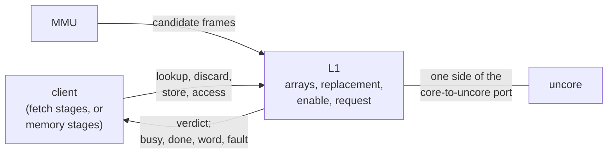

# Penumbra/3 — The L1 caches and their clients

> **Applies to:** Penumbra/3 · pipelined core (in design).

Each side of the core has one L1: the L1-I serves the fetch stages and
the L1-D the memory stages. An L1 is the only way its side reaches
memory. It answers lookups from its arrays, takes a store's write on a
hit, and carries everything that goes past it to the uncore: each L1
is its side's requester on the
[core-to-uncore port](./uncore-port.md). This document specifies what
an L1 offers its **client** and what stays inside it.

Four terms:

- A **lookup** reads the cache for one address. The client launches
  it, and the L1 gives its verdict a cycle later.
- The **current lookup** is the last one launched. The L1's verdict
  belongs to it until the next launch.
- An **access** is what goes past the L1: a load or fetch the L1 had
  no word for, and every store's write to memory.
- The **client** launches lookups and requests accesses: IF1 and IF2
  with the fetch replay on the fetch side, MEM1 and MEM2 with the
  completion unit on the data side.

What stays inside the L1: which way a line goes to, whether a line
goes in at all, the replacement state, the enable, and the port's
signals. The client sees none of them.

## Lookups

A lookup takes two cycles:

| Cycle | Client | L1 |
|---|---|---|
| L | `launch`, with the address's page offset | reads the indexed set of every way |
| L+1 | consumes the verdict | `hit`, `word` (the hit way's), and each way's hit and word |

In L+1 the MMU's candidate frames for the same address arrive beside
the L1's read, and the verdict compares every way's tag against every
frame at once
([the L1 compare](./mem-stage.md#the-l1-compare-behind-the-verdict)).
The per-way outputs let a client work on each way's word before the
hit selects one, as IF2 decodes each.

**A held lookup is read again.** With nothing launching, the L1 reads
the current lookup's set again every cycle, so a verdict a frozen
client holds follows the cache through an invalidate, a store or a
line installed under it, with no strobe to ask for it.

**`discard`** says the client has thrown the current lookup away: a
flush killed the slot it belonged to. It never cancels an access. The
L1 uses it only to know whether anything still holds the lookup when
an access completes ([busy and done](#busy-and-done)).

**Counting.** The client marks each cacheable read and write once, in
a resolve cycle (`count_read`, `count_write`), and the L1 counts it as
a hit or a miss for its cache device's counters.

**A disabled L1** (`CTRL.ENABLE=0`, the reset state) reads every way
invalid, so no lookup hits and no store is taken. Lines installed
before a disable survive it; software pairs an enable change with
`INVAL_ALL` ([`CTRL`](../../system/sysregs.md#ctrl-reg-1)).

## Stores

On the data side a committing store asks the L1 to take its write in
the resolve cycle of its own lookup: `store`, with the store's data in
its byte lanes and its byte enables. On a hit the L1 merges the bytes
over the hit way's word and writes the whole word a cycle later, from
registers, so the hit never reaches a block RAM's write enable. A
lookup of that word directly behind the store is given it ahead of the
block RAM, so a load behind a store needs no stall. On a miss the L1
writes nothing (write-no-allocate).

The store's write to memory is not part of this: it is an access of
its own, which every store requests ([accesses](#accesses)).

## Accesses

The client requests an access with `req`, for one cycle, in the
resolve cycle of the access's own lookup, or with no lookup at all. It
never requests one while the L1 is busy. The access's fields:

| Field | Width | Meaning |
|---|:-:|---|
| `we` | 1 | 1 = write; the fetch side only reads |
| `addr` | 32 | the access's physical byte address |
| `cacheable` | 1 | the page's cacheable attribute, the translation's verdict |
| `byte_en` | 4 | a write's byte lanes |
| `wdata` | 32 | a write's data, each byte in its lane |

The L1 carries the access as the port transaction its `we` and
`cacheable` name
([the four transactions](./uncore-port.md#the-four-transactions)):

- **A read of a cacheable page** is a line read. The L1 installs the
  line as the read completes, into the way its replacement named when
  the access was requested, unless the read faulted or the L1 is
  disabled. A disabled L1 still reads the line, so an enabled level
  below it still serves the access.
- **A read of an uncacheable page** is a word read and installs
  nothing.
- **A write** is one write to memory, cacheable or not. A store that
  hit has already written the L1.

A store buffer, where the core has one, takes a cacheable write in the
L1-D's place: the L1-D's `done` comes when the buffer has taken the
write, and the buffer writes memory itself
([what stays off the port](./uncore-port.md#what-stays-off-the-port)).

The client takes the access's word whatever the L1 did with the line.
Nothing the client does depends on whether the line went in.

**A request is a register.** `req` may form from the verdict in the
cycle the verdict forms; it sets the one register that raises the
port's `valid`. The access's fields load every cycle the L1 has no
access in flight, so none of their enables waits on the verdict.

## Busy and done

One access, cycle by cycle. q is the request, r the uncore's done:

| Cycle | L1 | Client |
|---|---|---|
| q | latches the access | `req` |
| q+1 … r | `busy`; the request is up on the port | launches no lookup, requests no access, writes no store, acts on no verdict |
| r | installs a line read's line | |
| r+1 | `done`; `word` and `fault` hold the access's result until the next `done`. `busy` is low, or high for one cycle more | takes the result |

**`busy` covers the cycle a held lookup needs.** A held lookup reads
the way an install wrote a cycle late: the arrays read nothing of a
way in the cycle it is written, so the cycle after the install still
gives what the way held before. When the install lands in the current
lookup's set and the current lookup is held, `busy` stays high through
r+1, and the client acts on the lookup from r+2. A bypass would show
the line at once, but it would put a mux between the tag block RAM and
the compare, on the hit path.

**A lookup is held** from its launch until the client discards it or
requests an access from it. The lookup an access was requested from
is therefore never held, nor is one a flush discarded; only a lookup
launched in the request's cycle can be.

## Responses

- **`word`** is the word the access's address selects from a line
  read's line, or a word read's bus word, each byte in its lane. The
  client extracts its bytes by the address's low bits and the access
  size, as it does from a word the L1 hit. A write returns none.
- **`fault`** says the bus faulted the access: any of a line read's
  four words, or a word access's one. A faulted line read installs
  nothing. A cacheable write's `done` never faults; its bus fault
  comes later, on `store_fault`.
- **`store_fault`** says the bus faulted a cacheable write an earlier
  `done` completed, and `store_fault_addr` holds that write's physical
  byte address. The L1-D passes both from the port for one cycle, in
  any cycle, a `done`'s included, and its client takes them as a
  deferred bus fault
  ([fault precision](./memory-completion.md#fault-precision)).

`busy`, `done`, `word`, `fault`, `store_fault` and `store_fault_addr`
all come from registers.

## The fetch side

IF1 launches a lookup every cycle it is not held, and IF2 resolves it.
A slot whose lookup missed, and which faulted on nothing earlier, has
no word. It leaves IF2 without one, since holding it there would put
the hit on IF1's hold, and the front end requests its access and
replays it:

- The cycle after the miss, IF1 is steered back to the missed PC, and
  the slot IF1 launched behind the miss is flushed, which discards its
  lookup.
- IF1 holds while the L1-I is busy.
- The fetch then comes round through IF2 again and takes the access's
  word, and its fault, in place of its lookup's verdict, whether or
  not the line went in.

A redirect or a fault entry that makes the fetch unwanted while its
access is in flight flushes it: the slot takes no word, and the access
runs to its done regardless.

The exception path's vector-table read is an access with no lookup: a
word read at a physical address, requested while IF1 is held and no
access is in flight, its word taken at `done`.

## The data side

MEM1 launches a lookup for a load or a store, and MEM2 resolves it.
A load that missed and every store leave MEM2 into the completion
unit, and the L1-D takes the access in the same cycle. The unit keeps
what the instruction needs when the access completes, and the launch
side freezes while the L1-D is busy, so a load or store held in MEM2
behind the access keeps its lookup. At `done` the unit completes the
access: a load's word to its register, a bus fault taken precisely
([memory completion](./memory-completion.md)).

The data side discards nothing: a load or store frozen in MEM2 holds
its lookup, and a flush during an access costs at most the cycle a
held lookup is given.
