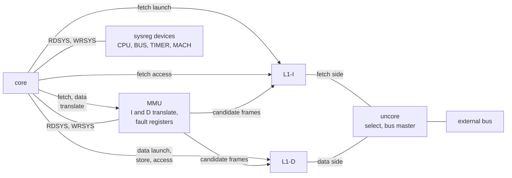

# Penumbra/3 — The machine

> **Applies to:** Penumbra/3 · pipelined core (in design).

The machine is the board-independent gen3 computer, the
[machine layer](../build-system.md#the-machine-layer) of the build: the
core, the MMU, the two L1s, the uncore and the sysreg devices, behind
the same external port list as the gen2 machine. A board top or a sim
wrapper attaches devices to its bus and needs nothing else, so the
one written for gen2 serves gen3 with the machine swapped.

This document specifies how the parts compose: what each connects to,
the sysreg devices and their read timing, the uncore when there is no
L2, and the program-end pulse.

## The parts

- **The fetch side.** The core launches a fetch with one strobe that
  the L1-I and the MMU's I port both take: the page offset indexes the
  L1-I, the full address goes to the MMU. A cycle later the MMU gives
  the core the fetch's physical address, cacheability and translation
  fault, and gives the L1-I its candidate frames; the L1-I gives the
  core its verdict. A fetch the L1-I had no word for, and the vector
  read, are the L1-I's accesses
  ([the fetch side](./l1-cache.md#the-fetch-side)).
- **The data side.** MEM1 launches the D translation and the L1-D's
  lookup together; MEM2 takes both verdicts a cycle later
  ([the memory stage](./mem-stage.md)). The core's launch hold
  freezes both launch-to-resolve registers alike, so a held slot keeps
  its verdicts. Stores and the accesses past the L1-D are the L1-D's
  ([accesses](./l1-cache.md#accesses)).
- **The MMU's fault registers** take the core's fault commit, already
  qualified to the faults that carry an address.
- **The store fault.** The L1-D passes the uncore's store fault and
  its write's address to the core, which takes it as a deferred bus
  fault ([fault precision](./memory-completion.md#fault-precision)).
- **The uncore** serves both L1s on the
  [core-to-uncore port](./uncore-port.md) and drives the external bus
  ([below](#the-uncore-with-no-l2)).

## Sysreg devices

The core's sysreg side reaches every device by number
([device map](../../system/sysregs.md#device-map)):

| dev | Device | Answers |
|:-:|---|---|
| 0 | MMU | a cycle after the read |
| 1 | CPU: identity (regs 0–4), performance counters (5 and up) | in the read's cycle |
| 2, 3 | L1-D, L1-I | a cycle after the read |
| 4 | BUS: bus reset and autoconfig enable, which leave the machine for the wrapper's autoconfig chain | in the read's cycle |
| 7 | TIMER | in the read's cycle |
| 8 | MACH: the board's identity, constants the board top supplies | in the read's cycle |
| 9 | L2: absent, every register reads 0 | — |

Any other device reads 0 and ignores writes. The CPU's name says
"/3"; its ISA word is every generation's.

**Read timing.** An `RDSYS` raises its read in MEM1, and MEM2 takes
the data a cycle later. The MMU and the L1s latch the register their
read names and answer from it in that later cycle. The other devices
answer in the read's cycle, so the machine registers their answer
then. A register of which device was read picks between the two at
the later cycle.

**Writes.** A `WRSYS` commits from EX into an empty pipe, so no read
is in flight with it, and each device's one register selector serves
both: the write's register in the write's cycle, the read's otherwise.

**Interrupts.** The core's timer interrupt is the timer device's
interrupt or the machine's timer input; its external interrupt is the
machine's interrupt input.

## The uncore with no L2

With no L2 the uncore turns each port transaction into bus accesses
through a bus master that runs one transaction at a time. When both
sides wait, the data side goes first, as the port's handshake
requires.

| Transaction | On the bus |
|---|---|
| Line read | four reads of whole words from the line's address, in address order |
| Word read | one read, the access's address and byte lanes as they are; the bus's 32 bits come back in word 0 |
| Word write | one write, the access's address and byte lanes as they are |
| Cacheable write | one write, as a word write |

The fetch side's accesses carry no byte lanes, so the uncore gives a
fetch's word read all four.

A transaction's `done` comes after the bus has answered its last
access, from registers. A read or a word write carries the bus's fault
with its `done`: any of a line read's four. A cacheable write's `done`
carries no fault; when the bus faulted the write, a `store_fault` with
the write's address comes in the same cycle.

**Nothing is posted.** A cacheable write's `done` comes once the bus
has taken the write, so every later read sees it, as the port's
cacheable write promises. The port lets a write complete sooner, once
it is accepted for later delivery, as an L2 or a store buffer does;
the write's fault then comes on `store_fault` in whatever cycle the bus
gives it ([faults](./uncore-port.md#faults)).

## Program end

The machine pulses program-end as a `BREAK`'s trap commits. The trap
itself is taken like any other: it vectors to `VEC_BREAK` and its
handler runs, so software can handle it. The pulse only reports it,
and the testbench decides whether a run ends there
([the program-end contract](../build-system.md#the-machine-layer)):
the program runners stop on it, because test programs end in `BREAK`.

## Observability

The port list's commit and trace signals are the gen2 machine's: the
register write each commit makes; the retiring instruction's PC, op
class and SR; a fault's vector as it commits; `ERET` and drain-commit
markers, the drain-commit's PC and op class; a taken branch with its
PC and target; and the PCs in EX and MEM with their valid bits.
