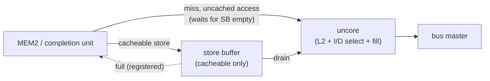

# Penumbra/3 — Memory-path performance: measurements and levers

> **Applies to:** Penumbra/3 · memory hierarchy and address translation
> (in design). Measured on the shared SDRAM stacks gen3 reuses, on the
> gen2 L1↔L2 chain gen3 replaces, and on the software TLB refill gen3
> inherits.

This records what the memory path costs, cycle by cycle, and what
gen2.5 hardware workload profiles say about where gen3's cycles will go.
It then collects the design levers those numbers point to for the gen3
uncore and TLB. The levers are proposals ranked by evidence, not
decisions, and every estimate is labeled as one.

Every lever here must preserve the completion contract in
[`memory-completion.md`](./memory-completion.md) and the structural rules
in [`timing-outline.md`](./timing-outline.md). The phase each one lands in
is set by the [build plan](./overview.md#build-plan).

## Measurement setup

Cycle counts are CPU cycles, from Verilator runs of two scratch wrappers
around unmodified RTL (commit `a463c4a`). The SDRAM clock runs at 4× and
2× the CPU clock; gen2.5's 37.5 MHz against the 100 MHz SDRAM is 2.67×,
between the two.

| Chain | Composition | Measured |
|---|---|---|
| A — gen3 bus side | `penumbra3_bus_master` → `sdram_sim` (adapter + CDC + controller + chip model) | master request accept → completion pulse |
| B — gen2 L1↔L2 | `fill_sequencer` → `l2_cache` (`HIT_LATENCY=3`, as the gen2 machine builds it) → `sdram_sim` | line request presented → `fill_done` |

Chain B excludes the gen2 `txn_arbiter` in front of the sequencer (one
registered cycle per transaction) and the L1/core miss overhead, so a
real gen2 miss costs somewhat more than chain B shows.

Chains A and B ran on the word stack (`hw/rtl/io/sdram/`), whose adapter
speculates one word ahead. The later measurements below (2026-09-25) use
the line stack (`hw/rtl/io/sdram_line/`), which answers a read with the
whole line and holds it, and add three instruments:

| Instrument | What it is | What it gives |
|---|---|---|
| Machine trace | `machine_penumbra2_sim`, gen2.5 core, line stack, clocks at the hardware ratio (37.5 : 100 MHz); a probe program reads `CPU_CYCLES` or `STALL_LOAD` around one dependent load, and the testbench logs every memory-side FSM each cycle | the cost of one miss and which layer owns each cycle |
| Hardware membench | `benchmark/membench` on the ULX3S at 37.5 MHz, both stacks | `STALL_LOAD` cycles per L2 read miss |
| Shadow models | the ISS's `+cachemodel` and `+tlbmodel`, fed every fetch, load and store (physical address, PTE `C`) and every main-TLB translation while NetBSD runs real workloads | miss counts by kind, for geometries that were never built |

The shadow models count accesses the way the RTL perfctrs do. Run over
the same window as Doom's own perfctr snapshot (`perf_demo_track` to
its exit handler), the as-built model reproduces the hardware's printed
rates: L1I 97.2 % (hardware 97.3 %), L1D 80.5 % (79.7 %), L2 85.3 %
(86.0 %), over 570 M instructions against the hardware's 579 M. Its
TLB model reproduces the real refill count within 3 %. That calibration
is what lets the split by kind below stand in for counters the hardware
does not print. It was made with the models' first version, which used
LRU where the caches use tree-PLRU and treated every level as enabled
once translation was on; the ISS's models follow the RTL in both.

## SDRAM line fill (chain A)

| Transaction | 4:1 | 2:1 |
|---|---|---|
| Line read, first (cold) | 28 — beats at 8, 11, 19, 27 | 36 — beats at 10, 15, 25, 35 |
| Line read, next line, same row | 27 — beats at 2, 10, 18, 26 | 33 — beats at 2, 12, 22, 32 |
| Line read, row conflict | 29 | 38 |
| Single-beat read | 9 | 11 |
| Line write | 10 | 13 |
| Single-beat write | 3 | 3 |
| 16 back-to-back line reads, per line | 31.9 | 40.7 |

**Words 2 and 3 each pay a full round trip.** They sit as far apart as
the cold first word, because `sdram_bus_adapter` keeps one speculative
read in flight and queues the next only when the previous one is
consumed. The fill is latency-bound: roughly 10 cycles of round trip
with one word of lookahead only covers word 1. At 2:1 a 16-byte line
takes 33–38 cycles, about a tenth of what either the 16-bit SDRAM
(200 MB/s) or the 32-bit sync bus at 37.5 MHz can carry.

The dangling speculation past the end of a line serves the *next*
line's first word in 2 cycles, so a single sequential stream benefits.
Interleaved streams do not: each fill orphans the other stream's
speculation, and the orphaned read still occupies the SDRAM.

## L1 line fill through L2 (chain B)

| Phase | 4:1 | 2:1 |
|---|---|---|
| L2 detects the miss, bus request starts | 3 | 3 |
| L2 fetches its own line from SDRAM | 28 | 37 |
| L2 re-serves the line to L1 | 14 | 14 |
| **Total, L2 miss** | **45** | **54** |
| Total, L2 hit (words at 4, 7, 10, 13) | 13 | 13 |

**The re-serve tail.** The L2 holds `busy` through its whole `S_FILL`.
After the last SDRAM word it installs the tag, latches the sequencer's
still-held word-0 request again as a fresh access, and serves it through
the hit pipeline: 5 cycles to the first L1 word, then 3 per word. At
`HIT_LATENCY=3` the stage-0 latch accepts a new read only every third
cycle, and the sequencer's registered address step allows no faster.
The data path to forward fill words live already exists (`o_rdata`
passes `i_mem_rdata` during `S_FILL`); only the busy-drop is missing.

**The front.** From an L1 miss to the first bus request gen2 spends 4
cycles, each a registered hand-off: the arbiter's request register, the
sequencer's engage cycle, the L2 stage-0 latch, and the stage-1 tag
compare.

## A miss on the line stack (gen2.5 machine, hardware-checked)

Measured 2026-09-25 with the machine trace, cross-checked on hardware.
`STALL_LOAD` per miss is the membench figure; the probe reads the same
counter, so the two compare directly.

| | Hardware membench | Machine trace |
|---|---|---|
| L1 hit | — | 1 |
| L1 miss, L2 hit | — | 17 |
| L1 miss, L2 miss, line stack | 38.2 | 38–39 |
| L1 miss, L2 miss, word stack | 55.2 | 51–52 ¹ |

¹ The word stack's speculation depends on the access stride, which
differs between the two tests (16 B membench, 64 B probe), so this row
agrees only roughly. The line stack speculates on nothing and agrees
within a cycle. The simulated PHY omits the board's one-cycle pipeline
each way (about +0.75 CPU cycles) and the probe's miss took a row
conflict membench mostly avoids (about −1.25); the two roughly cancel.

The line stack took **17 cycles off every L2 miss** on hardware. Where
the 38 go, cycle by cycle:

| Part | Cycles |
|---|---|
| Base load cycle (every load pays it) | 1 |
| L1 miss → arbiter register → sequencer engage → L2 stage 0 → stage-1 miss | 4 |
| **SDRAM→L2: bus request raised → last word acked, line installed** | **19** |
| L2 re-serves the line to L1, 3 cycles a word | 12 |
| Sequencer drain + L1 serve | 2 |

An L2 hit costs the front, the 12-cycle word walk and the tail: 16
cycles above a hit, 17 on the counter.

**The SDRAM→L2 leg** (19 cycles, about 505 ns at 37.5 MHz):

| | Cycles | What |
|---|---|---|
| Bus request presented; adapter pushes to the CDC | 2 | adapter start + push |
| Request crosses to the SDRAM clock | ~1.5–2 | 2-FF synchronizers + controller accept |
| DRAM work | ~5.3 | precharge, activate, read, CL2, 8-beat burst (~4 on a row hit) |
| Response crosses back; adapter captures it | ~3 | 2-FF synchronizers + the capture edge |
| Word 0 acked | 1 | |
| Words 1–3 from the adapter's held line | 6 | the bus floor: 2 cycles a word |

The fractional splits come from SDRAM-clock samples and are good to
about half a cycle; the 10 cycles between the push and word 0 are exact,
and the crossings take 4–5 of them.

About a quarter of the SDRAM leg is the DRAM itself; the rest is clock
crossings and bus hand-offs, six cycles of them the protocol floor. The
on-chip L1↔L2 part (4 + 12 + 2 = 18) is as large as the whole SDRAM leg,
which is what [one uncore pipeline](#one-uncore-pipeline) attacks.

## Store latency below the arbiter (chain B)

| Cacheable store, request → busy-drop | 4:1 | 2:1 |
|---|---|---|
| Isolated, L2 hit | 3 | 3 |
| Isolated, L2 miss | 3 | 3 |
| Burst of 8, per store | 3 2 4 2 3 2 3 2 | 3 2 6 3 4 3 4 3 |

**L2 hit or miss makes no difference.** The SDRAM adapter releases a
write as soon as its CDC accepts it, so the SDRAM leg of a store is
already posted. Of the 6 cycles a gen2.5 store costs, about 3 are this
handshake below the arbiter and about 3 are the L1, arbiter and MEM
hand-offs above it. A sustained store stream drains at about 3.5
cycles per store at 2:1.

## Workload profiles (gen2.5 hardware, 37.5 MHz)

Measured 2026-09-21. Cycles equal instructions retired plus stall cycles
exactly, so each stall class converts to cycles per instruction.

### Dhrystone — store-latency bound

139.3 M cycles, 65.4 M instructions, CPI 2.13.

| Stall | cyc/insn | Behind it |
|---|---|---|
| store | 0.56 | 7.30 M stores (11 % of instructions) × 5.0 cycles |
| flush | 0.21 | branch redirects |
| load | 0.21 | 11.3 M loads × 1.19 cycles — load-*hit* cost; 129 L1-D misses |
| hazard | 0.12 | |
| funit | 0.03 | |
| ifetch | 0.0002 | 347 L1-I misses |

The whole run takes 476 line fills; at the 54-cycle chain-B miss cost
that is about 26 k cycles, 0.02 % of the run. Fill-path work does
nothing for this workload. Draining its stores in the background would
keep the write path busy about a quarter of the time, so stores here
cost latency, not throughput.

### plasma (framebuffer) — L2-miss latency bound

1111 frames at 32.9 fps, 1262.7 M cycles, 297.9 M instructions,
CPI 4.24. Each 320×240 frame is 19,200 output words; the inner loop
loads one word from each of two fields, adds them, and stores one
framebuffer word per 4 pixels.

| Per output word | Cycles | Behind it |
|---|---|---|
| instructions | 14.0 | |
| load | 32.9 | 0.5 line fills × ~60 cycles each |
| store | 4.9 | one blocking framebuffer store |
| ifetch | 3.9 | ~3–4 k I-fills per frame — unexplained, see [open measurements](#open-measurements) |
| flush + hazard + funit | 3.5 | |

**Every field line misses L2.** A frame streams 153.6 KB of field data
through the 64 KB L2, so nothing survives to the next frame, and each
fill costs the chain-B miss plus core overhead. The field data moves at
about 5 MB/s, 2.5 % of the SDRAM: the memory system is idle and the core
waits on one fill at a time.

The printed `L2 hit 58.6%` hides this. It is a combined read+write rate
in which a missed line counts as 1 read miss and 3 read hits (words 1–3
are served after the install), instruction fills add mostly-hit lookups,
and the framebuffer stores count as write misses — the framebuffer's
user mapping is cacheable, see
[framebuffer stores](#framebuffer-stores-and-the-cacheable-only-rule).
Solving for a zero field-line hit rate reproduces about 60 %.

### fork / exec / pipe — L2-hit fill bound

`doc/TODO/hw-penumbra2.md` records `ifetch` at 16–20 % of cycles on
these paths,
against about 0 on Dhrystone. Their larger code footprint misses L1-I
but mostly hits L2, which makes the L2-hit fill (13 cycles in chain B)
the cost to attack.

### Doom — TLB refills, then fetch fills and data misses

Measured 2026-09-25: the 150-tic `BENCH.lmp` timedemo, a `PERFCTR=1`
build, 149 frames. Hardware: 1,709.8 M cycles, 579.0 M instructions,
CPI 2.95, 11.48 M cycles a frame; stalls ifetch 12.9 %, load 18.4 %,
store 13.4 %, flush 13.5 %, hazard 5.1 %, funit 2.9 %. The split by
kind comes from the calibrated shadow models, per frame:

| Event | Per frame | Hits L2 | Misses L2 |
|---|---|---|---|
| L1-I fill | 106 K | 98.9 K (93 %) | 7.1 K |
| L1-D read fill | 49.4 K | 25.0 K (51 %) | 24.4 K |
| Cacheable store | 250 K | 41 % miss L1-D (write-no-allocate: no fill) | |
| TLB refill | 16.9 K | | |

At the [line-stack costs](#a-miss-on-the-line-stack-gen25-machine-hardware-checked)
the fetch fills come to ~1.8 M cycles a frame. The hardware's ifetch
bucket is 1.48 M, so the model runs about a quarter high on the fetch
side, most likely because some fetch-miss cycles overlap other stall
classes and are charged there. The load side (~2.0 M, counting the
~1.2 cycles every load pays) agrees with the 2.1 M bucket.

**TLB refills are the largest single item.** At 4.4 a thousand
instructions and the measured [~137–170 cycles a
refill](#tlb-sets-and-a-cheaper-refill), they cost 2.3–2.9 M cycles a
frame — about a fifth of it, and about 22 % of the instructions retired
are the refill handler. The count moves with link layout: 9.4 K a frame
on the 2026-09-22 build ("Kernel: count TLB refills" in
`doc/TODO/kernel.md`), 16.9 K on this one.

| Workload | Binding cost | Lever |
|---|---|---|
| Dhrystone | store latency | [store buffer](#store-buffer-at-the-core-boundary) |
| fork / exec / pipe | L2-hit fill | [one uncore pipeline](#one-uncore-pipeline) with a line-wide or 1-word-per-cycle L2 read |
| plasma | L2-miss fill | [whole-line SDRAM fetch](#sdram-side-whole-line-fetch), [fill-through](#one-uncore-pipeline), [stream prefetch](#next-line-prefetch-into-stream-buffers) |
| Doom | TLB refills; then L2-hit fetch fills and L2-miss data fills | [TLB sets](#tlb-sets-and-a-cheaper-refill), [one uncore pipeline](#one-uncore-pipeline), [L1 size](#l1-geometry) |

## Miss profiles from the shadow models

Measured 2026-09-28 with the ISS's cache model on the multiuser image
(`GENERIC.DEBUG` kernel), booted and driven by
`sw/tools/iss-workloads.py` with `+core=penumbra2_5`:

- **Doom:** the 150-tic `BENCH.lmp` timedemo from the first
  `R_RenderPlayerView` to `G_CheckDemoStatus` (`+model_start`,
  `+model_stop`), 149 frames and 449 M instructions. The window needs
  no `PERFCTR` build.
- **Shell loop:** `for i in 1 2 3 4 5 6 7 8 9 10; do ls -l /usr/bin |
  sort | tail; grep -c run_rc_command /etc/rc.subr; done`, one window.
- **`pbench kernel`** and **`pbench libc`**, one window each.
  `pbench` sizes its iteration counts from timing, so two runs differ
  by about 1 %.

A fill's cost is taken at the machine trace's 16 cycles (L2 hit) and 37
(L2 miss), and at the ~5 and ~24 the
[line-wide transfer](#the-line-wide-transfer) is estimated at. On the
shell loop and `pbench kernel`, 67 % and 97 % of L1-I misses are taken
in supervisor mode, nearly all of them hitting L2; Doom's are 88 % user
mode.

**The streams carry gen2.5's TLB refills.** The ISS runs the 32×2 TLB,
so the refill handler runs 2.5 (Doom), 6.3 (shell loop) and 5.0
(`pbench kernel`) times per 1000 instructions, and 14.5 % of Doom's
instructions execute from its page. A gen3 TLB large enough to remove
most refills takes those instructions and their fills out of the
stream, so rates per 1000 instructions will move. Doom's per-frame
figures keep their denominator but still include the handler's own
fills.

### L1 geometry

Stall cycles from L1 fills, as today's fill cost → the line-wide
transfer's, with the same geometry for L1-I and L1-D over a 64 KB 4-way
L2:

| L1 | Doom, M cycles a frame | shell loop, cycles / 1000 insns | `pbench kernel`, cycles / 1000 insns |
|---|---|---|---|
| 4 KB 2-way (gen2) | 2.36 → 1.10 | 1729 → 683 | 1398 → 509 |
| 8 KB 2-way | 1.69 → 0.89 | 1290 → 542 | 1082 → 410 |
| 16 KB 4-way | 1.18 → 0.72 | 889 → 407 | 606 → 257 |
| 32 KB 8-way | 1.00 → 0.64 | 612 → 303 | 450 → 204 |

**A larger L1 is worth the L2-hit fills it removes, times the cost of
an L2-hit fill.** An L1 of 8–32 KB is far smaller than the L2, so a line
a larger L1 would keep is almost always in L2 already: 4 KB → 8 KB
removes 13.8 L2-hit fills per 1000 instructions on Doom and 0.03 L2-miss
fills. Two consequences:

- A cheaper L2-hit fill shrinks every L1 step by the same factor. At the
  line-wide transfer's cost, each step up to 16 KB keeps 31–34 % of
  what it saves at today's, close to the 5/16 ratio of the two L2-hit
  costs. The line-wide transfer and a larger L1 buy the same cycles.
- L1 and L2 capacity remove different fills, so their gains add
  ([L2 capacity](#l2-capacity)).

**Hit logic grows with ways, not with size.** A VIPT L1 indexes within
the 4 KB page, so a way holds at most 4 KB. 8 KB 2-way keeps the two
physical-tag compares of 4 KB 2-way, each one bit narrower; every
doubling past it doubles the ways, and each way is a compare in the IF2
and MEM2 cones (see
[`mem-stage.md`](./mem-stage.md#the-mem2-verdict-cone)).

**The step past 8 KB is mostly the fetch side.** 8 KB 2-way → 16 KB
4-way at the line-wide transfer's cost, in cycles per 1000
instructions:

| Saved on | Doom | shell loop | `pbench kernel` |
|---|---|---|---|
| L1-I | 44 | 110 | 139 |
| L1-D | 14 | 25 | 13 |

A 4-way L1 bought for the kernel paths is an L1-I; MEM2's verdict can
keep 2 ways at a cost of 13–25 cycles per 1000.

- 8 KB halves Doom's L1-I misses (9.6 M → 5.0 M over the window): the
  renderer's hot loops fit 8 KB and not 4 KB. 16 KB 4-way removes 86 %
  of them.
- The shell loop's footprint outgrows 16 KB: 16 → 32 KB still saves 104
  cycles per 1000 there, against 26 on Doom and 53 on
  `pbench kernel`.

### L2 capacity

At line-wide fill costs:

| L1 | L2 | Doom, M cycles a frame | Doom data L2 misses a frame | `pbench kernel`, cycles / 1000 insns |
|---|---|---|---|---|
| 8 KB 2-way | 64 KB 4-way | 0.89 | 23.3 K | 415 |
| | 128 KB 4-way | 0.80 | 20.3 K | 377 |
| | 128 KB 8-way | 0.80 | 20.2 K | 372 |
| | 256 KB 8-way | 0.69 | 15.8 K | 338 |
| | 512 KB 8-way | 0.41 | 3.2 K | 319 |
| 16 KB 4-way | 64 KB 4-way | 0.72 | 22.8 K | 257 |
| | 128 KB 4-way | 0.65 | 20.2 K | 224 |
| | 128 KB 8-way | 0.64 | 20.0 K | 220 |
| | 256 KB 8-way | 0.54 | 16.0 K | 186 |
| | 512 KB 8-way | 0.25 | 3.1 K | 167 |

- **L2 capacity does not stand in for L1 capacity.** 8 KB → 16 KB of
  L1 saves 50–58 cycles per 1000 on Doom and 152–158 on
  `pbench kernel` at every L2 size from 64 KB to 512 KB. A larger L2
  turns L2-miss fills into hits; the kernel paths' cost is L1-I misses
  that already hit, which only L1-I size or a cheaper fill reaches.
- **Doom's data working set fits at 512 KB.** That is affordable in
  block RAM on an Artix-7 board and not on the ECP5, whose 208 EBRs are
  142 used by the gen2.5 full top. 128 KB fits, at about 35 EBRs more
  than 64 KB ([`l2-cache.md`](../l2-cache.md)), and saves 28 (Doom) and
  38 (`pbench kernel`) cycles per 1000 behind an 8 KB L1.
- **Ways past 4 buy nothing** at 128 KB: 2–5 cycles per 1000.
- **Every cycle of L2 lookup is paid per L1 fill,** hit or miss: 22
  (Doom) and 60 (`pbench kernel`) cycles per 1000 behind an 8 KB L1, 12
  and 31 behind 16 KB. Behind 8 KB one cycle takes back most of what
  128 KB saves Doom and more than it saves `pbench kernel`, so a larger
  L2 pays only at the same lookup latency.

### Next-line structure

- 66–76 % of L1-I misses are to the line after the previous L1-I miss
  (Doom 76 %, shell loop 67 %, `pbench kernel` 66 %) at 4 KB, and
  67–72 % at 8 KB.
- L2 misses that continue one of the two most recent miss streams: Doom
  47 %, shell loop 50 %, `pbench kernel` 54 %, `pbench libc` 95 %.

### Reading the printed L2 rate

The L2 perfctr counts fill *words*: a fill that hits L2 is four read
hits, one that misses is one read miss and three read hits (the words
re-served after the install), and every write-through store is one
write event. A larger L1 therefore *lowers* the printed rate — fewer
easy word hits — while L2 line misses barely move: Doom at 8 KB 2-way
prints 75 % against 82 % at 4 KB with 4.32 M line misses against 4.33 M.
The rate cannot judge an L1 change. The raw counts can: L2 line misses
are the read misses, and fills that hit L2 are (read hits − 3 × read
misses) / 4.

## Levers for the gen3 uncore

### Store buffer at the core boundary

A small FIFO of cacheable stores between the completion unit and the
uncore. A cacheable store completes when it enters the buffer instead
of when its write-through is acknowledged; the buffer drains through the
uncore in the background.

- **Placement.** It must sit in front of the arbiter to hide the whole
  on-chip path. A buffer after L2 would hide only the SDRAM leg, which
  the adapter already posts.
- **No load search.** L1-D is updated in place at commit on a hit, so a
  load that hits L1 already sees every older store. Every access that
  goes to L2 — an I-fill, a D-fill, an uncached load — and every uncached
  store waits until the buffer has drained, so a load that misses L1
  finds L2 current. Misses are rare (476 in all of Dhrystone), so the
  drains cost almost nothing. This replaces the disambiguation search
  that made the gen2.5 store-buffer plan its most structural feature.
- **No software change.** A DMA kickoff is an uncached MMIO store, so it
  publishes every earlier cacheable store. Refetching modified code is an
  I-fill, so it drains too. Entries hold physical addresses, so MMU and
  cache-maintenance sysreg writes need no drain. Every drain is a side
  effect of an operation software already issues, and it blocks rather
  than requiring a poll.
- **Faults.** A cacheable-store bus fault is already asynchronous (a
  sticky bit) under the
  [fault-precision contract](./memory-completion.md#fault-precision),
  written with a deferring store path in mind. Uncached accesses stay
  unbuffered and precise.
- **Timing.** The core sees only registered signals: `full` joins the
  launch-side freeze, and `empty` gates reads at the uncore. No new
  combinational cone reaches issue or the MMU.
- **Depth.** Dhrystone's store bursts (struct copies of about 12 stores
  at one per 2 cycles, register saves at one per cycle) against a drain of
  about 3.5 cycles per store peak at 5–7 entries; 8 is enough.
- **Later: coalescing.** Merging same-line stores into one entry lets a
  full line drain as one write burst. That serves memset/copy-heavy code,
  not Dhrystone.

### Write-back L2: what it does and does not buy

A write-back hit completes at the L2 tag verdict, 2–3 cycles down its
pipeline — the same as the posted write-through it replaces. So on its
own it saves about 0–1 of the 5 cycles a store costs, and a write-back
L2 without a store buffer leaves Dhrystone's store stall largely in
place.

What it does add is less SDRAM write traffic. That matters only when
stores are throughput-bound: bulk fills and copies, page zeroing, or a
future DMA master competing for SDRAM bandwidth. Against that it costs
dirty bits, eviction-then-fill sequencing and flush operations, fmax
risk in the L2 miss path, and kernel-visible work: flush before a DMA
read and invalidate before a DMA write, including per-line operations
(`INVAL_LINE` is reserved but not implemented). Write-allocate is weaker
still for streaming writes, since it reads each line before overwriting
it. It stays a measure-driven option behind the store buffer.

### One uncore pipeline

gen2 registers every module boundary — arbiter, fill sequencer, L2 —
because each register cut a cone that crossed modules. The sum is one
register per *hand-off* rather than one per *pipeline stage*. gen3's
completion unit already parks a miss in a register before it leaves the
core, so the I/D choice can be a shallow select of two registered valid
bits feeding the L2's stage-0 flops. That allows folding the arbiter and
the fill sequencer into `penumbra3_l2`, with three registered edges:
requests in, the tag verdict, and the outputs (fill stream and bus
request).

| Overlap | Possible | Saves |
|---|---|---|
| I/D selection on the same edge as the L2's stage-0 latch | yes | 1–2 cycles on every transaction, including uncached accesses and blocking stores |
| The L2's miss register doubling as the bus master's request register (gen2's L2 already drives the bus from its `fill_*` registers; the separate `penumbra3_bus_master` adds a registered accept) | yes | 1 cycle per miss |
| Fill-through: bus words written into L2 and streamed to L1 at once | yes | ~12 of the 14-cycle re-serve tail |
| L2 walks a hit line itself at 1 word per cycle, or reads it line-wide | yes | L2-hit fill ~14 → ~7, ~4 line-wide |
| Starting the bus read in parallel with the tag lookup | no — the bus contract holds `re` until the `ack`, so a read cannot be abandoned; every L2 hit would cost an SDRAM read and orphan the adapter's speculation | 1–2 cycles per miss |
| Requesting the *external* bus during the lookup and withdrawing on a hit (once DMA masters exist) | yes — hidden arbitration, as in PCI and VME: a bus request can be withdrawn, a bus cycle cannot | hides grant latency |

Estimated from the chain-B numbers with the SDRAM side unchanged: an
L2-miss fill of about 46–55 cycles becomes about 33–42. Against the
[line stack's measured miss](#a-miss-on-the-line-stack-gen25-machine-hardware-checked),
fill-through and a line-wide transfer on gen2's own structure take an
L2-miss fill from 37 cycles above a hit to about 24, and an L2-hit fill
from 16 to about 5–6.

#### The line-wide transfer

One L2 access returns the whole line and L1 installs it in one cycle —
the stronger of the two hit-fill forms above. Both storage shapes were
checked by synthesis (yosys `synth_ecp5`):

- **L2 data in 128-bit rows**, one line per way per access: 8 EBRs a
  way in 1K×18 mode with byte enables, the same count as the word-wide
  layout, so the write-through byte update still maps.
- **L1 data written a line at a time and read a word at a time**:
  yosys maps it natively to asymmetric ports (36-bit write, 9-bit read),
  4 EBRs a way for up to 512 lines — 8 KB a way — so the word select
  happens inside the EBR and no LUT joins the hit path. 8 KB of L1 costs
  the same EBRs as 4 KB in this shape.
- **Read-during-write emulation.** For any BRAM whose read and write
  could coincide, yosys adds a bypass that returns the old data: flops
  capturing the write, and a mux on the EBR output. On gen2's L1 tag
  array that is 27 LUTs and 51 flops, merged into the first compare
  LUT; on the line-write/word-read array it is 155 LUTs, 65 `PFUMX` and
  296 flops, two LUT levels on the read path. Writing the exclusivity
  into the RTL — the write gated off while a read launches, or the read
  enable gated by a registered write strobe — lets yosys prove the
  collision cannot happen and drop the bypass (1 LUT and 16 LUTs
  respectively). The `no_rw_check` attribute removes it too, but only by
  telling synthesis to assume what it cannot check, so a broken
  invariant would silently diverge hardware from simulation; it is not
  used.

With the line in one register at the L2's output, the fill sequencer's
word walk disappears; the arbiter routes a line and a done strobe.
Every registered hop left on the fill path costs one cycle per fill.
Fills run at 36 per 1000 instructions in Doom and 80–93 on the kernel
paths with a 4 KB L1, and at 22 and 60–66 with 8 KB, so each hop is
worth several percent of cycles and the hops are worth budgeting
explicitly ([L2 capacity](#l2-capacity)). At 37.5 MHz: an L2-hit
fill of about 5 cycles, an L2-miss fill of about 24, of which the bus,
the clock crossings and the DRAM own about 19.

"One pipeline" does not require one file. The select, the tag/data
store, the line walk and the bus master can stay separate submodules;
what changes is that their boundaries stop each adding a registered
hand-off, while the pipeline's inputs and outputs stay registered.

Fills are atomic — the core resumes only when the whole line is in L1
(no critical-word-first) — so only the arrival of the *last* word
matters. Streaming words to L1 as they arrive buys nothing over handing
the whole line up at the end; the gain comes from deleting the serial
re-read, and needs no per-word valid bits.

### SDRAM side: whole-line fetch

The adapter can fetch the whole aligned 16-byte line on a read — one
BL=8 burst, crossing the CDC as a single transfer — instead of guessing
one word ahead. RAM reads have no side effects and the bus contract lets
a slave infer sequential access, so this stays inside the word-at-a-time
bus. It also stops interleaved streams from orphaning each other's
speculation, and retires the speculation itself: with one master and
blocking reads, no read is ever in flight that the master has not asked
for, so the line buffer needs only a tag, a valid bit and invalidation
on any write.

The burst runs six SDRAM clocks longer than a BL=2 read, so the line
lands about 10 cycles after the request at 4:1 and 13 at 2:1 (chain A's
first word, at 8 and 10, plus those clocks). Words 1–3 then come from
the buffer at the bus's floor of two cycles a word — the presentation
and a registered `ack` — adding six cycles however fast the SDRAM side
gets. Estimated: the SDRAM portion of an L2-miss fill drops from 28–37
cycles to about 16–19, and together with the uncore pipeline an L2-miss
fill lands around 21–25 cycles. gen2.5 keeps its 14-cycle re-serve
tail, so there the fetch saves about 13 of the ~60 cycles an L2 read
miss costs; L2-hit fills and stores do not change.

Delivering the line through the CDC in pieces does not pay: the bus,
not the SDRAM, paces words 1–3, so an early piece saves only as much as
word 0 lands ahead of the whole line — about 1.5 cycles for halves at
37.5 MHz. See "partial-line delivery for fills" under Ruled out in
`doc/TODO/hw-core.md`.

This is the Level-2 line buffer of
[`sdram-optimization.md`](../sdram-optimization.md#level-2-bl8-line-buffer--landed).

**Built, and measured on hardware.** It landed as the line stack
(`hw/rtl/io/sdram_line/`), a second SDRAM stack a top selects as a
fileset; the gen2 tops use it. An L2 read miss went from 55 to 38
`STALL_LOAD` cycles on hardware — 17 saved against the ~13 estimated —
and the SDRAM leg, bus request to line installed, measures 19 cycles
at 37.5 MHz against the 16–19 estimated
([breakdown](#a-miss-on-the-line-stack-gen25-machine-hardware-checked)).
The line stack keeps one request outstanding and speculates on nothing,
so the gapped-read deadlock recorded in `doc/TODO/hw-core.md` belongs
to the word stack alone.

### Next-line prefetch into stream buffers

With the SDRAM idle 97 % of the time in plasma, prefetch is the lever
that uses the spare bandwidth without making the core non-blocking.
Naive next-line prefetch can hurt: a useless prefetch occupying the
single-outstanding path delays the next demand miss, and prefetched
lines written into the cache evict useful ones. The safe form:

- **Prefetch into small stream buffers beside the L2, never into the
  cache.** A line moves into L2 only when a demand miss finds it, so
  nothing is polluted. plasma needs two, one per field.
- **Trigger only on a confirmed stream:** a miss to line N when line N−1
  was that stream's previous miss. A demand hit in a stream buffer
  re-arms it (tagged prefetch). Random and pointer-chasing access never
  confirms.
- **Stay inside the 4 KB page**; the next physical page is unrelated.
- **Demand misses win.** An unissued prefetch is cancelled; an issued
  one delays the demand miss by at most one line fetch — about 5–7
  cycles once the SDRAM side fetches whole lines.

The same structure can live on the system-clock side of the SDRAM
adapter as a small line buffer, needing no change above the bus. It
comes after the latency fixes, which also shrink its worst case.

**Measured reach** ([next-line structure](#next-line-structure)). Two
stream buffers could catch 47 % of Doom's L2 misses, 50–54 % on the
kernel paths and 95 % in `pbench libc`. At about 10 cycles saved per
caught miss that is roughly 1 % of Doom's cycles: worth it for the
streaming demos and bulk copies, not a lever for Doom.

**The fetch side has more structure.** 69–78 % of L1-I misses are to
the line after the previous one. Under a blocking, single-outstanding
uncore a next-line fetch prefetch roughly breaks even — the extra L2
read costs about what the avoided miss saves. It pays once it overlaps
execution: after the store buffer puts background traffic on the
uncore, a one-line stream buffer beside L1-I, filled from L2 while the
core runs the current line, is the same kind of work and sits outside
the core's timing cones.

For scale: the 386 and 486 had no hardware data prefetch at all. Their
only spatial prefetch was the 486's burst line fill, bounded by the line
that already missed. Commodity hardware prefetchers arrived around 2000
(Pentium 4, POWER4), confidence-gated and page-bounded as above.

### Framebuffer stores and the cacheable-only rule

`bus_space_mmap()` maps device memory into user space without
`PMAP_NOCACHE`, so the display framebuffer's user mapping is cacheable.
It happens to be coherent — the CPU is the framebuffer's only writer,
and write-through with update-on-hit keeps every cached copy current —
and under the cacheable-only rule its stores would be buffered.
Correcting the mapping to uncached would make each framebuffer store
drain the buffer and block, losing plasma's store win. A framebuffer
wants uncached-but-bufferable (write-combining) semantics, which is
close to the uncacheable-but-idempotent case the reserved PTE `S` bit
is earmarked for; the two decisions belong together.

## TLB: sets, and a cheaper refill

The TLB is software-managed: a miss traps to the kernel's
`_real_miss_handler`, which walks the two-level page table through
pinned windows and installs the entry with `WRSYS`. Measured
2026-09-25.

**What a refill costs** — the machine trace running a replica of that
handler, same instruction sequence:

| Load | Cycles |
|---|---|
| TLB hit | 6 |
| TLB miss, handler code and PTE line cached | 143 (a refill of ~137) |
| TLB miss, PTE line not cached | 174–180 (~170) |

Per operation above a no-op baseline: `WRSYS` ~6.3 cycles (a drain and
refetch), `RDSYS` ~2, `WRSPR` / `RDSPR` ~1; trap entry, the
MMU-bypassed vector fetch and `ERET` together ~31. The handler's ~50
instructions hold 6 `WRSYS` (three re-point the pinned L2-table window,
three install the entry), 4 `RDSYS`, 6 scratch moves and 2 page-table
loads, so a refill splits roughly into ~31 cycles of trap, ~38 of
`WRSYS` and ~68 for the rest of the walk. Instruction-count profiles
understate it about threefold.

**How often.** Refills per 1000 instructions, as built: Doom 4.4, the
shell loop 6.1, `pbench kernel` 4.8, boot 3.0. At ~137–170 cycles that
is about a fifth of Doom's cycles and 0.7–1.0 cycles per instruction on
the kernel paths — the largest single cost this document records.

**Layouts.** Shadow TLBs against the 32×2 as built, with random
replacement, which is what a software-managed refill gives:

| Layout | Entries | Doom | shell loop | `pbench kernel` |
|---|---|---|---|---|
| 32×2, LRU | 64 | −11 % | −16 % | −19 % |
| 16×4 | 64 | −61 % | −27 % | −46 % |
| 64×2 | 128 | −81 % | −55 % | −54 % |
| 64×2, hashed index | 128 | −80 % | −61 % | −68 % |
| 32×4 | 128 | −85 % | −71 % | −85 % |
| 128×2 | 256 | −94 % | −82 % | −72 % |
| 64×4 | 256 | −95 % | −91 % | −95 % |
| 256×2 | 512 | −98 % | −94 % | −92 % |
| fully associative, LRU | 64 | −81 % | −57 % | −68 % |

Replacement policy buys little at the built shape; sets and ways buy
nearly everything, and a hashed index helps only the kernel paths. The
shadows see an invalidation only when the kernel invalidates the same
entry in the real TLB, so the larger models keep a few stale entries and
read slightly optimistic; the as-built shadow reproduces the real
refill count within 3 %.

**In gen3 the sets are free.** A BRAM TLB copy is 512 entries deep at
its narrowest and 32 sets use a sliver of it, so 256×2 costs no EBRs and
no compare width — one more index bit per doubling — and removes 92–98 %
of refills. The software interface is ready for a new geometry:
`MMU_CONFIG` reports it and the kernel copies the refill handler built
for it at boot, stopping on one it does not know. Version 1 of
`MMU_CONFIG` names at most 32 sets and 2 ways, and a set field wider
than 5 bits collides with `TLB_INDEX`'s way bit (5) and pinned-select
bit (6), so a larger geometry needs version 2 with a wider `TLB_INDEX`
— a change to [`mmu.md`](../../system/mmu.md) first.

**Invalidation grows with it.** The kernel invalidates by searching
slots through `RDSYS`, and sweeps every slot for a torn-down address
space on each exit and on each exec that reuses one: ~1 k cycles a
sweep at 32×2, ~5–8 k at 256×2 (estimated from the per-op costs above,
not measured). Version 2 should carry invalidate-by-address and flush
ops done in the MMU; how they stay off the lookup path is in the
[timing outline](./timing-outline.md#5-mmu--tlb).

**Cheaper refills**, independent of layout:

- **The page-table window** is re-pointed on every refill: 3 of the 6
  `WRSYS`, ~20–25 cycles. Skipping it when the window already maps the
  L2 table the walk needs is a kernel-only change.
- **`WRSYS` serialization** is ~28 % of a refill. The
  [serialize-every-`WRSYS` default](./timing-outline.md#multi-cycle-and-serializing-instructions-divmul-wrsys-eret)
  costs several percent of cycles at these refill rates, more at gen3's
  lower base CPI, which argues for the selective form there.
- **The vector fetch is uncached**, an SDRAM round trip per trap unless
  the adapter still holds that line; making it cacheable is recorded
  under the gen3 build status in `doc/TODO/hw-core.md`.

## Synchronous CPU/SDRAM clocking — ruled out

The async FIFO in `sdram_cdc` costs 4–5 CPU cycles a round trip,
the two crossings in the [SDRAM→L2
leg](#a-miss-on-the-line-stack-gen25-machine-hardware-checked). Clocks
from one PLL at a whole-number ratio have a fixed phase and could cross
with a register each way instead, about 1.5 cycles. Analysed and
declined 2026-09-25:

- **The PLL leaves no useful ratio.** The ECP5 phase detector needs at
  least 10 MHz (5 MHz was flashed and never locked; see
  `hw/rtl/fpga/ecp5_pll_pkg.sv`), so the VCO is a multiple of 12.5 MHz,
  and USB's exact 60 MHz shares the PLL, so it is a multiple of 60 too:
  within the 400–800 MHz band only 600 MHz. That gives 37.5 : 75 (2:1,
  where the slower burst eats most of the saving, net ~2 cycles a
  miss), 33.3 : 100 (3:1, the CPU 11 % slower) or 40 : 120 (above
  gen2.5's fmax). Moving USB to its own PLL opens 675 MHz and
  37.5 : 112.5 (3:1, CL2, inside the SDRAM's spec).
- **nextpnr does not check the crossing.** A test design with a
  37.5 / 112.5 MHz pair and a deliberately long 14.2 ns crossing, against
  an 8.9 ns budget, reported it as a "Max delay" line only — no slack,
  no failure, both clocks passing. `--ignore-rel-clk` produced a
  byte-identical bitstream, and placement gave the crossing no weight.
  A synchronous crossing would sit outside everything the flow
  verifies; a post-route delay check could cover setup, but hold on the
  coincident edges would stay unchecked.
- **The payoff is small:** ~3–4 cycles an L2 miss, about 1–1.5 % of
  Doom and the kernel paths once the fill path and TLB above land.

The async FIFO is correct by construction whatever the placer does. Its
own untimed assumption — data settles before the synchronized pointer
announces it, a budget of about two receiving-clock periods — holds with
a wide margin: gen2.5's worst CPU↔SDRAM crossing delay is 6.2 ns, the
reset fan-out. Vivado does time clocks derived from one MMCM, so this
conclusion belongs to the ECP5 flow, not to an Artix-7 board.

## Estimated effect at 37.5 MHz

Estimates, not measurements. They assume every stall class not named
carries over from gen2.5 unchanged, and they leave out gen3's
per-transaction registration overhead.

**Dhrystone** (15.4 DMIPS on gen2.5):

| gen3 store handling | store cyc/insn | CPI | DMIPS |
|---|---|---|---|
| Blocking write-through | ≥ 0.56 | ≥ 2.13 | ≤ 15.4 |
| + write-back L2, stores still blocking | ~0.45–0.56 | ~2.0–2.13 | ~15.4–16.4 |
| + 8-entry store buffer | ~0.03–0.08 | ~1.6–1.65 | ~20 |

**plasma** (per output word, 32.9 fps on gen2.5):

| Change | Cycles/word | Speedup |
|---|---|---|
| gen2.5 | 59 | 1.0× |
| + store buffer | ~54 | 1.1× |
| + L2-miss fill ~60 → ~35 (whole-line SDRAM fetch + fill-through) | ~42 | 1.4× |
| + two-stream prefetch | ~28–31 | ~2× |

**Doom** (11.48 M cycles a frame, 3.29 fps on gen2.5), each lever alone
on gen2's structure, from the [shadow-model
profile](#doom--tlb-refills-then-fetch-fills-and-data-misses). The
ranges' lower ends scale the fetch-side savings down by the quarter the
model over-predicts ifetch. The levers overlap — the refill handler's
own fills are inside the fill figures — so they do not simply add.

| Change | Cycles a frame saved | Frame rate |
|---|---|---|
| Line-wide L2→L1 transfer + fill-through | 1.4–1.65 M | +14–17 % |
| 8 KB 2-way L1 | 0.9–1.1 M | +9–11 % |
| Both | 1.8–2.1 M | +18–22 % |
| 64×2 TLB | 1.9–2.4 M | +19–26 % |
| 256×2 TLB | 2.3–2.8 M | +24–33 % |

The TLB rows depend on the build's link layout, which moved Doom's
refills between 9.4 K and 16.9 K a frame; they are this build's.

## Design target: memory latency in CPU cycles

Streaming performance is set by how many CPU cycles a miss costs, not by
cache size. A 386DX-33 fetched a word from DRAM in about 3–5 clocks,
with its memory controller on the CPU clock and nothing in between; a
486DX-33 filled a 16-byte line in 5 clocks from its external cache,
about 10–15 from DRAM. Both had caches that plasma would overflow, and
both ran it well. With the line stack Penumbra's L2 read miss costs 38
cycles on hardware at 37.5 MHz, of which the SDRAM chip itself accounts
for about 5–6; the rest is the stack of hand-offs, clock crossings and
word-at-a-time bus transfers
[broken down above](#a-miss-on-the-line-stack-gen25-machine-hardware-checked).

That makes a 486-like L2-miss line of about 20–25 cycles the target for
gen3's uncore — reachable with the whole-line SDRAM fetch and the single
uncore pipeline, within the word-at-a-time bus contract. The contract
also sets the floor under it: two cycles a word on the bus, six of them
after the line has landed, and about 19 cycles from raising the bus
request to holding the line, which leaves roughly 5 for everything the
uncore does around it. At 50 MHz the SDRAM leg grows by 2–3 cycles,
since the DRAM's time and the SDRAM-side synchronizers are fixed in
nanoseconds.

## Open measurements

- **plasma L2 misses, raw.** Read `READ_MISSES` per frame instead of the
  combined rate; the model above predicts about 9.6 k field lines per
  frame plus a few instruction-side misses.
- **plasma `ifetch`.** 6.6 % (about 75 k cycles per frame) is far more
  than a ~10-instruction inner loop should cost. The per-frame syscalls
  (the keypress poll, `clock_gettime`) sweeping the 4 KB L1-I are a
  guess, not a finding.
- **gen3 blocking-store latency.** Once the uncore exists, the Phase-1
  store cost is the baseline the store buffer is measured against;
  gen3's extra registered hand-offs may put it above gen2.5's 6 cycles.
- **Refill cost on hardware.** The ~137–170 cycles come from the machine
  trace with a replica handler. Nothing counts refills on hardware yet
  ("Kernel: count TLB refills" in `doc/TODO/kernel.md`); a counter would
  also confirm the per-frame rate the shadow model reports.
- **Hardware cache counts.** The benchmark report prints combined hit
  rates; printing the four raw counts per cache would give the
  fills-by-kind split on hardware directly
  ([reading the printed L2 rate](#reading-the-printed-l2-rate)), in place
  of the shadow model's.
- **Reproducible chains and models.** The miss profiles come from the
  ISS's `+cachemodel` and can be re-run as they stand. The Doom
  workload profile and the TLB layout table still come from the
  models' first version: its LRU L2 may re-measure slightly
  differently, and its TLB index hash shifted by 5 bits whatever the
  set count, where `/hash` folds in index-width chunks. Chains A and B
  and the machine-trace probe were scratch tools; landing the probe as
  a characterization test, alongside `tb_l2_cache`'s back-to-back
  read-throughput test, would let the rest be re-measured after each
  change.
