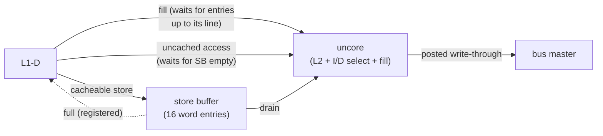

# Penumbra/3 — Memory-path performance: measurements and levers

> **Applies to:** Penumbra/3 · memory hierarchy and address translation
> (in design). Measured on the shared SDRAM stacks gen3 reuses, on the
> gen2 L1↔L2 chain gen3 replaces, and on the software TLB refill gen3
> inherits.

This records what the memory path costs, cycle by cycle, and what
gen2.5 hardware workload profiles say about where gen3's cycles will go.
It then collects the design levers those numbers point to for the gen3
uncore and TLB. The levers are proposals ranked by evidence, not
decisions, and every estimate is labeled as one.

Every lever here must preserve the completion contract in
[`memory-completion.md`](./memory-completion.md) and the structural rules
in [`timing-outline.md`](./timing-outline.md). The phase each one lands in
is set by the [build plan](./overview.md#build-plan).

## Measurement setup

Cycle counts are CPU cycles, from Verilator runs of two scratch wrappers
around unmodified RTL (commit `a463c4a`). The SDRAM clock runs at 4× and
2× the CPU clock; gen2.5's 37.5 MHz against the 100 MHz SDRAM is 2.67×,
between the two.

| Chain | Composition | Measured |
|---|---|---|
| A — gen3 bus side | `penumbra3_bus_master` → `sdram_sim` (adapter + CDC + controller + chip model) | master request accept → completion pulse |
| B — gen2 L1↔L2 | `fill_sequencer` → `l2_cache` (`HIT_LATENCY=3`, as the gen2 machine builds it) → `sdram_sim` | line request presented → `fill_done` |

Chain B excludes the gen2 `txn_arbiter` in front of the sequencer (one
registered cycle per transaction) and the L1/core miss overhead, so a
real gen2 miss costs somewhat more than chain B shows.

Chains A and B ran on the word stack (`hw/rtl/io/sdram/`), whose adapter
speculates one word ahead. The later measurements below (2026-09-25) use
the line stack (`hw/rtl/io/sdram_line/`), which answers a read with the
whole line and holds it, and add four instruments:

| Instrument | What it is | What it gives |
|---|---|---|
| Machine trace | `machine_penumbra2_sim`, gen2.5 core, line stack, clocks at the hardware ratio (37.5 : 100 MHz); a probe program reads `CPU_CYCLES` or `STALL_LOAD` around one dependent load, and the testbench logs every memory-side FSM each cycle | the cost of one miss and which layer owns each cycle |
| Hardware membench | `benchmark/membench` on the ULX3S at 37.5 MHz, both stacks | `STALL_LOAD` cycles per L2 read miss |
| Shadow models | the ISS's `+cachemodel` and `+tlbmodel`, fed every fetch, load and store (physical address, PTE `C`) and every main-TLB translation while NetBSD runs real workloads | miss counts by kind, for geometries that were never built |
| Store-buffer model | the ISS's `+sbmodel`: shadow store buffers on an estimated clock, fed every store and the first cache model's fills | the cycles a buffer's shape and drain rules make the core wait |

The shadow models count accesses the way the RTL perfctrs do. Run over
the same window as Doom's own perfctr snapshot (`perf_demo_track` to
its exit handler), the as-built model reproduces the hardware's printed
rates: L1I 97.2 % (hardware 97.3 %), L1D 80.5 % (79.7 %), L2 85.3 %
(86.0 %), over 570 M instructions against the hardware's 579 M. Its
TLB model reproduces the real refill count within 3 %. That calibration
is what lets the split by kind below stand in for counters the hardware
does not print. It was made with the models' first version, which used
LRU where the caches use tree-PLRU and treated every level as enabled
once translation was on; the ISS's models follow the RTL in both.

## SDRAM line fill (chain A)

| Transaction | 4:1 | 2:1 |
|---|---|---|
| Line read, first (cold) | 28 — beats at 8, 11, 19, 27 | 36 — beats at 10, 15, 25, 35 |
| Line read, next line, same row | 27 — beats at 2, 10, 18, 26 | 33 — beats at 2, 12, 22, 32 |
| Line read, row conflict | 29 | 38 |
| Single-beat read | 9 | 11 |
| Line write | 10 | 13 |
| Single-beat write | 3 | 3 |
| 16 back-to-back line reads, per line | 31.9 | 40.7 |

**Words 2 and 3 each pay a full round trip.** They sit as far apart as
the cold first word, because `sdram_bus_adapter` keeps one speculative
read in flight and queues the next only when the previous one is
consumed. The fill is latency-bound: roughly 10 cycles of round trip
with one word of lookahead only covers word 1. At 2:1 a 16-byte line
takes 33–38 cycles, about a tenth of what either the 16-bit SDRAM
(200 MB/s) or the 32-bit sync bus at 37.5 MHz can carry.

The dangling speculation past the end of a line serves the *next*
line's first word in 2 cycles, so a single sequential stream benefits.
Interleaved streams do not: each fill orphans the other stream's
speculation, and the orphaned read still occupies the SDRAM.

## L1 line fill through L2 (chain B)

| Phase | 4:1 | 2:1 |
|---|---|---|
| L2 detects the miss, bus request starts | 3 | 3 |
| L2 fetches its own line from SDRAM | 28 | 37 |
| L2 re-serves the line to L1 | 14 | 14 |
| **Total, L2 miss** | **45** | **54** |
| Total, L2 hit (words at 4, 7, 10, 13) | 13 | 13 |

**The re-serve tail.** The L2 holds `busy` through its whole `S_FILL`.
After the last SDRAM word it installs the tag, latches the sequencer's
still-held word-0 request again as a fresh access, and serves it through
the hit pipeline: 5 cycles to the first L1 word, then 3 per word. At
`HIT_LATENCY=3` the stage-0 latch accepts a new read only every third
cycle, and the sequencer's registered address step allows no faster.
The data path to forward fill words live already exists (`o_rdata`
passes `i_mem_rdata` during `S_FILL`); only the busy-drop is missing.

**The front.** From an L1 miss to the first bus request gen2 spends 4
cycles, each a registered hand-off: the arbiter's request register, the
sequencer's engage cycle, the L2 stage-0 latch, and the stage-1 tag
compare.

## A miss on the line stack (gen2.5 machine, hardware-checked)

Measured 2026-09-25 with the machine trace, cross-checked on hardware.
`STALL_LOAD` per miss is the membench figure; the probe reads the same
counter, so the two compare directly.

| | Hardware membench | Machine trace |
|---|---|---|
| L1 hit | — | 1 |
| L1 miss, L2 hit | — | 17 |
| L1 miss, L2 miss, line stack | 38.2 | 38–39 |
| L1 miss, L2 miss, word stack | 55.2 | 51–52 ¹ |

¹ The word stack's speculation depends on the access stride, which
differs between the two tests (16 B membench, 64 B probe), so this row
agrees only roughly. The line stack speculates on nothing and agrees
within a cycle. The simulated PHY omits the board's one-cycle pipeline
each way (about +0.75 CPU cycles) and the probe's miss took a row
conflict membench mostly avoids (about −1.25); the two roughly cancel.

The line stack took **17 cycles off every L2 miss** on hardware. Where
the 38 go, cycle by cycle:

| Part | Cycles |
|---|---|
| Base load cycle (every load pays it) | 1 |
| L1 miss → arbiter register → sequencer engage → L2 stage 0 → stage-1 miss | 4 |
| **SDRAM→L2: bus request raised → last word acked, line installed** | **19** |
| L2 re-serves the line to L1, 3 cycles a word | 12 |
| Sequencer drain + L1 serve | 2 |

An L2 hit costs the front, the 12-cycle word walk and the tail: 16
cycles above a hit, 17 on the counter.

**The SDRAM→L2 leg** (19 cycles, about 505 ns at 37.5 MHz):

| | Cycles | What |
|---|---|---|
| Bus request presented; adapter pushes to the CDC | 2 | adapter start + push |
| Request crosses to the SDRAM clock | ~1.5–2 | 2-FF synchronizers + controller accept |
| DRAM work | ~5.3 | precharge, activate, read, CL2, 8-beat burst (~4 on a row hit) |
| Response crosses back; adapter captures it | ~3 | 2-FF synchronizers + the capture edge |
| Word 0 acked | 1 | |
| Words 1–3 from the adapter's held line | 6 | the bus floor: 2 cycles a word |

The fractional splits come from SDRAM-clock samples and are good to
about half a cycle; the 10 cycles between the push and word 0 are exact,
and the crossings take 4–5 of them.

About a quarter of the SDRAM leg is the DRAM itself; the rest is clock
crossings and bus hand-offs, six cycles of them the protocol floor. The
on-chip L1↔L2 part (4 + 12 + 2 = 18) is as large as the whole SDRAM leg,
which is what [one uncore pipeline](#one-uncore-pipeline) attacks.

## Store latency below the arbiter (chain B)

| Cacheable store, request → busy-drop | 4:1 | 2:1 |
|---|---|---|
| Isolated, L2 hit | 3 | 3 |
| Isolated, L2 miss | 3 | 3 |
| Burst of 8, per store | 3 2 4 2 3 2 3 2 | 3 2 6 3 4 3 4 3 |

**L2 hit or miss makes no difference.** The SDRAM adapter releases a
write as soon as its CDC accepts it, so the SDRAM leg of a store is
already posted. Of the 6 cycles a gen2.5 store costs, about 3 are this
handshake below the arbiter and about 3 are the L1, arbiter and MEM
hand-offs above it. A sustained store stream drains at about 3.5
cycles per store at 2:1.

## Sustained writes on the SDRAM stack

Measured 2026-09-29 in Verilator with scratch wrappers around
unmodified RTL: the bus port of `sdram_sim` driven as a registered
master (held strobe, address advanced after each `ack`), and
`penumbra3_bus_master` issuing each transaction the cycle it is ready
again. The line-write row through the bus master is re-measured
2026-11-20, with the master taking its next request in the cycle it
completes one, and the single-beat rows 2026-11-21 at `0cb08b8`, with
it holding its strobe across a run of them.
The word and line stacks share the write path and measure the same.
CPU cycles; the middle column runs the clocks at the hardware's
37.5 : 100 MHz.

| Transaction | 4:1 | 37.5 : 100 | 2:1 |
|---|---|---|---|
| Write burst on the bus, sequential, per word | 2.53 | 3.04 | 3.56 |
| … per 16-byte line | 10.1 | 12.2 | 14.2 |
| Write burst, a new row every word, per word | 3.00 | 3.65 | 4.56 |
| Separate writes, strobe dropped between, per word | 4.0 | 4.0 | 4.0 |
| Line writes through `penumbra3_bus_master`, per line | 11.1 | 12.2 | 14.2 |
| Single-beat writes through `penumbra3_bus_master`, sequential, per store | 2.54 | 3.03 | 3.54 |
| … a new row every word | 3.02 | 3.63 | 4.55 |
| Line read (line stack) behind 1–16 posted writes, cycles added | 0–1 | 0–1 | 2 |

- **The CDC paces a word stream.** Acknowledgements come in pairs
  (gaps of 2, 4, 2, 4 at 37.5 MHz): its two slots fill, then wait for
  the read pointer to cross back to the system clock. The controller's
  own time for a word written to the open row, six SDRAM clocks or
  2.25 CPU cycles, sits under that; a row change on every word adds
  only 0.6.
- **The bus master writes a run of stores as one burst.** It takes a
  single-beat write behind the one it is writing and puts it on the bus
  the cycle after that one's ack, so the strobe stays up and the run
  costs what the held-strobe burst does. Between any other two
  transactions the strobe drops a cycle: a line write runs at the
  burst's rate but for that cycle, which shows only at 4:1; the CDC's
  pacing hides it at the slower ratios.
- **Posted writes barely delay a read.** The CDC holds at most two,
  and the controller finishes them while the read is crossing.

## Transfer rates by block size, on hardware

`benchmark/memspeed` reads, writes and copies one block over and over,
for blocks from 512 B to 4 MiB, and reports CPU cycles per 32-bit
word. Its loops are written by hand: 32 accesses an iteration, no
loaded value ever read, a write storing one unchanging register, and a
copy loading a line's four words before it stores them, so no access
waits on another. Three runs:

| Run | Board | CPU clock | Memory |
|---|---|---|---|
| gen2.5 | Nexys Video | 60 MHz | DDR3-667 |
| gen3 at `3539275` | Nexys Video | 60 MHz | DDR3-667 |
| gen3 at `3539275` | ULX3S | 37.5 MHz | SDR SDRAM at 100 MHz, line stack |

Each has 2-way L1s and a 64 KiB 4-way L2. gen2.5's L1-D is 4 KiB and
its TLB 32×2; gen3's are 8 KiB and 256×2. Cycles per word, at the
largest block each cache holds and at 128 KiB for memory:

| Run | Level | Read | Write | Copy |
|---|---|--:|--:|--:|
| gen2.5, Nexys | L1 (4 KiB) | 2.13 | 6.39 | 8.41 |
| | L2 (64 KiB) | 6.12 | 6.37 | 12.36 |
| | memory | 12.36 | 6.37 | 18.57 |
| gen3, Nexys | L1 (8 KiB) | 1.12 | 5.31 | 5.31 |
| | L2 (64 KiB) | 2.12 | 5.31 | 5.31 |
| | memory | 8.18 | 5.31 | 13.74 |
| gen3, ULX3S | L1 (8 KiB) | 1.12 | 5.00 | 5.00 |
| | L2 (64 KiB) | 2.12 | 5.00 | 5.00 |
| | memory | 7.15 | 5.00 | 13.01 |

What a fill adds to a line's four reads, over four L1 hits:

| Fill | gen2.5, Nexys | gen3, Nexys | gen3, ULX3S | Estimated |
|---|--:|--:|--:|---|
| From L2 | 16.0 | 4.0 | 4.0 | 16 → ~5 ([line-wide transfer](#the-line-wide-transfer)) |
| From memory | 40.9 | 28.2 | 24.1 | 37 → ~24; 20–25 the [target](#design-target-memory-latency-in-cpu-cycles) |

- **The line-wide transfer meets its estimates.** An L2 fill costs 4
  cycles on both boards, which run the same core and uncore cycle for
  cycle with L2 on chip. A memory fill saves 12.7 cycles on the Nexys,
  the 13 estimated, and costs 24.1 on the ULX3S against gen2.5's 38
  there: the target's floor of about 19 cycles on the bus, plus about
  5 in the uncore. In time the DDR3 fill is the faster, 470 ns against
  643, at more cycles.
- **A write stream runs at the drain.** Both caches write through, so
  every store becomes a bus write and the write rate is the same at
  every block size. The store buffer's sixteen entries absorb a burst;
  a longer stream runs at the rate the buffer drains. On the ULX3S at
  `3539275` that is the bus master's single-beat floor of the time,
  5.00 cycles a store, with the loop's own instructions hidden under
  it. The master now holds its strobe across a run of stores
  ([sustained writes](#sustained-writes-on-the-sdram-stack)), and
  memspeed on the ULX3S on 2026-11-21 at `0cb08b8` wrote at 3.04 a
  word and copied from memory at 9.00, against 4.02 and 9.60 on the
  build before it, its reads unchanged. The Nexys's 5.31 is its DDR3
  stack's own rate and stays with the faster master: `sdram_cdc`
  presents the controller one request at a time and frees its slot
  only on the controller's ack, which comes to about 7.4 of the
  controller's 83.33 MHz clocks a write. gen2.5's 6.4 is its blocking
  store, about 3 cycles of which are below its arbiter
  ([store latency](#store-latency-below-the-arbiter-chain-b)).
- **A copy from a cache costs its writes alone on gen3.** Its loads and
  its L2 fills need no bus, so they run under the drain. gen2.5's
  blocking stores make every copy cost its reads plus its writes.
- **A copy from memory costs its reads plus its writes on gen3.** The
  bus carries both and runs one transaction at a time: a line read
  that takes the bus waits until no store is posted, and a post
  completes only while no transaction is in flight
  ([the store buffer](./uncore.md#the-store-buffer)). On the Nexys it
  costs 13.74, the sum of 13.49 and about a cycle a line.
- **The ULX3S also pays for switching rows.** Its copy from memory
  costs 13.01 against a sum of 12.15, about 3.4 cycles a line more.
  The SDRAM controller keeps one row open for the whole chip, and a
  copy's source and destination lie in different rows, so each line
  switches twice: the read after the writes waits out `T_WR`, then
  precharges and activates, and the first write after the read
  precharges and activates again. At 2 SDRAM clocks each for `T_WR`,
  `T_RP` and `T_RCD`, that is about 10 SDRAM clocks a line, 3.7 CPU
  cycles. The read and write sweeps each stay in one row for 64 lines
  and never show it. The Nexys's controller keeps a row open in each
  bank.
- **Past the TLB's reach the rates rise:** from 192 KiB on gen2.5,
  from 1.5 MiB on gen3. If every page past the reach missed once a
  pass, gen2.5's rise of 0.14 cycles a word at 4 MiB would be 143
  cycles a refill, inside the ~137–170 the
  [refill](#tlb-sets-and-a-cheaper-refill) is measured at, and gen3's
  0.09 on the Nexys and 0.08 on the ULX3S about 90 and 80. With a
  victim picked by counter some of gen3's pages still hit at 4 MiB, so
  its refills cost somewhat more than that. The refill is the
  benchmark's own handler's, not the kernel's.
- **Stream prefetch** lowers the read and copy rates from memory on
  both boards; the table is without it
  ([next-line prefetch](#next-line-prefetch-into-stream-buffers)).

## Workload profiles (gen2.5 hardware, 37.5 MHz)

Measured 2026-09-21. Cycles equal instructions retired plus stall cycles
exactly, so each stall class converts to cycles per instruction.

### Dhrystone — store-latency bound

139.3 M cycles, 65.4 M instructions, CPI 2.13.

| Stall | cyc/insn | Behind it |
|---|---|---|
| store | 0.56 | 7.30 M stores (11 % of instructions) × 5.0 cycles |
| flush | 0.21 | branch redirects |
| load | 0.21 | 11.3 M loads × 1.19 cycles — load-*hit* cost; 129 L1-D misses |
| hazard | 0.12 | |
| funit | 0.03 | |
| ifetch | 0.0002 | 347 L1-I misses |

The whole run takes 476 line fills; at the 54-cycle chain-B miss cost
that is about 26 k cycles, 0.02 % of the run. Fill-path work does
nothing for this workload. Draining its stores in the background would
keep the write path busy about a quarter of the time, so stores here
cost latency, not throughput.

### plasma (framebuffer) — L2-miss latency bound

1111 frames at 32.9 fps, 1262.7 M cycles, 297.9 M instructions,
CPI 4.24. Each 320×240 frame is 19,200 output words; the inner loop
loads one word from each of two fields, adds them, and stores one
framebuffer word per 4 pixels.

| Per output word | Cycles | Behind it |
|---|---|---|
| instructions | 14.0 | |
| load | 32.9 | 0.5 line fills × ~60 cycles each |
| store | 4.9 | one blocking framebuffer store |
| ifetch | 3.9 | ~3–4 k I-fills per frame — unexplained, see [open measurements](#open-measurements) |
| flush + hazard + funit | 3.5 | |

**Every field line misses L2.** A frame streams 153.6 KB of field data
through the 64 KB L2, so nothing survives to the next frame, and each
fill costs the chain-B miss plus core overhead. The field data moves at
about 5 MB/s, 2.5 % of the SDRAM: the memory system is idle and the core
waits on one fill at a time.

The printed `L2 hit 58.6%` hides this. It is a combined read+write rate
in which a missed line counts as 1 read miss and 3 read hits (words 1–3
are served after the install), instruction fills add mostly-hit lookups,
and the framebuffer stores count as write misses — the framebuffer's
user mapping is cacheable, see
[framebuffer stores](#framebuffer-stores-and-the-cacheable-only-rule).
Solving for a zero field-line hit rate reproduces about 60 %.

### fork / exec / pipe — L2-hit fill bound

`doc/TODO/hw-penumbra2.md` records `ifetch` at 16–20 % of cycles on
these paths,
against about 0 on Dhrystone. Their larger code footprint misses L1-I
but mostly hits L2, which makes the L2-hit fill (13 cycles in chain B)
the cost to attack.

### Doom — TLB refills, then fetch fills and data misses

Measured 2026-09-25: the 150-tic `BENCH.lmp` timedemo, a `PERFCTR=1`
build, 149 frames. Hardware: 1,709.8 M cycles, 579.0 M instructions,
CPI 2.95, 11.48 M cycles a frame; stalls ifetch 12.9 %, load 18.4 %,
store 13.4 %, flush 13.5 %, hazard 5.1 %, funit 2.9 %. The split by
kind comes from the calibrated shadow models, per frame:

| Event | Per frame | Hits L2 | Misses L2 |
|---|---|---|---|
| L1-I fill | 106 K | 98.9 K (93 %) | 7.1 K |
| L1-D read fill | 49.4 K | 25.0 K (51 %) | 24.4 K |
| Cacheable store | 250 K | 41 % miss L1-D (write-no-allocate: no fill) | |
| TLB refill | 16.9 K | | |

At the [line-stack costs](#a-miss-on-the-line-stack-gen25-machine-hardware-checked)
the fetch fills come to ~1.8 M cycles a frame. The hardware's ifetch
bucket is 1.48 M, so the model runs about a quarter high on the fetch
side, most likely because some fetch-miss cycles overlap other stall
classes and are charged there. The load side (~2.0 M, counting the
~1.2 cycles every load pays) agrees with the 2.1 M bucket.

**TLB refills are the largest single item.** At 4.4 a thousand
instructions and the measured [~137–170 cycles a
refill](#tlb-sets-and-a-cheaper-refill), they cost 2.3–2.9 M cycles a
frame — about a fifth of it, and about 22 % of the instructions retired
are the refill handler. The count moves with link layout: 9.4 K a frame
on the 2026-09-22 build ("Kernel: count TLB refills" in
`doc/TODO/kernel.md`), 16.9 K on this one.

| Workload | Binding cost | Lever |
|---|---|---|
| Dhrystone | store latency | [store buffer](#store-buffer-at-the-core-boundary) |
| fork / exec / pipe | L2-hit fill | [one uncore pipeline](#one-uncore-pipeline) with a line-wide or 1-word-per-cycle L2 read, [next-line prediction buffer](#next-line-prediction-buffer-for-l1-i) |
| plasma | L2-miss fill | [whole-line SDRAM fetch](#sdram-side-whole-line-fetch), [fill-through](#one-uncore-pipeline), [stream prefetch](#next-line-prefetch-into-stream-buffers) |
| Doom | TLB refills; then L2-hit fetch fills and L2-miss data fills | [TLB sets](#tlb-sets-and-a-cheaper-refill), [one uncore pipeline](#one-uncore-pipeline), [L1 size](#l1-geometry) |

## Miss profiles from the shadow models

Measured 2026-09-28 with the ISS's cache model on the multiuser image
(`GENERIC.DEBUG` kernel), booted and driven by
`sw/tools/iss-workloads.py` with `+core=penumbra2_5`:

- **Doom:** Freedoom's 150-tic `BENCH.lmp` timedemo from the first
  `R_RenderPlayerView` to `G_CheckDemoStatus` (`+model_start`,
  `+model_stop`), 149 frames and 449 M instructions. The window needs
  no `PERFCTR` build.
- **Doom `demo3`:** the shareware `DOOM1.WAD`'s `demo3`
  (`doom -iwad DOOM1.WAD -timedemo demo3`) over the same window, 2,134
  gametics and 2.92 G instructions, measured 2026-09-30. Freedoom's WAD
  is far larger and behaves differently, so the two are separate
  workloads; the measurements from 2026-09-30 on use `demo3`.
- **Shell loop:** `for i in 1 2 3 4 5 6 7 8 9 10; do ls -l /usr/bin |
  sort | tail; grep -c run_rc_command /etc/rc.subr; done`, one window.
- **`pbench kernel`** and **`pbench libc`**, one window each.
  `pbench` sizes its iteration counts from timing, so two runs differ
  by about 1 %.

A fill's cost is taken at the machine trace's 16 cycles (L2 hit) and 37
(L2 miss), and at the ~5 and ~24 the
[line-wide transfer](#the-line-wide-transfer) is estimated at. On the
shell loop and `pbench kernel`, 67 % and 97 % of L1-I misses are taken
in supervisor mode, nearly all of them hitting L2; Doom's are 88 % user
mode.

**The streams carry gen2.5's TLB refills.** The ISS runs the 32×2 TLB,
so the refill handler runs 2.5 (Doom), 6.3 (shell loop) and 5.0
(`pbench kernel`) times per 1000 instructions, and 14.5 % of Doom's
instructions execute from its page. A gen3 TLB large enough to remove
most refills takes those instructions and their fills out of the
stream, so rates per 1000 instructions will move. Doom's per-frame
figures keep their denominator but still include the handler's own
fills.

### L1 geometry

Stall cycles from L1 fills, as today's fill cost → the line-wide
transfer's, with the same geometry for L1-I and L1-D over a 64 KB 4-way
L2:

| L1 | Doom, M cycles a frame | shell loop, cycles / 1000 insns | `pbench kernel`, cycles / 1000 insns |
|---|---|---|---|
| 4 KB 2-way (gen2) | 2.36 → 1.10 | 1729 → 683 | 1398 → 509 |
| 8 KB 2-way | 1.69 → 0.89 | 1290 → 542 | 1082 → 410 |
| 16 KB 4-way | 1.18 → 0.72 | 889 → 407 | 606 → 257 |
| 32 KB 8-way | 1.00 → 0.64 | 612 → 303 | 450 → 204 |

**A larger L1 is worth the L2-hit fills it removes, times the cost of
an L2-hit fill.** An L1 of 8–32 KB is far smaller than the L2, so a line
a larger L1 would keep is almost always in L2 already: 4 KB → 8 KB
removes 13.8 L2-hit fills per 1000 instructions on Doom and 0.03 L2-miss
fills. Two consequences:

- A cheaper L2-hit fill shrinks every L1 step by the same factor. At the
  line-wide transfer's cost, each step up to 16 KB keeps 31–34 % of
  what it saves at today's, close to the 5/16 ratio of the two L2-hit
  costs. The line-wide transfer and a larger L1 buy the same cycles.
- L1 and L2 capacity remove different fills, so their gains add
  ([L2 capacity](#l2-capacity)).

**Hit logic grows with ways, not with size.** A VIPT L1 indexes within
the 4 KB page, so a way holds at most 4 KB. 8 KB 2-way keeps the two
physical-tag compares of 4 KB 2-way, each one bit narrower; every
doubling past it doubles the ways, and each way is a compare in the IF2
and MEM2 cones (see
[`mem-stage.md`](./mem-stage.md#the-mem2-verdict-cone)).

**The step past 8 KB is mostly the fetch side.** 8 KB 2-way → 16 KB
4-way at the line-wide transfer's cost, in cycles per 1000
instructions:

| Saved on | Doom | shell loop | `pbench kernel` |
|---|---|---|---|
| L1-I | 44 | 110 | 139 |
| L1-D | 14 | 25 | 13 |

A 4-way L1 bought for the kernel paths is an L1-I; MEM2's verdict can
keep 2 ways at a cost of 13–25 cycles per 1000.

- 8 KB halves Doom's L1-I misses (9.6 M → 5.0 M over the window): the
  renderer's hot loops fit 8 KB and not 4 KB. 16 KB 4-way removes 86 %
  of them.
- The shell loop's footprint outgrows 16 KB: 16 → 32 KB still saves 104
  cycles per 1000 there, against 26 on Doom and 53 on
  `pbench kernel`.

### L2 capacity

At line-wide fill costs, with the models' first version: an LRU L2 and
gen2.5's 32×2 TLB. [L2 size and stream buffers at gen3's
geometry](#l2-size-and-stream-buffers-at-gen3s-geometry) re-measures
the 8 KB rows at gen3's.

| L1 | L2 | Doom, M cycles a frame | Doom data L2 misses a frame | `pbench kernel`, cycles / 1000 insns |
|---|---|---|---|---|
| 8 KB 2-way | 64 KB 4-way | 0.89 | 23.3 K | 415 |
| | 128 KB 4-way | 0.80 | 20.3 K | 377 |
| | 128 KB 8-way | 0.80 | 20.2 K | 372 |
| | 256 KB 8-way | 0.69 | 15.8 K | 338 |
| | 512 KB 8-way | 0.41 | 3.2 K | 319 |
| 16 KB 4-way | 64 KB 4-way | 0.72 | 22.8 K | 257 |
| | 128 KB 4-way | 0.65 | 20.2 K | 224 |
| | 128 KB 8-way | 0.64 | 20.0 K | 220 |
| | 256 KB 8-way | 0.54 | 16.0 K | 186 |
| | 512 KB 8-way | 0.25 | 3.1 K | 167 |

- **L2 capacity does not stand in for L1 capacity.** 8 KB → 16 KB of
  L1 saves 50–58 cycles per 1000 on Doom and 152–158 on
  `pbench kernel` at every L2 size from 64 KB to 512 KB. A larger L2
  turns L2-miss fills into hits; the kernel paths' cost is L1-I misses
  that already hit, which only L1-I size or a cheaper fill reaches.
- **Doom's data working set fits at 512 KB.** That is affordable in
  block RAM on an Artix-7 board and not on the ECP5, whose 208 EBRs are
  142 used by the gen2.5 full top. 128 KB fits, at about 35 EBRs more
  than 64 KB ([`l2-cache.md`](../l2-cache.md)).
- **Ways past 4 buy nothing** at 128 KB: 2–5 cycles per 1000.
- **Every cycle of L2 lookup is paid per L1 fill,** hit or miss: 22
  (Doom) and 60 (`pbench kernel`) cycles per 1000 behind an 8 KB L1, 12
  and 31 behind 16 KB. Behind 8 KB one cycle takes back most of what
  128 KB saves Doom and more than it saves `pbench kernel`, so a larger
  L2 pays only at the same lookup latency.

### Next-line structure

- 66–76 % of L1-I misses are to the line after the previous L1-I miss
  (Doom 76 %, shell loop 67 %, `pbench kernel` 66 %) at 4 KB, and
  67–72 % at 8 KB.
- L2 misses that continue one of the two most recent miss streams: Doom
  47 %, shell loop 50 %, `pbench kernel` 54 %, `pbench libc` 95 %.

### Reading the printed L2 rate

The L2 perfctr counts fill *words*: a fill that hits L2 is four read
hits, one that misses is one read miss and three read hits (the words
re-served after the install), and every write-through store is one
write event. A larger L1 therefore *lowers* the printed rate — fewer
easy word hits — while L2 line misses barely move: Doom at 8 KB 2-way
prints 75 % against 82 % at 4 KB with 4.32 M line misses against 4.33 M.
The rate cannot judge an L1 change. The raw counts can: L2 line misses
are the read misses, and fills that hit L2 are (read hits − 3 × read
misses) / 4.

### Store streams

Measured 2026-09-29 on the same image and workloads, each in its own
window, counted once with a scratch patch to the ISS: cacheable stores
to RAM, grouped into streams of consecutive addresses. A few streams
stay open at once, so an interrupt's stack pushes do not split a copy.

| | shell loop | `pbench kernel` |
|---|---|---|
| Cacheable RAM stores per 1000 instructions | 83 | 117 |
| In streams shorter than 16 B | 73 % | 65 % |
| In streams of 16–255 B | 16 % | 30 % |
| In streams of 256 B or more | 12 % | 5.5 % |
| Instructions those long streams span | 3.8 % | 2.0 % |
| Long-stream stores in `memset` / `memcpy` / `pmci_burst` / user mode | 55 / 29 / 10 / 6 % | 42 / 50 / 5 / 2 % |

- **Bulk writes are page operations.** About 4,000 page-sized streams
  a window, nearly all in supervisor mode: `memset` zeroing pages, and
  `memcpy` copying them or copying out to user space. `memset` stores
  a line every 7 instructions.
- **Most stores are isolated.** Two thirds or more fall in streams
  shorter than a line. They cost latency, which a store buffer hides,
  and combining merges few of them.
- **Short bursts are frequent on the kernel paths.** `pbench kernel`
  writes about one 64–255 B stream per 1000 instructions, 21 words on
  average at one store per 1.8 instructions, 98 % of them in
  supervisor mode. Frame saves are the likely source; they were not
  attributed. One such burst overflows eight word-sized buffer entries
  and fits in eight line-sized ones.
- **`pmci_burst` stores bytes.** The SD driver copies each block out
  of the SPI controller's byte-wide data register, one byte a store.
  That is a question for the device, not the RAM path.

### Fills and refills at gen3's geometries

Measured 2026-09-30 in one run per workload, every hierarchy and TLB
layout side by side, with the models' current versions. Per 1000
instructions:

| | shell loop | `pbench kernel` | Doom `demo3` |
|---|---|---|---|
| L1 fills from L2 / from memory, 4 KB 2-way L1s, 64 KB L2 | 81.3 / 11.7 | 77.9 / 6.1 | 14.9 / 11.9 |
| … 8 KB 2-way L1s | 54.6 / 11.3 | 56.7 / 6.1 | 7.0 / 11.9 |
| … 16 KB 4-way L1s | 31.5 / 10.5 | 26.8 / 5.9 | 1.9 / 11.7 |
| … 8 KB 2-way L1s, 128 KB L2 | 59.3 / 6.6 | 58.7 / 4.1 | 8.7 / 10.2 |
| L1-I misses the prediction buffer serves, continue, 8 KB | 33.6 | 35.6 | 3.3 |
| Memory fills that continue one of the last two | 50 % | 56 % | 54 % |
| Stores | 83 | 117 | 76 |
| TLB refills, 32×2 as built (the kernel's own count) | 6.26 | 4.44 | 2.62 |
| … shadow 64×2 / 128×2 / 256×2 | 2.57 / 0.98 / 0.35 | 2.08 / 1.15 / 0.29 | 0.74 / 0.28 / 0.05 |

- **`demo3` is not Freedoom.** It refills the TLB 2.6 times per 1000
  instructions against Freedoom's 4.4, and its code fits an 8 KB L1-I
  (7 fills per 1000). Its cost is data streaming through L2: 8.7 data
  fills per 1000 come from memory, a larger L1 barely moves them, and
  54 % of memory fills continue a stream.
- **The kernel paths are fetch-bound.** Their L2-hit fills are nearly
  all L1-I misses, which is what the line-wide transfer, a larger L1-I
  and the prediction buffer each reach.
- **The as-built shadow undercounts Doom's refills** — 1.87 per 1000
  against the kernel's 2.62 — though it matches the kernel paths within
  4 %, so the larger layouts may read optimistic on Doom.

### L2 size and stream buffers at gen3's geometry

Measured 2026-11-20 at `+core=penumbra3`, with its 256×2 TLB and a
tree-PLRU L2, on the same three workloads and the day's multiuser
image. One run per workload holds every hierarchy side by side: 8 KB
2-way L1s over 4-way L2s of 64 KB (gen3's), 128, 256 and 512 KB.

The stream buffers are the cache model's two-buffer shadow
(`sw/sim/cache_model.h`). A buffer starts prefetching once two memory
fills land on consecutive lines, then prefetches the line after each
fill it serves. It never crosses a page and never looks in L2 first.
The buffers change nothing the caches hold, so every hierarchy prices
them against its own misses.

Memory fills per 1000 instructions, and the share the buffers serve:

| L2 | shell loop | `pbench kernel` | Doom `demo3` |
|---|---|---|---|
| 64 KB | 15.48, 36 % | 7.34, 43 % | 13.71, 46 % |
| 128 KB | 8.97, 38 % | 4.68, 46 % | 11.83, 46 % |
| 256 KB | 6.30, 40 % | 2.63, 45 % | 6.21, 33 % |
| 512 KB | 4.49, 41 % | 1.22, 44 % | 1.24, 15 % |

Doom per frame (2,134 frames, 1.165 M instructions each):

| L2 | Memory fills | Data | Instruction | Buffers serve | Prefetches unused |
|---|--:|--:|--:|--:|--:|
| 64 KB | 15,972 | 12,198 | 3,775 | 7,315 | 1,567 |
| 128 KB | 13,791 | 10,964 | 2,827 | 6,401 | 1,332 |
| 256 KB | 7,242 | 5,844 | 1,398 | 2,386 | 988 |
| 512 KB | 1,447 | 1,175 | 272 | 216 | 215 |

- **Doom's data needs 256 KB.** Its frame copy reads the 64,000-byte
  screen buffer through L2 every frame, and the renderer's stores into
  it never allocate ([Doom](../../TODO/workloads.md), "the frame copy is
  11% of a gen3 frame"). At 128 KB its data fills fall only 10 %: the
  screen buffer and the rest of the frame's data do not fit together,
  so each evicts the other every frame. At 256 KB they halve, and at
  512 KB nine in ten go.
- **The kernel paths gain from 128 KB, mostly in fetch.** Instruction
  fills from memory fall from 9.42 to 4.12 per 1000 on the shell loop
  and from 3.85 to 1.98 on `pbench kernel`.
- **The buffers serve a steady ~40 % on the kernel paths at every L2
  size,** two thirds of it instruction streams on the shell loop at
  64 KB. On Doom they and capacity reach the same misses: their share
  falls from 46 % to 15 % as L2 grows, the screen buffer being the
  stream a large L2 keeps.
- **A fifth to a third of prefetches go unused** at 64 KB: 18 % on
  Doom, 25 % on `pbench kernel`, 31 % on the shell loop. Each is a read
  on gen3's in-order bus that delays whatever follows it.
- **Priced** at gen3's measured fills, 4.0 cycles from L2 and 24.1 from
  memory on the ULX3S
  ([transfer rates](#transfer-rates-by-block-size-on-hardware)), a
  memory fill a larger L2 removes saves ~20 cycles. Per 1000
  instructions on the shell loop / `pbench kernel` / Doom, 64 → 128 KB
  saves ~131 / ~53 / ~38 cycles, 256 KB ~185 / ~95 / ~151 and 512 KB
  ~221 / ~123 / ~251. What a served fill saves depends on how long
  before its read the prefetch lands, which the model does not see;
  on hardware it is
  [measured](#next-line-prefetch-into-stream-buffers) against these
  counts.
- **Measured on the Nexys Video,** at 80 MHz on 2026-11-21: Doom
  `demo3` ran at 38.01 fps with a 64 KB L2 and 42.75 with 256 KB
  (`d92e4de`), 233 k cycles a frame fewer, about 27 for each memory
  fill the model has 256 KB remove. Each fill costs more cycles there
  than on the ULX3S, DDR3 latency being fixed in nanoseconds, and some
  of the removed ones were fills the stream buffers served.
- **Only at the same lookup latency.** The 8 KB L1s fill 95 (shell
  loop), 91 (`pbench kernel`) and 21 (Doom) times per 1000
  instructions, and every fill pays each cycle of L2 lookup. One more
  cycle takes back most of what 128 KB saves the shell loop, more than
  all of it on `pbench kernel`, and half of it on Doom.

## Levers for the gen3 uncore

### Store buffer at the core boundary

A small FIFO of cacheable stores between the L1-D and the uncore. A
cacheable store completes when it enters the buffer instead of when its
write-through is acknowledged; the buffer drains through the uncore in
the background. Its shape comes from the
[store-buffer model](#the-store-buffer-in-the-model): sixteen word
entries, a fill that waits only for the entries up to the youngest
holding its line, and an L2 that posts its write-through.

- **Placement.** It must sit in front of the arbiter to hide the whole
  on-chip path. A buffer after L2 would hide only the SDRAM leg, which
  the adapter already posts.
- **Entries are words.** Each holds one store: its word's physical
  address, its data and its byte lanes. It drains as one single-beat
  write: the uncore's cacheable write and the bus master's single
  beat, with no new transfer shape. Line entries, which merge a line's
  stores and drain them as one burst, wait about 4 cycles per 1000
  instructions less at CPI 2, and 15–37 less at CPI 1 on the kernel
  paths, where a frame save's burst overflows word entries
  ([line or word entries](#line-or-word-entries)). They need a merge at
  enqueue, a bus burst over a run of words each with its own lanes, and
  line-wide writes into L2; drained a word at a time instead, they
  wait more than word entries do.
- **A fill searches the buffer by line; a load hit never does.** L1-D
  is updated in place at commit on a hit, so a load that hits L1
  already sees every older store. A fill — an I-fill or a D-fill —
  waits for the entries up to the youngest holding its line, so L2 is
  current for that line when the fill reads it. The search compares the
  lines of the entries' addresses against the registered miss address
  in the uncore, off the core's cones. Uncached loads and stores wait
  until the buffer has drained. Waiting for every entry before every
  fill instead costs word entries 3–8 more cycles per 1000
  instructions at CPI 2 and 14–31 at CPI 1. This replaces the
  disambiguation search that made the gen2.5 store-buffer plan its most
  structural feature: the compare runs on misses, never in the load-hit
  path.
- **L2 posts its write-through.** L2 takes a drained entry's write in
  its pipeline, and the entry waits in the buffer for its bus write,
  which frees it. A fill L2 serves goes ahead while a write is on the
  bus; a fill from memory and an uncached access wait for the bus. The
  buffer is the posting queue, so L2 needs no write buffer of its own.
  This is L2 serving a hit while its bus port is busy with a write, not
  the [hit under miss](#hit-under-miss-in-the-l2--ruled-out) ruled out
  below: a write returns nothing to steer back.
- **No software change.** An uncached store, to a device or any other
  memory with side effects, drains the buffer first, so it is ordered
  after every earlier cacheable store. That matters little in practice,
  since memory with side effects is mapped uncached, but the strong
  guarantee is cheap and kept. Refetching modified code is an I-fill,
  which waits for the entries holding its line. Sysreg writes stay
  outside the buffer's ordering:
  entries hold physical addresses, so MMU and cache-maintenance writes
  need no drain, and TLB refills should not pay for one. A sysreg-driven
  copy engine would therefore need an explicit drain before it starts.
  Every other drain is a side effect of an operation software already
  issues, and it blocks rather than requiring a poll.
- **Faults.** A cacheable-store bus fault is already deferred, a trap
  at a later instruction, under the
  [fault-precision contract](./memory-completion.md#fault-precision),
  written with a deferring store path in mind. The buffer reports a
  drain's fault with the drained write's physical address, as the
  uncore does. Uncached accesses stay unbuffered and precise.
- **Timing.** The core sees only registered signals: `full` joins the
  launch-side freeze, and the line compare and `empty` gate accesses at
  the uncore. No new combinational cone reaches issue or the MMU.
- **Depth.** Sixteen word entries. Eight wait 16–43 cycles per 1000
  instructions more at CPI 1 on the kernel paths, where bursts
  overflow them, and up to 5 more at CPI 2. Thirty-two gain under 1 at
  CPI 2.
- **Merging from the buffer: measured, not worth it.** A fill could
  take its line's buffered bytes instead of waiting for them, at the
  cost of an entry read and a byte merge on the fill path. Over the
  line search it saves under 0.5 cycles per 1000 instructions on every
  workload measured: a fill whose line is still buffered is rare, and
  its entry has usually started draining.
- **Write combining** in the SDRAM adapter
  ([write combining](#sdram-side-write-combining)) takes a burst's
  words as one controller request, so it has nothing to combine in
  word entries' single-beat drains. With line entries it saves 4–6
  cycles per 1000 on the kernel paths once L2 posts, 12–14 without;
  1–7 on Doom.

#### The store buffer in the model

Measured 2026-09-30 with the ISS's `+sbmodel` (`sw/sim/sb_model.h`)
over the ECP5's 8 KB 2-way L1s and 64 KB L2
(`+cachemodel=8k/2:8k/2:64k/4`), on the shell loop, `pbench kernel`
and Doom `demo3` ([workloads](#miss-profiles-from-the-shadow-models)).
Each buffer runs its own estimated clock: 1 or 2 cycles an instruction,
L1 fills at the line-wide transfer's 5 (L2) and 24 (memory) cycles,
uncached accesses at the bus master's 5, L2 taking a posted write in
2, and drains at the costs [measured](#sustained-writes-on-the-sdram-stack)
for 1–4 words: 5, 7, 11, 13 cycles, or 5, 7, 9, 11 with write
combining. Nothing else stalls, so the waits are an upper bound; CPI 2
is nearer a pipeline with its other stalls.

Cycles per 1000 instructions the core waits on the buffer, CPI 1 /
CPI 2, eight line entries unless stated:

| Fill rule and uncore | shell loop | `pbench kernel` | Doom `demo3` |
|---|---|---|---|
| Wait for every entry | 168 / 145 | 167 / 140 | 70 / 64 |
| … L2 posts write-through | 81 / 67 | 67 / 56 | 58 / 52 |
| Wait for entries up to the fill's line | 99 / 67 | 93 / 58 | 21 / 7.6 |
| … L2 posts write-through | 41 / 25 | 29 / 17 | 16 / 4.1 |
| … and the adapter combines writes | 35 / 22 | 25 / 15 | 9.2 / 3.7 |
| Merge buffered bytes into the fill, posted, combined | 34 / 22 | 25 / 15 | 9.1 / 3.6 |
| Eight word entries, wait for every entry | 159 / 88 | 200 / 89 | 41 / 15 |

For scale, the model's clock runs 1,330–1,720 cycles per 1000
instructions at CPI 1 and 2,325–2,700 at CPI 2. A blocking store
costing gen2.5's 5 stall cycles would cost 415, 585 and 380 per 1000:
83, 117 and 76 stores per 1000 instructions.

- **The fill rule decides how much of the buffer's win survives.**
  Against those blocking costs, waiting for every entry keeps 60–82 %
  of the saving, and the line search with posting 92–98 %.
- **The line search leaves fills stuck behind a drain in flight,**
  mostly I-fills on the kernel paths: 72 of the shell loop's 99 cycles
  at CPI 1. Posting lets the ones L2 serves through, taking I-fill
  waits to 16 there and from 74 to 13 on `pbench kernel`.
- **Doom's waits are D-fills,** 54 of its 70 under the every-entry
  rule. It stores about 76 times per 1000 instructions, mostly missing
  L1-D into the buffer, so a load miss usually finds entries ahead of
  it. The line search removes nearly all of them at CPI 2.
- **Word entries overflow on bursts:** 31–73 cycles per 1000 of
  full-buffer stalls at CPI 1 on the kernel paths. They wait less at
  fills than line entries under the every-entry rule, since nothing
  holds an entry open, but more than line entries under the line
  search.
- `pbench kernel` sizes its iterations from timing, and its runs
  differ by up to 4 %. L2's 2-cycle posted write is an assumption.

#### Line or word entries

Measured 2026-11-11 with `+sbmodel` under `+core=penumbra3`, over
gen3's own caches and TLB (8 KiB 2-way L1s, a 64 KiB 4-way L2, the
256×2 TLB), on the same three workloads. Every buffer posts its
write-through and drains at the `bus` costs, 5, 7, 11 and 13 cycles
for one to four words, unless stated; a word entry drains in 5.

Cycles per 1000 instructions the core waits on the buffer, CPI 1 /
CPI 2:

| Entries and fill rule | shell loop | `pbench kernel` | Doom `demo3` |
|---|---|---|---|
| 8 line, entries up to the fill's line | 60.9 / 36.1 | 35.8 / 21.9 | 19.4 / 5.1 |
| … drained a word at a time (5, 10, 15, 20) | 98.9 / 62.6 | 98.1 / 38.1 | 50.1 / 8.0 |
| … the adapter combining writes | 53.2 / 32.5 | 31.6 / 19.2 | 11.1 / 4.5 |
| 8 word, entries up to the fill's line | 92.2 / 41.7 | 116.1 / 30.5 | 25.4 / 9.6 |
| 16 word, entries up to the fill's line | 75.7 / 40.0 | 72.9 / 25.4 | 24.4 / 9.2 |
| 32 word, entries up to the fill's line | 69.7 / 39.3 | 42.5 / 25.1 | 23.6 / 8.7 |
| 8 line, every entry | 122.4 / 101.5 | 83.5 / 72.2 | 67.4 / 60.8 |
| 8 word, every entry | 121.9 / 48.9 | 137.1 / 34.2 | 39.2 / 12.1 |
| 16 word, every entry | 107.0 / 47.5 | 94.6 / 29.3 | 38.7 / 11.8 |

- **Line entries win only with their burst.** Drained a word at a
  time, they wait more than sixteen word entries on every row but
  Doom's at CPI 2: a fill waits for the whole entry holding its line,
  and a four-word drain holds the bus for 20 cycles where a word entry
  holds it for 5.
- **With the burst, the gap is the bursts of stores.** At CPI 1,
  sixteen word entries spend 32 and 42 cycles per 1000 waiting for
  room on the kernel paths, against line entries' 13 and 5: a frame
  save fills them. At CPI 2 a burst arrives slowly enough to drain, and
  the gap closes to about 4 cycles.
- **Waiting for every entry costs line entries far more.** A line
  entry stays open while stores merge into it and drains for longer,
  so a fill waits behind more. Word entries without the search come
  within 3–8 cycles per 1000 of their search at CPI 2.
- **Doom's remaining waits are D fills** in every configuration: 5.5
  of sixteen word entries' 9.2 at CPI 2.

### Write-back L2: what it does and does not buy

A write-back hit completes at the L2 tag verdict, 2–3 cycles down its
pipeline — the same as the posted write-through it replaces. So on its
own it saves about 0–1 of the 5 cycles a store costs, and a write-back
L2 without a store buffer leaves Dhrystone's store stall largely in
place.

What it does add is less SDRAM write traffic. That matters only when
stores are throughput-bound: bulk fills and copies, page zeroing, or a
copy engine on the master's side sharing the bus with the CPU. Against
that it costs dirty bits, eviction-then-fill sequencing and flush
operations, fmax risk in the L2 miss path, and kernel-visible work:
flush before other hardware reads memory and invalidate before it
writes, including per-line operations (`INVAL_LINE` is reserved but not
implemented). Write-allocate is weaker still for streaming writes, since
it reads each line before overwriting it. It stays a measure-driven
option behind the store buffer.

### One uncore pipeline

gen2 registers every module boundary — arbiter, fill sequencer, L2 —
because each register cut a cone that crossed modules. The sum is one
register per *hand-off* rather than one per *pipeline stage*. gen3's
L1s already hold each miss in a register before it reaches the uncore,
so the I/D choice can be a shallow select of two registered valid
bits feeding the L2's stage-0 flops. That allows folding the arbiter and
the fill sequencer into `penumbra3_l2`, with three registered edges:
requests in, the tag verdict, and the outputs (fill stream and bus
request).

| Overlap | Possible | Saves |
|---|---|---|
| I/D selection on the same edge as the L2's stage-0 latch | yes | 1–2 cycles on every transaction, including uncached accesses and blocking stores |
| The L2's miss register doubling as the bus master's request register (gen2's L2 already drives the bus from its `fill_*` registers; the separate `penumbra3_bus_master` adds a registered accept) | yes | 1 cycle per miss |
| Fill-through: bus words written into L2 and streamed to L1 at once | yes | ~12 of the 14-cycle re-serve tail |
| L2 walks a hit line itself at 1 word per cycle, or reads it line-wide | yes | L2-hit fill ~14 → ~7, ~4 line-wide |
| Starting the bus read in parallel with the tag lookup | no — the bus contract holds `re` until the `ack`, so a read cannot be abandoned; every L2 hit would cost an SDRAM read and orphan the adapter's speculation | 1–2 cycles per miss |

Estimated from the chain-B numbers with the SDRAM side unchanged: an
L2-miss fill of about 46–55 cycles becomes about 33–42. Against the
[line stack's measured miss](#a-miss-on-the-line-stack-gen25-machine-hardware-checked),
fill-through and a line-wide transfer on gen2's own structure take an
L2-miss fill from 37 cycles above a hit to about 24, and an L2-hit fill
from 16 to about 5–6.

#### The line-wide transfer

One L2 access returns the whole line and L1 installs it in one cycle —
the stronger of the two hit-fill forms above. Both storage shapes were
checked by synthesis (yosys `synth_ecp5`):

- **L2 data in 128-bit rows**, one line per way per access: 8 EBRs a
  way in 1K×18 mode with byte enables, the same count as the word-wide
  layout, so the write-through byte update still maps.
- **L1 data written a line at a time and read a word at a time**:
  yosys maps it natively to asymmetric ports (36-bit write, 9-bit read),
  4 EBRs a way for up to 512 lines — 8 KB a way — so the word select
  happens inside the EBR and no LUT joins the hit path. 8 KB of L1 costs
  the same EBRs as 4 KB in this shape. Vivado maps it only when the
  whole row is written under one enable, and a store hit writes one
  word of it, so P0.5's probe built its L1s from registers there (93K
  LUTs, 129K flip-flops); `penumbra3_l1_store` keeps word columns, with
  a 4:1 word select beside the tag compare.
- **Read-during-write emulation.** For any BRAM whose read and write
  could coincide, yosys adds a bypass that returns the old data: flops
  capturing the write, and a mux on the EBR output. On gen2's L1 tag
  array that is 27 LUTs and 51 flops, merged into the first compare
  LUT; on the line-write/word-read array it is 155 LUTs, 65 `PFUMX` and
  296 flops, two LUT levels on the read path. Writing the exclusivity
  into the RTL — the write gated off while a read launches, or the read
  enable gated by a registered write strobe — lets yosys prove the
  collision cannot happen and drop the bypass (1 LUT and 16 LUTs
  respectively). yosys credits only exclusive enables: in
  `penumbra3_l1_store`, suppressing a launch's read only when it meets
  the store's address left the emulation in place (1106 flops, 1830
  LUTs for an 8 KB 2-way L1-D), and `no_rw_check` on those lanes, with
  an assertion checking the same exclusion, removed it (514 flops, 1525
  LUTs) — the same as writing each store only in a cycle with no
  launch, without holding stores back.

With the line in one register at the L2's output, the fill sequencer's
word walk disappears; the arbiter routes a line and a done strobe.
Every registered hop left on the fill path costs one cycle per fill.
Fills run at 36 per 1000 instructions in Doom and 80–93 on the kernel
paths with a 4 KB L1, and at 22 and 60–66 with 8 KB, so each hop is
worth several percent of cycles and the hops are worth budgeting
explicitly ([L2 capacity](#l2-capacity)). At 37.5 MHz: an L2-hit
fill of about 5 cycles, an L2-miss fill of about 24, of which the bus,
the clock crossings and the DRAM own about 19.

"One pipeline" does not require one file. The select, the tag/data
store, the line walk and the bus master can stay separate submodules;
what changes is that their boundaries stop each adding a registered
hand-off, while the pipeline's inputs and outputs stay registered.

Fills are atomic — the core resumes only when the whole line is in L1
(no critical-word-first) — so only the arrival of the *last* word
matters. Streaming words to L1 as they arrive buys nothing over handing
the whole line up at the end; the gain comes from deleting the serial
re-read, and needs no per-word valid bits.

### SDRAM side: whole-line fetch

The adapter can fetch the whole aligned 16-byte line on a read — one
BL=8 burst, crossing the CDC as a single transfer — instead of guessing
one word ahead. RAM reads have no side effects and the bus contract lets
a slave infer sequential access, so this stays inside the word-at-a-time
bus. It also stops interleaved streams from orphaning each other's
speculation, and retires the speculation itself: with one master and
blocking reads, no read is ever in flight that the master has not asked
for, so the line buffer needs only a tag, a valid bit and invalidation
on any write.

The burst runs six SDRAM clocks longer than a BL=2 read, so the line
lands about 10 cycles after the request at 4:1 and 13 at 2:1 (chain A's
first word, at 8 and 10, plus those clocks). Words 1–3 then come from
the buffer at the bus's floor of two cycles a word — the presentation
and a registered `ack` — adding six cycles however fast the SDRAM side
gets. Estimated: the SDRAM portion of an L2-miss fill drops from 28–37
cycles to about 16–19, and together with the uncore pipeline an L2-miss
fill lands around 21–25 cycles. gen2.5 keeps its 14-cycle re-serve
tail, so there the fetch saves about 13 of the ~60 cycles an L2 read
miss costs; L2-hit fills and stores do not change.

Delivering the line through the CDC in pieces does not pay: the bus,
not the SDRAM, paces words 1–3, so an early piece saves only as much as
word 0 lands ahead of the whole line — about 1.5 cycles for halves at
37.5 MHz. See "partial-line delivery for fills" under Ruled out in
`doc/TODO/hw-core.md`.

This is the Level-2 line buffer of
[`sdram-optimization.md`](../sdram-optimization.md#level-2-bl8-line-buffer--landed).

**Built, and measured on hardware.** It landed as the line stack
(`hw/rtl/io/sdram_line/`), a second SDRAM stack a top selects as a
fileset; the gen2 tops use it. An L2 read miss went from 55 to 38
`STALL_LOAD` cycles on hardware — 17 saved against the ~13 estimated —
and the SDRAM leg, bus request to line installed, measures 19 cycles
at 37.5 MHz against the 16–19 estimated
([breakdown](#a-miss-on-the-line-stack-gen25-machine-hardware-checked)).
The line stack keeps one request outstanding and speculates on nothing,
so the gapped-read deadlock recorded in `doc/TODO/hw-core.md` belongs
to the word stack alone.

### SDRAM side: write combining

A stream of stores is paced by what the SDRAM stack spends on each
request, not by the latency of one store on an idle stack. Every word
is a request of its own: the CDC's two slots recycle one every ~3
cycles at 37.5 MHz, and the controller takes 2.25 more cycles of its
own under that. A stream of word writes drains at 12.2 cycles a line
on the bus, and at 13.1 through `penumbra3_bus_master`
([sustained writes](#sustained-writes-on-the-sdram-stack)).

That rate binds only on long streams, which are 2–4 % of the
instructions on the kernel paths ([store streams](#store-streams)).
Elsewhere a store buffer that drains faster than the core fills it
never makes the core wait.

**Combining inside the bus contract** takes one change at each layer:

- **The store buffer drains a line as one burst.** Entries are lines
  with a byte mask, and a drain holds the strobe across the line's
  words ([sync burst](../../hardware/bus-protocol.md#sync-burst)),
  each beat carrying its own `byte_en`. A beat with no lane set
  commits nothing under the bus's default contract, so a line with
  holes still drains as one burst. `penumbra3_bus_master` already
  drives write bursts; it needs a `byte_en` per beat.
- **The adapter gathers the burst and hands the controller one line
  write.** It acknowledges each word as it takes it and pushes the
  line when the line is complete or the burst ends. A read pushes any
  gathered words ahead of itself, so the CDC's ordering keeps every
  later access behind them. That is what the bus contract asks of a
  committed write, and every access to the RAM passes through the
  adapter.
- **The controller writes the line as one request:** back-to-back
  single-location `WRITE`s for the enabled half-words, then one `T_WR`
  wait, about 12 SDRAM clocks for a full line on the open row.

The CDC then carries one request a line and the controller spends
~4.5 cycles on it, so the bus paces the line at its floor: four words
at two cycles each. Estimated: a page-sized stream drains at ~9 cycles
a line through the bus master instead of 13.1, and `memset`, at 7
instructions a line, runs close to the speed of the core.

- Both SDRAM stacks serve the gen2 tops, whose stores are single
  beats. They would carry the gathering logic for nothing, so it
  belongs in a gen3 variant of the line stack.
- The CDC's write payload widens to a line and its mask, which goes
  with the rework of its slot arrays (`doc/TODO/hw-core.md`, "memories
  must map the same way under yosys and Vivado").
- An isolated store reaches the adapter as a one-word burst and gains
  nothing. Through `penumbra3_bus_master` it costs the master's own
  5-cycle transaction, which the stack could take in 3–4; that is the
  master's registered hand-offs
  ([one uncore pipeline](#one-uncore-pipeline)), not the SDRAM's.

**A native port for on-board RAM** — a burst path from the uncore
beside the bus, with RAM on the bus still reachable through it — would
drain a line at the controller's ~4.5 cycles rather than the bus's 8,
and at ~3.4 if the controller waited out `T_WR` only before a
precharge (`doc/TODO/hw-core.md`, "the SDRAM controller waits out
`T_WR` after every write"). Over the combined burst that is worth ~3
cycles per 1000 instructions on the shell loop and `pbench kernel`.
On reads it removes the six cycles of word walk after the line lands
([whole-line fetch](#sdram-side-whole-line-fetch)), which stream
prefetch mostly hides.

### Next-line prefetch into stream buffers

Two stream buffers beside the L2 follow its memory fills. Once two
fills land on consecutive lines, the buffer following them reads the
next line in the background, and a read of it that misses the L2 is
served from the buffer without the bus, a cycle after an L2 hit would
be ([the stream buffers](./uncore.md#the-stream-buffers)). A line
enters the L2 only when a read finds it, so nothing is polluted, and
a buffer never reads past its page.

**In the uncore, not below the bus.** A line buffer at the SDRAM
stack's front, on the system clock beside the adapter, would need no
change above the bus, but every read it served would still pay the
bus's word walk: it hides only the clock crossing and the DRAM, about
half a memory fill. In the uncore a served read costs about what an L2
hit does. That takes a prefetch that runs on the bus master without
being a bus transaction, so the L2 serves hits and takes posts while
it runs, which is cheap where hit under miss is not
([ruled out](#hit-under-miss-in-the-l2--ruled-out)): nothing waits on
a prefetch, so no line is steered back to a requester and nothing
installs from it.

**Measured** 2026-11-21 at `96b778f` against `c4ad80b`, each pair in
one session:

| | ULX3S without | ULX3S with | Nexys without | Nexys with |
|---|--:|--:|--:|--:|
| memspeed read from memory, cycles a word | 7.15 | 6.26 | 8.18 | 6.87 |
| memspeed copy from memory | 12.02 | 9.60 | 13.74 | 11.62 |
| memspeed write | 4.02 | 4.02 | 5.31 | 5.31 |
| Doom `demo3`, fps | 18.43 | 19.21 | 28.32 | 29.46 |
| `pbench` `fork_exit`, median ms | 44.36 | 42.72 | 28.93 | 28.22 |

- **Nothing the caches hold changes.** memspeed's L1 and L2 rates are
  the same with the buffers, and so are `getpid`, `clock_gettime` and
  `pipe_pingpong`. `fork_exec` moves within its run-to-run spread.
- **A served read saves what the core does before it.** A buffer reads
  the next line only once the fill before it is done, and memspeed's
  read loop reaches that line about 5 cycles later, so its read waits
  out most of the prefetch. A line's reads save 3.6 cycles on the
  ULX3S and 5.2 on the Nexys; a copy's, whose four stores a line give
  the prefetch longer, 9.7 and 8.5. A prefetch landing before its read
  would save ~19 and ~23: a memory fill less the 5 a served read
  costs.
- **Doom saves ~82k cycles a frame on both boards,** about 11 for each
  fill the model's buffers serve
  ([L2 size and stream buffers](#l2-size-and-stream-buffers-at-gen3s-geometry)):
  a half to three fifths of what each could save. Its renderer does
  more between misses than memspeed does.
- **A copy from memory is bus-bound.** Each line puts a line read and
  four store writes on the one-transaction bus: about 35 cycles on the
  ULX3S, four writes at 4.02 and the ~19 a line read takes on the bus,
  against the copy's 38.4 a line, and about 44 on the Nexys against
  46.5. A buffer kept two lines ahead would find little bus time left
  there. It would bring a read-only stream to about a bus read a line,
  ~20 cycles on the ULX3S and ~24 on the Nexys against 25.0 and 27.5,
  but no stream Doom or the kernel paths run is read-only
  (`doc/TODO/hw-core.md`, "Ruled out"). A native port for on-board RAM
  takes the reads off the shared bus, which would change that.

**The cache model** counts which fills the two buffers would serve but
keeps no time
([L2 size and stream buffers](#l2-size-and-stream-buffers-at-gen3s-geometry)).
On Doom a larger L2 takes most of the same misses; on the kernel paths
the buffers keep their share at every L2 size. `pbench libc`'s 95 % of
memory fills continuing a stream ([next-line
structure](#next-line-structure)) is the streaming case.

**The fetch side** is served by a
[next-line prediction buffer](#next-line-prediction-buffer-for-l1-i)
beside L1-I rather than a stream buffer beside L2: its misses are L2
hits, not SDRAM reads.

For scale: the 386 and 486 had no hardware data prefetch at all. Their
only spatial prefetch was the 486's burst line fill, bounded by the line
that already missed. Commodity hardware prefetchers arrived around 2000
(Pentium 4, POWER4), confidence-gated and page-bounded as above.

### Next-line prediction buffer for L1-I

A one-line buffer beside L1-I holds a prediction of the next fetch
miss: line N+1, looked up in L2 while line N fills. It goes after the
fills a larger L1-I would remove — L2-hit fetch fills, two thirds or
more of them to the line after the previous miss
([next-line structure](#next-line-structure)) — without adding a way
to the IF2 hit logic.

- **Filled from L2 only.** On an L1-I miss to line N the L2 looks up
  N+1 as well, the cycle after N, in the same transaction. A hit loads
  the buffer. A miss drops the prediction rather than reading memory:
  a bus read cannot be abandoned, and one would hold the
  single-outstanding path for an SDRAM round trip. No prediction
  crosses a 4 KB page. A lookup is an L2 read like any other and waits
  for the store buffer to drain, so it sees every earlier store.
- **Installed only by a demand miss.** A fetch that misses L1-I and
  matches the buffer installs the line from it and refetches. L1-I
  never holds a line no fetch asked for, so a wrong prediction evicts
  nothing, and the installed line cannot already be in L1-I, so no
  duplicate check reads L1-I's tags. A new prediction replaces an
  unused one.
- **Off the hit path.** The buffer's tag is compared beside the miss
  verdict and the match registered with it; a buffer hit completes as
  a short miss, install then refetch, in about 2 cycles against about
  5 for an L2 hit. Feeding the buffer into the fetch-word mux instead
  would add a third source,
  `(hit0 & d0) | (hit1 & d1) | (hitB & dB)`, one LUT level more than
  2 ways: the same depth step as 4 ways.
- **Physical, and cleared with L1-I.** The buffer is physically
  tagged, so translation changes do not touch it. L1-I does not snoop
  stores — software invalidates it after writing code
  ([`sysregs.md`](../../system/sysregs.md)) — so the buffer needs no
  snoop either, only clearing by the same invalidation.

Two policies differ in what a buffer hit does:

- **Once:** only a demand fill looks up N+1. Every lookup rides a
  demand transaction; no request stands alone.
- **Continue:** a buffer hit on line M also looks up M+1, which keeps a
  sequential run in the buffer. That lookup is a request of its own,
  carried on the fetch side's request with a prefetch flag rather than
  as a third requester in the uncore's select, and a data miss wins
  over it. A fetch miss to a line whose lookup is still in flight waits
  for it instead of issuing its own.

Counted by the ISS cache model, whose report gives both policies on a
`next-line` line, with an 8 KB 2-way L1 and a 64 KB L2, per 1000
instructions:

| | Doom | shell loop | `pbench kernel` |
|---|---|---|---|
| L1-I misses | 11.1 | 57.8 | 55.3 |
| served by the buffer, once | 3.9 | 20.6 | 20.4 |
| served by the buffer, continue | 6.6 | 33.6 | 34.2 |
| lookups never used, continue | 2.0 | 9.4 | 10.5 |
| cycles saved, continue, at ~3 a hit | ~20 | ~101 | ~102 |
| cycles 8 KB → 16 KB 4-way L1-I saves | 44 | 110 | 139 |

The counts are exact for the architectural stream, since the buffer
changes which misses are cheap but not what L1-I holds; the cycles are
estimates. An unused lookup costs anything only when a demand request
lands while it occupies the L2, at most about 3 cycles: 31 cycles per
1000 on `pbench kernel` if every one collided.

On the kernel paths the continue policy recovers 73–92 % of what a
16 KB 4-way L1-I saves, with no change to the hit logic; on Doom it
recovers 45 %. It needs one property of the uncore: an L2 whose first
stage accepts a new lookup every cycle, so the N+1 lookup follows N
without a gap and a standalone lookup delays a data miss by at most a
cycle.

### Framebuffer stores and the cacheable-only rule

`bus_space_mmap()` maps device memory into user space without
`PMAP_NOCACHE`, so the display framebuffer's user mapping is cacheable.
It happens to be coherent — the CPU is the framebuffer's only writer,
and write-through with update-on-hit keeps every cached copy current —
and under the cacheable-only rule its stores would be buffered.
Correcting the mapping to uncached would make each framebuffer store
drain the buffer and block, losing plasma's store win. A framebuffer
wants uncached-but-bufferable (write-combining) semantics, which is
close to the uncacheable-but-idempotent case the reserved PTE `S` bit
is earmarked for; the two decisions belong together.

## TLB: sets, and a cheaper refill

The TLB is software-managed: a miss traps to the kernel's
`_real_miss_handler`, which walks the two-level page table through
pinned windows and installs the entry with `WRSYS`. Measured
2026-09-25.

**What a refill costs** — the machine trace running a replica of that
handler, same instruction sequence:

| Load | Cycles |
|---|---|
| TLB hit | 6 |
| TLB miss, handler code and PTE line cached | 143 (a refill of ~137) |
| TLB miss, PTE line not cached | 174–180 (~170) |

Per operation above a no-op baseline: `WRSYS` ~6.3 cycles (a drain and
refetch), `RDSYS` ~2, `WRSPR` / `RDSPR` ~1; trap entry, the
MMU-bypassed vector fetch and `ERET` together ~31. The handler's ~50
instructions hold 6 `WRSYS` (three re-point the pinned L2-table window,
three install the entry), 4 `RDSYS`, 6 scratch moves and 2 page-table
loads, so a refill splits roughly into ~31 cycles of trap, ~38 of
`WRSYS` and ~68 for the rest of the walk. Instruction-count profiles
understate it about threefold.

**How often.** Refills per 1000 instructions, as built: Doom 4.4, the
shell loop 6.1, `pbench kernel` 4.8, boot 3.0. At ~137–170 cycles that
is about a fifth of Doom's cycles and 0.7–1.0 cycles per instruction on
the kernel paths — the largest single cost this document records.

**Layouts.** Shadow TLBs against the 32×2 as built, with random
replacement, which is what a software-managed refill gives:

| Layout | Entries | Doom | shell loop | `pbench kernel` |
|---|---|---|---|---|
| 32×2, LRU | 64 | −11 % | −16 % | −19 % |
| 16×4 | 64 | −61 % | −27 % | −46 % |
| 64×2 | 128 | −81 % | −55 % | −54 % |
| 64×2, hashed index | 128 | −80 % | −61 % | −68 % |
| 32×4 | 128 | −85 % | −71 % | −85 % |
| 128×2 | 256 | −94 % | −82 % | −72 % |
| 64×4 | 256 | −95 % | −91 % | −95 % |
| 256×2 | 512 | −98 % | −94 % | −92 % |
| fully associative, LRU | 64 | −81 % | −57 % | −68 % |

Replacement policy buys little at the built shape; sets and ways buy
nearly everything, and a hashed index helps only the kernel paths. The
shadows see an invalidation only when the kernel invalidates the same
entry in the real TLB, so the larger models keep a few stale entries and
read slightly optimistic; the as-built shadow reproduces the real
refill count within 3 %.

**In gen3 the sets are free.** A BRAM TLB copy is 512 entries deep at
its narrowest and 32 sets use a sliver of it, so 256×2 costs no EBRs and
no compare width — one more index bit per doubling — and removes 92–98 %
of refills. `MMU_CONFIG` reports the geometry and the kernel installs
the refill handler built for it at boot, stopping on one it does not
know. Version 1 of `MMU_CONFIG` names at most 32 sets and 2 ways, and a
set field wider than 5 bits collides with `TLB_INDEX`'s way bit (5) and
pinned-select bit (6), so a larger geometry takes version 2's wider
`TLB_INDEX` ([`mmu.md`](../../system/mmu.md)), which gen3 builds
([mem-stage](./mem-stage.md#software-interface)).

**Invalidation grows with it.** The kernel invalidates by searching
slots through `RDSYS`, and sweeps every slot for a torn-down address
space on each exit and on each exec that reuses one: ~1 k cycles a
sweep at 32×2, ~5–8 k at 256×2 (estimated from the per-op costs above,
not measured). Version 2's invalidation registers do the search in
the MMU instead; how they stay off the lookup path is in the
[timing outline](./timing-outline.md#5-mmu--tlb).

**Cheaper refills**, independent of layout:

- **The page-table window** is re-pointed on every refill: 3 of the 6
  `WRSYS`, ~20–25 cycles. Skipping it when the window already maps the
  L2 table the walk needs is a kernel-only change.
- **`WRSYS` serialization** is ~28 % of a refill. The
  [serialize-every-`WRSYS` default](./timing-outline.md#multi-cycle-and-serializing-instructions-divmul-wrsys-eret)
  costs several percent of cycles at these refill rates, more at gen3's
  lower base CPI, which argues for the selective form there.
- **The vector fetch is uncached**, an SDRAM round trip per trap unless
  the adapter still holds that line; making it cacheable was left
  unbuilt ([not built](./not-built.md#an-exceptions-vector-read-always-goes-to-memory)).

## Synchronous CPU/SDRAM clocking — ruled out

The async FIFO in `sdram_cdc` costs 4–5 CPU cycles a round trip,
the two crossings in the [SDRAM→L2
leg](#a-miss-on-the-line-stack-gen25-machine-hardware-checked). Clocks
from one PLL at a whole-number ratio have a fixed phase and could cross
with a register each way instead, about 1.5 cycles. Analysed and
declined 2026-09-25:

- **The PLL leaves no useful ratio.** The ECP5 phase detector needs at
  least 10 MHz (5 MHz was flashed and never locked; see
  `hw/rtl/fpga/ecp5_pll_pkg.sv`), so the VCO is a multiple of 12.5 MHz,
  and USB's exact 60 MHz shares the PLL, so it is a multiple of 60 too:
  within the 400–800 MHz band only 600 MHz. That gives 37.5 : 75 (2:1,
  where the slower burst eats most of the saving, net ~2 cycles a
  miss), 33.3 : 100 (3:1, the CPU 11 % slower) or 40 : 120 (above
  gen2.5's fmax). Moving USB to its own PLL opens 675 MHz and
  37.5 : 112.5 (3:1, CL2, inside the SDRAM's spec).
- **nextpnr does not check the crossing.** A test design with a
  37.5 / 112.5 MHz pair and a deliberately long 14.2 ns crossing, against
  an 8.9 ns budget, reported it as a "Max delay" line only — no slack,
  no failure, both clocks passing. `--ignore-rel-clk` produced a
  byte-identical bitstream, and placement gave the crossing no weight.
  A synchronous crossing would sit outside everything the flow
  verifies; a post-route delay check could cover setup, but hold on the
  coincident edges would stay unchecked.
- **The payoff is small:** ~3–4 cycles an L2 miss, about 1–1.5 % of
  Doom and the kernel paths once the fill path and TLB above land.

The async FIFO is correct by construction whatever the placer does. Its
own untimed assumption — data settles before the synchronized pointer
announces it, a budget of about two receiving-clock periods — holds with
a wide margin: gen2.5's worst CPU↔SDRAM crossing delay is 6.2 ns, the
reset fan-out. Vivado does time clocks derived from one MMCM, so this
conclusion belongs to the ECP5 flow, not to an Artix-7 board.

## Hit under miss in the L2 — ruled out

When L1-I and L1-D both miss, the single-outstanding L2 serves one
after the other. Serving an L2 hit while an L2 miss waits on SDRAM, or
overlapping two lookups, was analysed 2026-09-28 and declined:

- **A core that holds on a miss cannot use the overlap.** Overlap saves
  at most the shorter of the two fills, and the pipeline hides most of
  that. A fetch fill finished under a data miss only replaces bubbles
  that the instructions already between fetch and MEM2 cover once the
  data returns. A data fill finished under a fetch miss moves the
  load's stall inside the fetch bubble and saves the data fill's ~5
  cycles, but only when a fetch fill goes to SDRAM while an older load
  misses L1-D and hits L2: about 0.2–0.7 cycles per 1000 instructions
  on Doom, the shell loop and `pbench kernel`.
- **Contention is rare.** Fetch misses within 7 instructions after a
  data miss, a generous bound on the two being in flight together, run
  2.1 (Doom), 5.0 (shell loop) and 3.3 (`pbench kernel`) per 1000
  instructions with an 8 KB L1, counted once with a scratch patch to
  the cache model. At ~5 cycles each that is at most 11–25 cycles per
  1000.
- **The logic is the expensive kind:** a parked miss so the L2 can
  serve hits during it, fills steered back to the right L1, installs
  ordered against hits on the L2's block RAMs, and every L2 read still
  waiting for the store buffer to drain.
- **Two memory misses at once are not available.** The SDRAM path takes
  one request at a time, and the bus cannot abandon a read.

Overlap pays when the core can work past a miss: loads that stall on
use rather than on miss (in-order cores that mark the destination busy
and keep issuing, such as ARM's Cortex-A53), or out-of-order issue.
[`memory-completion.md`](./memory-completion.md#load-miss--hold-and-complete)
rules out non-blocking loads for gen3 to keep the issue cone shallow
and faults precise. An L2 that accepts a lookup every cycle is still
wanted, for the
[prediction buffer](#next-line-prediction-buffer-for-l1-i), not for
concurrency.

## The final builds, on hardware

Measured 2026-11-21 on each board's last gen3 build: the ULX3S top at
`0cb08b8` (37.5 MHz, 8 KB 2-way L1s, a 64 KB L2), whose RTL is
unchanged since, and the Nexys Video's at `d92e4de` (80 MHz, the same
L1s, a 256 KB L2). Both prefetch into stream buffers and hold the bus
master's strobe across a run of stores. The benchmarks are built with
the compiler tuned for `penumbra3`, its default.

memspeed, CPU cycles per word, at the largest block each cache holds
and at 512 KiB for memory:

| Board | L1 | L2 | Read, memory | Write | Copy, memory |
|---|--:|--:|--:|--:|--:|
| ULX3S | 1.12 | 2.12 | 6.26 | 3.04 | 9.00 |
| Nexys Video | 1.12 | 2.12 | 7.85 | 7.09 | 13.81 |

- **In time the Nexys reads memory faster and writes it no faster:**
  98 ns a word read against the ULX3S's 167, and 89 ns a word written
  against 81. Its write rate is its DDR3 stack's, 89 ns a word at
  80 MHz as at 60 ([transfer rates](#transfer-rates-by-block-size-on-hardware)),
  the crossing freeing a slot only on the controller's ack, so the
  faster clock buys its store drain nothing.
- **Its L2 serves blocks up to 256 KiB** at the L2 rate, where the
  ULX3S reaches memory past 64 KiB.

Benchmarks:

| Benchmark | ULX3S | Nexys Video |
|---|---|---|
| Dhrystone 2.1 | 29.52 DMIPS, 0.787 a MHz, CPI 1.21 | 62.97 DMIPS, 0.787 a MHz, CPI 1.21 |
| CoreMark 1.0 | 1.637 a MHz, CPI 1.56 | 1.636 a MHz, CPI 1.56 |
| Doom `demo3` | 19.28 fps | 42.25 fps |

- **Dhrystone runs in the L1s,** 723 cycles an iteration on both
  boards, within 906 cycles over the 100,000. Its stalls are hazards
  at 8.8 % of its cycles and flushes at 8.2 %. Its loads wait 634
  cycles in the whole run and its stores none: it misses the L1-D on
  18 reads, and the store buffer takes every store.
- **CoreMark runs at the same rate a MHz on both boards,** its code and
  data held in the L1s. Its largest stall is the multiplier, `funit` at
  15.5 % of its cycles, then hazards at 12.7 % and flushes at 7.7 %
  (`doc/TODO/hw-core.md`, "Hardware: MUL and DIV iterate over every
  bit, whatever the operands").
- **Doom's frame copy** is 10.7 % of the Nexys run, from a `-noblit`
  pair built tuned for `penumbra2_5`, which ran `demo3` 3 realtics
  faster than this build
  ([workloads](../../TODO/workloads.md), "Doom: the frame copy is 11%
  of a gen3 frame").

## Estimated effect at 37.5 MHz

Estimates, not measurements. They assume every stall class not named
carries over from gen2.5 unchanged, and they leave out gen3's
per-transaction registration overhead.

**Dhrystone** (15.4 DMIPS on gen2.5):

| gen3 store handling | store cyc/insn | CPI | DMIPS |
|---|---|---|---|
| Blocking write-through | ≥ 0.56 | ≥ 2.13 | ≤ 15.4 |
| + write-back L2, stores still blocking | ~0.45–0.56 | ~2.0–2.13 | ~15.4–16.4 |
| + 8-entry store buffer | ~0.03–0.08 | ~1.6–1.65 | ~20 |

gen3 as built is measured in [the final builds](#the-final-builds-on-hardware):
its stores never wait, below even the last row, and the rest of the
design takes its CPI well under that row's.

**plasma** (per output word, 32.9 fps on gen2.5):

| Change | Cycles/word | Speedup |
|---|---|---|
| gen2.5 | 59 | 1.0× |
| + store buffer | ~54 | 1.1× |
| + L2-miss fill ~60 → ~35 (whole-line SDRAM fetch + fill-through) | ~42 | 1.4× |
| + two-stream prefetch | ~28–31 | ~2× |

**Doom** (11.48 M cycles a frame, 3.29 fps on gen2.5), each lever alone
on gen2's structure, from the [shadow-model
profile](#doom--tlb-refills-then-fetch-fills-and-data-misses). The
ranges' lower ends scale the fetch-side savings down by the quarter the
model over-predicts ifetch. The levers overlap — the refill handler's
own fills are inside the fill figures — so they do not simply add.

| Change | Cycles a frame saved | Frame rate |
|---|---|---|
| Line-wide L2→L1 transfer + fill-through | 1.4–1.65 M | +14–17 % |
| 8 KB 2-way L1 | 0.9–1.1 M | +9–11 % |
| Both | 1.8–2.1 M | +18–22 % |
| 64×2 TLB | 1.9–2.4 M | +19–26 % |
| 256×2 TLB | 2.3–2.8 M | +24–33 % |

The TLB rows depend on the build's link layout, which moved Doom's
refills between 9.4 K and 16.9 K a frame; they are this build's.

## Design target: memory latency in CPU cycles

Streaming performance is set by how many CPU cycles a miss costs, not by
cache size. A 386DX-33 fetched a word from DRAM in about 3–5 clocks,
with its memory controller on the CPU clock and nothing in between; a
486DX-33 filled a 16-byte line in 5 clocks from its external cache,
about 10–15 from DRAM. Both had caches that plasma would overflow, and
both ran it well. With the line stack Penumbra's L2 read miss costs 38
cycles on hardware at 37.5 MHz, of which the SDRAM chip itself accounts
for about 5–6; the rest is the stack of hand-offs, clock crossings and
word-at-a-time bus transfers
[broken down above](#a-miss-on-the-line-stack-gen25-machine-hardware-checked).

That makes a 486-like L2-miss line of about 20–25 cycles the target for
gen3's uncore — reachable with the whole-line SDRAM fetch and the single
uncore pipeline, within the word-at-a-time bus contract. The contract
also sets the floor under it: two cycles a word on the bus, six of them
after the line has landed, and about 19 cycles from raising the bus
request to holding the line, which leaves roughly 5 for everything the
uncore does around it. At 50 MHz the SDRAM leg grows by 2–3 cycles,
since the DRAM's time and the SDRAM-side synchronizers are fixed in
nanoseconds.

## Open measurements

- **plasma L2 misses, raw.** Read `READ_MISSES` per frame instead of the
  combined rate; the model above predicts about 9.6 k field lines per
  frame plus a few instruction-side misses.
- **plasma `ifetch`.** 6.6 % (about 75 k cycles per frame) is far more
  than a ~10-instruction inner loop should cost. The per-frame syscalls
  (the keypress poll, `clock_gettime`) sweeping the 4 KB L1-I are a
  guess, not a finding.
- **Refill cost on hardware.** The ~137–170 cycles come from the machine
  trace with a replica handler. Nothing counts refills on hardware yet
  ("Kernel: count TLB refills" in `doc/TODO/kernel.md`); a counter would
  also confirm the per-frame rate the shadow model reports. Transfer
  rates past the TLB's reach bound a bare-metal handler's refill on
  both generations ([transfer rates](#transfer-rates-by-block-size-on-hardware)).
- **Hardware cache counts.** The benchmark report prints combined hit
  rates; printing the four raw counts per cache would give the
  fills-by-kind split on hardware directly
  ([reading the printed L2 rate](#reading-the-printed-l2-rate)), in place
  of the shadow model's.
- **Reproducible chains and models.** The miss profiles come from the
  ISS's `+cachemodel` and can be re-run as they stand. The Doom
  workload profile and the TLB layout table still come from the
  models' first version: its LRU L2 may re-measure slightly
  differently, and its TLB index hash shifted by 5 bits whatever the
  set count, where `/hash` folds in index-width chunks. Chains A and B
  and the machine-trace probe were scratch tools; landing the probe as
  a characterization test, alongside `tb_l2_cache`'s back-to-back
  read-throughput test, would let the rest be re-measured after each
  change.
