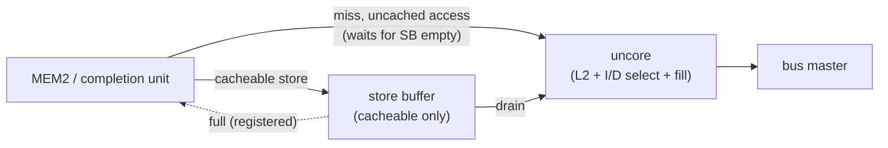

# Penumbra/3 — Memory-path performance: measurements and levers

> **Applies to:** Penumbra/3 · memory hierarchy (in design). Measured on
> the shared SDRAM stack gen3 reuses and on the gen2 L1↔L2 chain gen3
> replaces.

This records what the memory path costs, cycle by cycle, and what two
gen2.5 hardware workload profiles say about where gen3's cycles will go.
It then collects the design levers those numbers point to for the gen3
uncore. The levers are proposals ranked by evidence, not decisions, and
every estimate is labeled as one.

Every lever here must preserve the completion contract in
[`memory-completion.md`](./memory-completion.md) and the structural rules
in [`timing-outline.md`](./timing-outline.md). The phase each one lands in
is set by the [build plan](./overview.md#build-plan).

## Measurement setup

Cycle counts are CPU cycles, from Verilator runs of two scratch wrappers
around unmodified RTL (commit `a463c4a`). The SDRAM clock runs at 4× and
2× the CPU clock; gen2.5's 37.5 MHz against the 100 MHz SDRAM is 2.67×,
between the two.

| Chain | Composition | Measured |
|---|---|---|
| A — gen3 bus side | `penumbra3_bus_master` → `sdram_sim` (adapter + CDC + controller + chip model) | master request accept → completion pulse |
| B — gen2 L1↔L2 | `fill_sequencer` → `l2_cache` (`HIT_LATENCY=3`, as the gen2 machine builds it) → `sdram_sim` | line request presented → `fill_done` |

Chain B excludes the gen2 `txn_arbiter` in front of the sequencer (one
registered cycle per transaction) and the L1/core miss overhead, so a
real gen2 miss costs somewhat more than chain B shows.

## SDRAM line fill (chain A)

| Transaction | 4:1 | 2:1 |
|---|---|---|
| Line read, first (cold) | 28 — beats at 8, 11, 19, 27 | 36 — beats at 10, 15, 25, 35 |
| Line read, next line, same row | 27 — beats at 2, 10, 18, 26 | 33 — beats at 2, 12, 22, 32 |
| Line read, row conflict | 29 | 38 |
| Single-beat read | 9 | 11 |
| Line write | 10 | 13 |
| Single-beat write | 3 | 3 |
| 16 back-to-back line reads, per line | 31.9 | 40.7 |

**Words 2 and 3 each pay a full round trip.** They sit as far apart as
the cold first word, because `sdram_bus_adapter` keeps one speculative
read in flight and queues the next only when the previous one is
consumed. The fill is latency-bound: roughly 10 cycles of round trip
with one word of lookahead only covers word 1. At 2:1 a 16-byte line
takes 33–38 cycles, about a tenth of what either the 16-bit SDRAM
(200 MB/s) or the 32-bit sync bus at 37.5 MHz can carry.

The dangling speculation past the end of a line serves the *next*
line's first word in 2 cycles, so a single sequential stream benefits.
Interleaved streams do not: each fill orphans the other stream's
speculation, and the orphaned read still occupies the SDRAM.

## L1 line fill through L2 (chain B)

| Phase | 4:1 | 2:1 |
|---|---|---|
| L2 detects the miss, bus request starts | 3 | 3 |
| L2 fetches its own line from SDRAM | 28 | 37 |
| L2 re-serves the line to L1 | 14 | 14 |
| **Total, L2 miss** | **45** | **54** |
| Total, L2 hit (words at 4, 7, 10, 13) | 13 | 13 |

**The re-serve tail.** The L2 holds `busy` through its whole `S_FILL`.
After the last SDRAM word it installs the tag, latches the sequencer's
still-held word-0 request again as a fresh access, and serves it through
the hit pipeline: 5 cycles to the first L1 word, then 3 per word. At
`HIT_LATENCY=3` the stage-0 latch accepts a new read only every third
cycle, and the sequencer's registered address step allows no faster.
The data path to forward fill words live already exists (`o_rdata`
passes `i_mem_rdata` during `S_FILL`); only the busy-drop is missing.

**The front.** From an L1 miss to the first bus request gen2 spends 4
cycles, each a registered hand-off: the arbiter's request register, the
sequencer's engage cycle, the L2 stage-0 latch, and the stage-1 tag
compare.

## Store latency below the arbiter (chain B)

| Cacheable store, request → busy-drop | 4:1 | 2:1 |
|---|---|---|
| Isolated, L2 hit | 3 | 3 |
| Isolated, L2 miss | 3 | 3 |
| Burst of 8, per store | 3 2 4 2 3 2 3 2 | 3 2 6 3 4 3 4 3 |

**L2 hit or miss makes no difference.** The SDRAM adapter releases a
write as soon as its CDC accepts it, so the SDRAM leg of a store is
already posted. Of the 5 cycles a gen2.5 store costs on hardware, about
3 are this handshake below the arbiter and about 2 are the L1, arbiter
and MEM hand-offs above it. A sustained store stream drains at about 3.5
cycles per store at 2:1.

## Workload profiles (gen2.5 hardware, 37.5 MHz)

Measured 2026-09-21. Cycles equal instructions retired plus stall cycles
exactly, so each stall class converts to cycles per instruction.

### Dhrystone — store-latency bound

139.3 M cycles, 65.4 M instructions, CPI 2.13.

| Stall | cyc/insn | Behind it |
|---|---|---|
| store | 0.56 | 7.30 M stores (11 % of instructions) × 5.0 cycles |
| flush | 0.21 | branch redirects |
| load | 0.21 | 11.3 M loads × 1.19 cycles — load-*hit* cost; 129 L1-D misses |
| hazard | 0.12 | |
| funit | 0.03 | |
| ifetch | 0.0002 | 347 L1-I misses |

The whole run takes 476 line fills; at the 54-cycle chain-B miss cost
that is about 26 k cycles, 0.02 % of the run. Fill-path work does
nothing for this workload. Draining its stores in the background would
keep the write path busy about a quarter of the time, so stores here
cost latency, not throughput.

### plasma (framebuffer) — L2-miss latency bound

1111 frames at 32.9 fps, 1262.7 M cycles, 297.9 M instructions,
CPI 4.24. Each 320×240 frame is 19,200 output words; the inner loop
loads one word from each of two fields, adds them, and stores one
framebuffer word per 4 pixels.

| Per output word | Cycles | Behind it |
|---|---|---|
| instructions | 14.0 | |
| load | 32.9 | 0.5 line fills × ~60 cycles each |
| store | 4.9 | one blocking framebuffer store |
| ifetch | 3.9 | ~3–4 k I-fills per frame — unexplained, see [open measurements](#open-measurements) |
| flush + hazard + funit | 3.5 | |

**Every field line misses L2.** A frame streams 153.6 KB of field data
through the 64 KB L2, so nothing survives to the next frame, and each
fill costs the chain-B miss plus core overhead. The field data moves at
about 5 MB/s, 2.5 % of the SDRAM: the memory system is idle and the core
waits on one fill at a time.

The printed `L2 hit 58.6%` hides this. It is a combined read+write rate
in which a missed line counts as 1 read miss and 3 read hits (words 1–3
are served after the install), instruction fills add mostly-hit lookups,
and the framebuffer stores count as write misses — the framebuffer's
user mapping is cacheable, see
[framebuffer stores](#framebuffer-stores-and-the-cacheable-only-rule).
Solving for a zero field-line hit rate reproduces about 60 %.

### fork / exec / pipe — L2-hit fill bound

`doc/TODO.md` records `ifetch` at 16–20 % of cycles on these paths,
against about 0 on Dhrystone. Their larger code footprint misses L1-I
but mostly hits L2, which makes the L2-hit fill (13 cycles in chain B)
the cost to attack.

| Workload | Binding cost | Lever |
|---|---|---|
| Dhrystone | store latency | [store buffer](#store-buffer-at-the-core-boundary) |
| fork / exec / pipe | L2-hit fill | [one uncore pipeline](#one-uncore-pipeline) with a line-wide or 1-word-per-cycle L2 read |
| plasma | L2-miss fill | [whole-line SDRAM fetch](#sdram-side-whole-line-fetch), [fill-through](#one-uncore-pipeline), [stream prefetch](#next-line-prefetch-into-stream-buffers) |

## Levers for the gen3 uncore

### Store buffer at the core boundary

A small FIFO of cacheable stores between the completion unit and the
uncore. A cacheable store completes when it enters the buffer instead
of when its write-through is acknowledged; the buffer drains through the
uncore in the background.

- **Placement.** It must sit in front of the arbiter to hide the whole
  on-chip path. A buffer after L2 would hide only the SDRAM leg, which
  the adapter already posts.
- **No load search.** L1-D is updated in place at commit on a hit, so a
  load that hits L1 already sees every older store. Every access that
  goes to L2 — an I-fill, a D-fill, an uncached load — and every uncached
  store waits until the buffer has drained, so a load that misses L1
  finds L2 current. Misses are rare (476 in all of Dhrystone), so the
  drains cost almost nothing. This replaces the disambiguation search
  that made the gen2.5 store-buffer plan its most structural feature.
- **No software change.** A DMA kickoff is an uncached MMIO store, so it
  publishes every earlier cacheable store. Refetching modified code is an
  I-fill, so it drains too. Entries hold physical addresses, so MMU and
  cache-maintenance sysreg writes need no drain. Every drain is a side
  effect of an operation software already issues, and it blocks rather
  than requiring a poll.
- **Faults.** A cacheable-store bus fault is already asynchronous (a
  sticky bit) under the
  [fault-precision contract](./memory-completion.md#fault-precision),
  written with a deferring store path in mind. Uncached accesses stay
  unbuffered and precise.
- **Timing.** The core sees only registered signals: `full` joins the
  launch-side freeze, and `empty` gates reads at the uncore. No new
  combinational cone reaches issue or the MMU.
- **Depth.** Dhrystone's store bursts (struct copies of about 12 stores
  at one per 2 cycles, register saves at one per cycle) against a drain of
  about 3.5 cycles per store peak at 5–7 entries; 8 is enough.
- **Later: coalescing.** Merging same-line stores into one entry lets a
  full line drain as one write burst. That serves memset/copy-heavy code,
  not Dhrystone.

### Write-back L2: what it does and does not buy

A write-back hit completes at the L2 tag verdict, 2–3 cycles down its
pipeline — the same as the posted write-through it replaces. So on its
own it saves about 0–1 of the 5 cycles a store costs, and a write-back
L2 without a store buffer leaves Dhrystone's store stall largely in
place.

What it does add is less SDRAM write traffic. That matters only when
stores are throughput-bound: bulk fills and copies, page zeroing, or a
future DMA master competing for SDRAM bandwidth. Against that it costs
dirty bits, eviction-then-fill sequencing and flush operations, fmax
risk in the L2 miss path, and kernel-visible work: flush before a DMA
read and invalidate before a DMA write, including per-line operations
(`INVAL_LINE` is reserved but not implemented). Write-allocate is weaker
still for streaming writes, since it reads each line before overwriting
it. It stays a measure-driven option behind the store buffer.

### One uncore pipeline

gen2 registers every module boundary — arbiter, fill sequencer, L2 —
because each register cut a cone that crossed modules. The sum is one
register per *hand-off* rather than one per *pipeline stage*. gen3's
completion unit already parks a miss in a register before it leaves the
core, so the I/D choice can be a shallow select of two registered valid
bits feeding the L2's stage-0 flops. That allows folding the arbiter and
the fill sequencer into `penumbra3_l2`, with three registered edges:
requests in, the tag verdict, and the outputs (fill stream and bus
request).

| Overlap | Possible | Saves |
|---|---|---|
| I/D selection on the same edge as the L2's stage-0 latch | yes | 1–2 cycles on every transaction, including uncached accesses and blocking stores |
| The L2's miss register doubling as the bus master's request register (gen2's L2 already drives the bus from its `fill_*` registers; the separate `penumbra3_bus_master` adds a registered accept) | yes | 1 cycle per miss |
| Fill-through: bus words written into L2 and streamed to L1 at once | yes | ~12 of the 14-cycle re-serve tail |
| L2 walks a hit line itself at 1 word per cycle, or reads it line-wide | yes | L2-hit fill ~14 → ~7, ~4 line-wide |
| Starting the bus read in parallel with the tag lookup | no — the bus contract holds `re` until the busy-drop, so a read cannot be abandoned; every L2 hit would cost an SDRAM read and orphan the adapter's speculation | 1–2 cycles per miss |
| Requesting the *external* bus during the lookup and withdrawing on a hit (once DMA masters exist) | yes — hidden arbitration, as in PCI and VME: a bus request can be withdrawn, a bus cycle cannot | hides grant latency |

Estimated from the chain-B numbers with the SDRAM side unchanged: an
L2-miss fill of about 46–55 cycles becomes about 33–42.

"One pipeline" does not require one file. The select, the tag/data
store, the line walk and the bus master can stay separate submodules;
what changes is that their boundaries stop each adding a registered
hand-off, while the pipeline's inputs and outputs stay registered.

Fills are atomic — the core resumes only when the whole line is in L1
(no critical-word-first) — so only the arrival of the *last* word
matters. Streaming words to L1 as they arrive buys nothing over handing
the whole line up at the end; the gain comes from deleting the serial
re-read, and needs no per-word valid bits.

### SDRAM side: whole-line fetch

The adapter can fetch the whole aligned 16-byte line on a read — one
BL=8 burst, or four pipelined BL=2 reads with enough CDC depth to keep
them streaming — instead of guessing one word ahead. RAM reads have no
side effects and the bus contract lets a slave infer sequential access,
so this stays inside the word-at-a-time bus. It also stops interleaved
streams from orphaning each other's speculation. Estimated: the SDRAM
portion of an L2-miss fill drops from 28–37 cycles to about 13–15, and
together with the uncore pipeline an L2-miss fill lands around 20–25
cycles.

This is a change to a shared device (`io/sdram`), the Level-2 line
buffer of [`sdram-optimization.md`](../sdram-optimization.md#level-2-bl8-line-buffer);
gen1 and gen2 benefit too. The same rework is the place to fix the
adapter's suspected deadlock on gapped read streams, recorded in
`doc/TODO.md`.

### Next-line prefetch into stream buffers

With the SDRAM idle 97 % of the time in plasma, prefetch is the lever
that uses the spare bandwidth without making the core non-blocking.
Naive next-line prefetch can hurt: a useless prefetch occupying the
single-outstanding path delays the next demand miss, and prefetched
lines written into the cache evict useful ones. The safe form:

- **Prefetch into small stream buffers beside the L2, never into the
  cache.** A line moves into L2 only when a demand miss finds it, so
  nothing is polluted. plasma needs two, one per field.
- **Trigger only on a confirmed stream:** a miss to line N when line N−1
  was that stream's previous miss. A demand hit in a stream buffer
  re-arms it (tagged prefetch). Random and pointer-chasing access never
  confirms.
- **Stay inside the 4 KB page**; the next physical page is unrelated.
- **Demand misses win.** An unissued prefetch is cancelled; an issued
  one delays the demand miss by at most one line fetch — about 5–7
  cycles once the SDRAM side fetches whole lines.

The same structure can live on the system-clock side of the SDRAM
adapter as a small line buffer, needing no change above the bus. It
comes after the latency fixes, which also shrink its worst case.

For scale: the 386 and 486 had no hardware data prefetch at all. Their
only spatial prefetch was the 486's burst line fill, bounded by the line
that already missed. Commodity hardware prefetchers arrived around 2000
(Pentium 4, POWER4), confidence-gated and page-bounded as above.

### Framebuffer stores and the cacheable-only rule

`bus_space_mmap()` maps device memory into user space without
`PMAP_NOCACHE`, so the display framebuffer's user mapping is cacheable.
It happens to be coherent — the CPU is the framebuffer's only writer,
and write-through with update-on-hit keeps every cached copy current —
and under the cacheable-only rule its stores would be buffered.
Correcting the mapping to uncached would make each framebuffer store
drain the buffer and block, losing plasma's store win. A framebuffer
wants uncached-but-bufferable (write-combining) semantics, which is
close to the uncacheable-but-idempotent case the reserved PTE `S` bit
is earmarked for; the two decisions belong together.

## Estimated effect at 37.5 MHz

Estimates, not measurements. They assume every stall class not named
carries over from gen2.5 unchanged, and they leave out gen3's
per-transaction registration overhead.

**Dhrystone** (15.4 DMIPS on gen2.5):

| gen3 store handling | store cyc/insn | CPI | DMIPS |
|---|---|---|---|
| Blocking write-through | ≥ 0.56 | ≥ 2.13 | ≤ 15.4 |
| + write-back L2, stores still blocking | ~0.45–0.56 | ~2.0–2.13 | ~15.4–16.4 |
| + 8-entry store buffer | ~0.03–0.08 | ~1.6–1.65 | ~20 |

**plasma** (per output word, 32.9 fps on gen2.5):

| Change | Cycles/word | Speedup |
|---|---|---|
| gen2.5 | 59 | 1.0× |
| + store buffer | ~54 | 1.1× |
| + L2-miss fill ~60 → ~30 (whole-line SDRAM fetch + fill-through) | ~39 | 1.5× |
| + two-stream prefetch | ~28–31 | ~2× |

## Design target: memory latency in CPU cycles

Streaming performance is set by how many CPU cycles a miss costs, not by
cache size. A 386DX-33 fetched a word from DRAM in about 3–5 clocks,
with its memory controller on the CPU clock and nothing in between; a
486DX-33 filled a 16-byte line in 5 clocks from its external cache,
about 10–15 from DRAM. Both had caches that plasma would overflow, and
both ran it well. Penumbra's L2-miss fill is about 60 cycles, of which
the SDRAM chip itself accounts for about 7–9; the rest is the stack of
word-at-a-time hand-offs described above.

That makes a 486-like L2-miss line in about 20 cycles the target for
gen3's uncore — reachable with the whole-line SDRAM fetch and the single
uncore pipeline, and still within the word-at-a-time bus contract.

## Open measurements

- **plasma L2 misses, raw.** Read `READ_MISSES` per frame instead of the
  combined rate; the model above predicts about 9.6 k field lines per
  frame plus a few instruction-side misses.
- **plasma `ifetch`.** 6.6 % (about 75 k cycles per frame) is far more
  than a ~10-instruction inner loop should cost. The per-frame syscalls
  (the keypress poll, `clock_gettime`) sweeping the 4 KB L1-I are a
  guess, not a finding.
- **fork / exec / pipe fill split.** The L1-I miss count and the L2
  hit/miss split for instruction fills size the uncore-pipeline win.
- **gen3 blocking-store latency.** Once the uncore exists, the Phase-1
  store cost is the baseline the store buffer is measured against;
  gen3's extra registered hand-offs may put it above gen2.5's 5 cycles.
- **Reproducible chains.** Chains A and B were scratch wrappers. Landing
  them as characterization tests, alongside `tb_l2_cache`'s
  back-to-back read-throughput test, would let these numbers be
  re-measured after each change.
