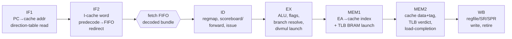

# Penumbra/3 — Overview & Build Plan

> **Applies to:** Penumbra/3 · pipelined in-order core.

Penumbra/3 is a **fresh redo of the gen2 in-order pipeline**,
re-architected to clear the timing floor that capped gen2. It is **not**
superscalar and **not** out-of-order — it is the same single-issue,
in-order, classic-RISC machine, rebuilt so that every inter-block
boundary is a registered handshake and no cross-module combinational cone
survives to become a structural ceiling.

This document is the entry point for gen3: what it is, why it exists, the
fork boundary against the shared system, the pipeline shape, the feature
set, and — most importantly — the **build plan**, whose ordering is the
direct lesson learned from how gen2 dead-ended.

Companion: [`timing-outline.md`](./timing-outline.md) is the
structural-rules research (Rule Zero and the per-subsystem design points)
this plan is built on. Read it alongside this document; this overview does
not restate its rules in full.

## Why a third generation

gen2/2.5 is [abandoned](./../penumbra2/overview.md). It reaches **37.5 MHz**
on the ULX3S ECP5 only after a closure round stripped it back, with no
headroom left for its own remaining features. The limiter is not placement
— it is the **D-side memory-hit cone**: an in-order pure-stall machine
requires the cache hit verdict to gate commit *the same cycle*, so
`D-cache tag compare → busy → stall network → commit` is one combinational
path spanning the die (~29 ns, ~34 MHz floor), and the same cone reappears
on the MMU verdict and the load-use freeze. Floorplanning cannot shorten a
cross-module combinational path.

**The gen2 mistake gen3 must not repeat.** gen2 wired those boundaries
combinationally as "register them later," built the whole machine on top,
and only discovered at closure that the cone was a *structural* floor —
unfixable without rewriting the pipeline that now depended on it. The
microarchitecture to fix it already exists (the timing outline). What gen3
adds is **discipline of sequencing**: prove the hard structural claims hold
at the target clock, on realistic context, *before* building on them. That
discipline is the [build plan](#build-plan) below.

## What gen3 is — and is not

| | |
|---|---|
| **Is** | Single-issue, in-order, 7-stage pipelined RISC. Same ISA, ABI, exception model, and bus contracts as gen1/gen2. Boots the same NetBSD binary (CPUID-discriminated). |
| **Is not** | Superscalar, out-of-order, multi-issue, or speculative beyond fetch-time branch prediction. Those stay out of scope (a hypothetical gen4's territory). |
| **Target** | A **reliable** 37.5 MHz on the −6 ULX3S ECP5: the full top closes across a seed sweep, with headroom left for the staged features. 50 MHz is not a goal; a board with faster fabric (the Artix-7 Nexys Video) runs the same RTL at whatever its full top closes at. Performance comes from cycles — memory latency first, then prediction ([feature set](#feature-set-whats-foundational-vs-staged)). |

The discrete-logic constraint does **not** apply: like gen2, gen3 is
FPGA-only (BRAM caches, wide registered datapaths). Only gen1 and the ISA
honor 74xx feasibility. What gen3 still honors is the externally-visible
ISA contracts — bus protocol, autoconfig, the device sysreg interface —
because those are ISA-level, shared by every generation.

## The four structural changes (the thesis)

From the [timing outline](./timing-outline.md); everything else is
hygiene around these:

1. **Registered load-completion back-end.** The pipeline gate moves from
   the live cache `busy` to a registered `mem_pending` flop; a miss parks
   the load in a one-entry hold buffer and completes on a registered event
   (`{data}` or `{fault}`). This deletes the gen2 floor cone — both the
   load-use freeze and the MMU-verdict path, which are the same cone.
   Faults stay precise by the in-order single-outstanding invariant.
2. **Registered decode→issue boundary.** The fetch FIFO presents a
   *pre-decoded control bundle*, not a raw word — the heavy word→bundle
   decode runs at FIFO enqueue (fetch-domain slack), so ID's cone starts
   from registered fields. The hazard/forward compare then runs on
   already-registered register numbers (the shape every surveyed core uses;
   never a 25 ns path). Regmap stays in ID on live supervisor mode.
3. **CPU↔bus transaction decouple (Amiga model).** A registered
   line-transaction request out, streamed response back through a fill
   buffer; the cache hides bus latency and the CPU clock is independent of
   bus speed. Memory stays a first-class autoconfig bus device — the async
   4-phase protocol is preserved *for peripherals*.
4. **Split MEM1/MEM2 + duplicated BRAM TLB + L2 burst fill.** Pipelines
   loads (kills gen2's ~0.35 CPI per-op bubble), gives the sync BRAM TLB
   the cycle it needs (launch in MEM1, verdict in MEM2), and makes L2 fills
   cost per-line not per-word — all interlocking.

## Pipeline shape

7 stages; pre-decode folds into the fetch-FIFO enqueue (no extra stage).

| Property | gen3 |
|---|---|
| Stages | 7 (IF1, IF2, ID, EX, MEM1, MEM2, WB) + elastic fetch FIFO |
| Hazards | Full operand forwarding (EX→EX, MEM2→EX, WB→EX) + NZCV flag forwarding; scoreboard interlock for the residual cases |
| Branches | Resolve in EX; IF2 pre-decode redirects with a bimodal table and a return-stack ring → 1 bubble on a correct taken prediction; mispredict = registered flush ([branch prediction](./branch-prediction.md)) |
| Load-use | 2 cycles: a load forwards from the MEM2/WB register, never from MEM2's cache read ([memory completion](./memory-completion.md#load-hit--a-registered-load-use-hazard)) |
| Loads | Single-outstanding, hold-and-complete (no per-op MEM bubble) |
| divmul | Side FU (reused `common/divmul.sv`), registered completion, dual-write sequenced over two WB cycles |
| Serializing ops (WRSYS/ERET) | Serialize + registered flush/redirect at commit; default serialize *every* WRSYS |

## Fork boundary

gen3 is a full `CORE=penumbra3` generation (like gen2 forked from gen1),
**not** a `penumbra2_5`-style composition sub-variant. It gets its own core
*and its own on-chip memory hierarchy*, because registering every
inter-block boundary is the whole thesis — and those boundaries are exactly
the L1/MMU/arbiter/fill/L2 modules gen2 *shared*. gen1 and gen2 stay
byte-frozen and re-synthesizable; gen3 only adds files.

The fork is **deeper than gen2's**: gen2 forked only the pipeline + L1 and
shared L2/MMU storage; gen3 forks the entire machine guts down to the
registered bus master. The seam is the **machine layer** — `machine_penumbra3`
keeps `machine_penumbra2`'s external port list byte-identical (a generic
master bus + IRQ + trace + program-end), so the board top is a near-verbatim
copy and the board never learns gen3 exists.

| Disposition | Modules |
|---|---|
| **Reuse as-is (generation-neutral leaf)** | `common/penumbra_pkg.sv` (ISA/system contract), `common/divmul.sv` (MUL/DIV peer FU), `common/cond_eval.sv`, `common/byte_ext.sv`, `common/byte_rep.sv`. `common/tlb_pinned.sv` = reuse-candidate, revisit under the MMU rewrite. |
| **Reuse as-is (bus devices + board)** | `soc/`: `boot_rom`, `busctl`, `cpuid`, `machid`, `timer`, `autoconfig_dev`, `bus_devsel`, `cache_perfctr`. All of `io/` (UART, SPI, **SDRAM controller stack**, video). The `fpga/ulx3s` PLL + shell. |
| **Fork & rewrite → `penumbra3/` (pipeline)** | core, spine, IF1/IF2/fetch_buffer/ID/EX/MEM1/MEM2/WB, decode, regmap, alu, regfile, scoreboard, flag_bypass, spr_file, scratch_file, irq, vecfetch, perfctr, pkg |
| **Fork & rewrite → `penumbra3/` (memory hierarchy — the boundaries Rule Zero registers)** | MMU + TLB storage (duplicated BRAM I/D, MEM1-launch/MEM2-verdict), L1 (write-through, hit→registered-replay), arbiter + CPU↔bus decouple (registered line-transaction), fill sequencer (burst), L2 (`soc/l2_cache.sv` → `penumbra3_l2.sv`; **write-through; write-back/write-allocate a measure-driven option — outside the core cones**) |
| **New thin wrappers** | `machine/machine_penumbra3.sv` (port list identical to gen2), `fpga/ulx3s/ulx3s_penumbra3_top.sv` and `fpga/nexysvideo/nexysvideo_penumbra3_top.sv` (copies of the gen2 tops, the machine instance swapped) |

**Known sharp edge.** Registering the L2↔bus boundary in gen2 tripped a
suspected **SDRAM-adapter deadlock on gapped reads** (`test_l2_ifetch`
hung). gen3's registered burst fill is the centerpiece, so it must issue
clean back-to-back bursts the existing `sdram_bus_adapter` tolerates, or
that adapter takes a (shared) fix. This is the one place "reuse `io/`
as-is" carries a real risk — and it is a Phase-0 probe.

## Feature set: what's foundational vs staged

**Foundational — designed in from the start.** Forwarding and branch
prediction are *not* additive: the gen2 post-mortem is explicit that
forwarding + branch prediction reshape the EX/MEM/stall/commit region,
which is exactly the floor. Designing that region without them means
optimizing a tail that gets rewritten. So the Phase-1 skeleton already
carries full operand forwarding, flag forwarding, and the registered
load-completion back-end; branch prediction lands right behind it: the
IF2 pre-decode redirect, a 1K bimodal table and a return-stack ring,
with a target buffer as the IF2 redirect's timing requires
([measured](./branch-prediction.md)).

**Shapes — built into the memory hierarchy as it is written.** The
largest measured costs are TLB refills and L1 fills
([memory-performance](./memory-performance.md)), and what removes them
is the shape of storage the L1, L2 and TLB fix when they are written.
Changing a shape later means rewriting the module, so these land with
the Phase-1 memory hierarchy:

- **The line-wide L2→L1 transfer with fill-through, in one uncore
  pipeline.** One L2 access returns the whole line and L1 installs it
  in a cycle; on an L2 miss, L1 takes the line the bus delivered. An
  L2-hit fill drops from 16 cycles to ~5 and an L2-miss fill from 37
  to ~24 ([the line-wide
  transfer](./memory-performance.md#the-line-wide-transfer)). The L2's
  first stage accepts a lookup every cycle, which the L1-I prediction
  buffer below depends on, and it serves a hit while its bus port
  carries a posted write-through, which the store buffer's drains
  depend on
  ([store buffer](./memory-performance.md#store-buffer-at-the-core-boundary)).
- **The main TLB at 256×2.** It removes 92–98 % of refills, the
  largest single cost measured, and costs no block RAM over 32×2
  ([TLB sets](./memory-performance.md#tlb-sets-and-a-cheaper-refill)).
  It needs `MMU_CONFIG` version 2 with invalidation done in the MMU
  ([timing outline](./timing-outline.md#5-mmu--tlb)); without it, the
  kernel's invalidation sweep grows with the TLB.
- **The L1 at 8 KB 2-way on the ECP5,** which the line-wide array
  shape gives for the block RAM of 4 KB; an Artix-7 board takes
  16 KB ([targets](#performance-targets)).
- **Read/write exclusivity written into every array,** so no BRAM
  output carries a synthesized bypass.

**Staged — additive, outside the core cones,** in the order the
[measured benefits](#levers-ranked-by-measured-benefit) rank them.
None reshapes the core's critical cones, so each follows the booting
skeleton:

1. **Store buffer** — the store-traffic strategy below.
2. **Next-line prediction buffer for L1-I** — most of what a 16 KB
   4-way L1-I would save on the kernel paths, with no change to the
   hit logic
   ([prediction buffer](./memory-performance.md#next-line-prediction-buffer-for-l1-i)).
3. **Stream prefetch beside the L2,** for data streaming through it —
   Doom, the streaming demos and bulk copies
   ([stream buffers](./memory-performance.md#next-line-prefetch-into-stream-buffers)).
4. **A 128 KB L2,** where block RAM allows.
5. **Selective `WRSYS` serialization:** a 256×2 TLB leaves too few
   refills for it to pay much
   ([timing outline](./timing-outline.md#multi-cycle-and-serializing-instructions-divmul-wrsys-eret)).
6. **Write combining in the SDRAM adapter** — whole lines drained as
   one burst, inside the bus contract
   ([write combining](./memory-performance.md#sdram-side-write-combining)).
7. **Write-back L2,** only if stores prove throughput-bound.
8. **A native port for on-board RAM** — stretch.

The store buffer needs no reserved seam in the core's cones: it sits
between the L1-D and the uncore and reaches the core only through a
registered `full`.

### Store-traffic strategy — store buffer first, write-back L2 only if it earns it

Store performance has two distinct costs:

- **Write latency** — how long the pipe waits on each store. In an
  in-order machine a store produces no register result, so only a
  blocking store path or a full buffer makes the core wait.
- **Write throughput** — the sustained rate the memory side absorbs
  stores. It binds only when stores arrive faster than they drain.

Measured on gen2.5 hardware, the binding cost is latency. Dhrystone
spends 26 % of its cycles waiting on stores (5 cycles each), while
draining the same stores in the background would keep the write path
busy about a quarter of the time. Below the arbiter a store takes 3
cycles whether it hits L2 or not: the SDRAM adapter releases a write as
soon as its CDC accepts it, so the SDRAM leg is already posted. The
measurements and the analysis are in
[`memory-performance.md`](./memory-performance.md).

That sets the order:

- **Phase-1 store-completion model: blocking write-through, WnA.** A store
  writes through L1-D to L2 and the core waits for the ack. Correct and
  simple; slow-but-correct, and because the cost is a *stall* (CPI), not a
  combinational path (fmax), it is safe to leave until the store buffer.
  A later load misses WnA L1-D and fills from L2, which already holds the
  completed store.
- **A store buffer is the primary store-traffic fix.** Cacheable stores
  retire into a small FIFO between the L1-D and the uncore and drain
  in the background. It needs no load disambiguation: L1-D is
  updated in place at commit on a hit, so only a fill searches the
  buffer, waiting for the entries up to the youngest holding its line,
  and every uncached access waits for the buffer to drain. L2 posts its
  write-through, so a fill L2 serves never waits for the bus. Waiting
  for every entry before every fill instead would cost 3–8 cycles per
  1000 instructions at CPI 2 and 14–31 at CPI 1
  ([measured](./memory-performance.md#line-or-word-entries)).
  It meets the core only through registered signals
  (`full` into the freeze), so it lives outside the core timing cones and
  is *safe to defer* (see the [deferral principle](#build-plan)). Its
  sixteen entries are words, one store each, drained as single-beat
  writes. Line entries, which merge a line's stores and drain them as
  one burst, wait about 4 cycles per 1000 instructions less at CPI 2,
  and need a merge, a bus burst over a run of words and line-wide
  writes into L2 to do it
  ([line or word entries](./memory-performance.md#line-or-word-entries)).
- **Write-back L2 is a measure-driven option, not a plan item.** A
  write-back hit completes at the L2 tag verdict, about as late as the
  posted write-through it replaces, so it does little for store latency.
  It reduces SDRAM write traffic, which matters only if stores prove
  throughput-bound, and it adds dirty/eviction logic in the L2 miss path
  plus kernel flush/invalidate work around other hardware's memory
  accesses.
- **L1-D write-allocate stays off the table for now.** Its allocation logic
  is complex and sits in the most critical timing cones, so it is a real
  fmax risk; investigate only once the basic design closes. Keep WT-WnA.

Whatever store path lands, the ordering contract is unchanged and rides
existing ops: an uncached store, to a device or any other memory with side
effects, is ordered after every earlier store (the store buffer drains ahead
of it), so no new ISA barrier is introduced. Sysreg writes stay outside that
ordering, so a sysreg-driven copy engine would need an explicit drain.

## Levers ranked by measured benefit

The ECP5 cannot take every lever. It is routing-bound far below its LUT
count, its 208 block RAMs are shared with the peripherals (gen2.5's
full top uses 142), and every block added is a timing cost somewhere on
the full top. So the levers are ranked by what they save, measured on
the same three workloads, beside what each costs the ECP5.

Cycles saved per 1000 instructions on the shell loop / `pbench kernel`
/ Doom `demo3`. The counts come from the ISS's shadow models at gen3's
geometries
([fills and refills](./memory-performance.md#fills-and-refills-at-gen3s-geometries),
[store buffer](./memory-performance.md#line-or-word-entries));
the costs they are priced at are listed below the table. The levers
overlap, so they do not add.

| Lever | Saves | ECP5 cost | When |
|---|---|---|---|
| Main TLB 32×2 → 256×2 | 810–1000 / 570–700 / 350–440 | no block RAM; invalidation in the MMU; `MMU_CONFIG` version 2 | shape |
| Line-wide L2→L1 transfer, fill-through, one uncore pipeline | ~750 / ~700 / ~230 | block RAM as word-wide; a 128-bit fill path in place of the word walk | shape |
| Store buffer: word entries, line search, L2 posting | ~340 / ~510 / ~355 | ~1.1 kbit of entries, 16 line compares; outside the core cones | staged 1; posting is an L2 shape |
| Branch prediction: IF2 pre-decode, 1K bimodal table, 4–8-deep return ring | ~205 / ~205 / ~200 | a block RAM for the table, a ring of return addresses, the IF2 redirect into the next PC | Phase 2 |
| L1 4 KB → 8 KB 2-way | ~140 / ~110 / ~40 | none in the line-wide shape | shape |
| L1 8 KB → 16 KB 4-way | ~135 / ~155 / ~30 | ~10 more block RAMs; two more tag compares in IF2 | Artix-7; not built |
| Next-line prediction buffer, L1-I | ~100 / ~105 / ~10 | a line register, a tag compare, a second L2 look-up per fill | staged 2; not built |
| Stream prefetch beside L2 | ~55 / ~31 / ~63 | two line buffers and stream detection; a third request into the bus master | staged 3; built |
| L2 64 KB → 128 KB | ~131 / ~53 / ~38 | ~35 more block RAMs | staged 4; not built |
| L2 64 KB → 256 KB | ~185 / ~95 / ~151 | ~52 more block RAM tiles on an Artix-7; beyond the ECP5 | Artix-7; built on the Nexys Video |
| Selective `WRSYS`, behind a 256×2 TLB | ~15 / ~10 / ~2 | a serialize bit on the MMU's responses | staged 5; not built |
| Write combining, L2 posting | ~6 / ~4 / ~7 | a line buffer in the SDRAM adapter and a wider CDC, where placement is tight | staged 6; not built |
| Native port for on-board RAM | ~3 | a second memory port and stack front end | stretch; not built |
| Merging from the store buffer | under 0.5 | an entry read and byte merge on the fill path | ruled out |

- **Fills** are priced at gen2.5's measured 16 cycles from L2 and 37
  from memory against the line-wide transfer's estimated ~5 and ~24;
  L1 sizes at the line-wide costs, over the 8 KB L1 where it matters.
  L2 sizes and stream prefetch are counted at gen3's geometry and
  priced at gen3's measured 4.0 and 24.1
  ([L2 size and stream buffers](./memory-performance.md#l2-size-and-stream-buffers-at-gen3s-geometry)).
- **Refills** at the 137–170 cycles gen2.5's handler takes, its own
  fills included. On Doom the as-built shadow undercounts refills, so
  its larger layouts may read optimistic.
- **The store buffer** against a blocking store at gen2.5's 5 cycles,
  less the model's waits at 1 cycle an instruction — an upper bound on
  the waits, so the saving is a floor.
- **The prediction buffer** at ~3 cycles a served miss; unused
  look-ups can take back up to ~30 on the kernel paths.
- **Stream prefetch** at ~10 cycles for each memory fill the cache
  model's two stream buffers serve behind a 64 KB L2, the low end of
  the 10–20 a timely prefetch saves, which Doom's measured gain bears
  out ([next-line prefetch](./memory-performance.md#next-line-prefetch-into-stream-buffers)).
  Behind a larger L2 they serve fewer of Doom's.
- **Selective `WRSYS`** at the ~38 cycles of serialization in each
  refill a 256×2 TLB still takes.
- **Branch prediction** against resolving every transfer in EX, with
  fetch and IF2 redirects at 1 cycle and EX at 4
  ([branch prediction](./branch-prediction.md)). A registered IF2
  redirect would cost it ~60–70 of that unless a target buffer takes
  the direct transfers.

What that means for the ECP5:

1. **The three shapes lead and cost almost no block RAM:** the 256×2
   TLB, the line-wide transfer with fill-through and posting, and the
   8 KB L1. They come with the Phase-1 memory hierarchy.
2. **The store buffer is the largest staged lever.**
3. **Branch prediction is cheap for what it recovers:** a 1K bimodal
   table and a plain 4–8-deep ring behind the IF2 pre-decode; gshare,
   bigger tables and deeper rings buy nothing. The IF2 redirect closes
   in its cycle (P0.5), so direct transfers need no target buffer.
4. **Everything else saves about 150 per 1000 or less,** and the
   workloads disagree on the order: the prediction buffer serves the
   kernel paths, stream prefetch serves Doom's data, and a 128 KB L2
   costs a sixth of the block RAM. A 16 KB L1 and a 256 KB L2 are
   Artix-7 levers; the Nexys Video builds the L2
   ([measured](./memory-performance.md#l2-size-and-stream-buffers-at-gen3s-geometry)).
5. **Take the levers in order, reading a full-top seed sweep after
   each,** and stop adding when the sweep stops closing 37.5 MHz with
   margin. gen3 stopped after stream prefetch; what it left is in
   [not built](./not-built.md).

## Performance targets

The targets the design was built to, and what the built machine
reached.

| Metric | gen3 target | Reference | Built |
|---|---|---|---|
| Fmax | ULX3S: reliable 37.5 MHz across a seed sweep, with headroom for the staged features; Artix-7: whatever the full top closes at | gen2 topped at barely-37.5 | ULX3S: 37.5 MHz on most seeds of a full-top sweep, not all ([sweep](#where-the-build-stopped)); Nexys Video: 80 MHz ([Ruled out](../../TODO/hw-nexysvideo.md#ruled-out)) |
| CPI, cache-hot tight loop | ~1.1–1.3 (forwarding from day one) | gen2 ~2.5–3.0 unforwarded | met on Dhrystone; above it on CoreMark, whose multiplies stall it most ([final builds](./memory-performance.md#the-final-builds-on-hardware)) |
| CMP+Bcc heavy | ~1.0–1.1 (flags forwarded, branch prediction) | — | not measured |
| L1 size | per board: ECP5 8 KB 2-way (gen2's hit logic); Artix-7 16 KB, with 4 ways on the fetch side if MEM2 cannot take them ([geometry data](./memory-performance.md#l1-geometry)) | gen2 4 KB (then 2-way) | 8 KB 2-way on both boards ([Ruled out](../../TODO/hw-nexysvideo.md#ruled-out)) |
| Main TLB | 256×2 in BRAM ([refill data](./memory-performance.md#tlb-sets-and-a-cheaper-refill)) | gen2 32×2 | as targeted |
| L2-hit fill | ~5 cycles ([line-wide transfer](./memory-performance.md#the-line-wide-transfer)) | gen2.5 16 | met ([transfer rates](./memory-performance.md#transfer-rates-by-block-size-on-hardware)) |
| L2-miss fill | ~20–25 cycles ([design target](./memory-performance.md#design-target-memory-latency-in-cpu-cycles)) | gen2.5 38 with the line stack | met on the ULX3S; more cycles on the Nexys Video, its DDR3 slower in nanoseconds ([transfer rates](./memory-performance.md#transfer-rates-by-block-size-on-hardware)) |
| Load-use stall | 1 (forwarded) | gen2 4 | 2: the load completes through a register ([memory completion](./memory-completion.md#load-hit--a-registered-load-use-hazard)) |
| Taken-branch bubbles | 1 predicted at IF2 / 4 mispredicted | gen2 3; gen2.5 1 predicted | met ([instruction timing](../../system/instruction-timing.md#control-transfers)) |

## Build plan

The ordering is the point. Each phase's structural prerequisite was proven
in Phase 0; nothing is built on an unproven cone. fmax is always read on
the **full top**, never on a bare-core probe (a bare cone over-reports — the
project has measured ~55 vs ~31 MHz between the two).

**The deferral principle.** The anti-dead-end rule applies to *timing cones*
— combinational boundaries that set fmax. Those are proven in Phase 0 and
never deferred. It does **not** apply to *cycle-count* perf that lives
outside the core cones (store throughput, L2 policy): that is always safe to
defer, because improving it later never forces a core rewrite. gen2's fatal
error was conflating the two — it deferred a *structural boundary* as if it
were a perf knob. gen3 keeps them separate: defer freely outside the cones,
never inside them.

### Phase 0 — structural feasibility probes (the gate)

Prove the four load-bearing claims close with margin on a bare cone, each
wired with realistic fanout on both sides of the boundary (not bare cells).
Full per-probe specs — RTL to build, exact path to measure, pass threshold,
decision-on-fail — are in [`phase0-probes.md`](./phase0-probes.md).

The bars are 50 MHz ones, a margin heuristic rather than a gate: they
keep a cone from being marginal at 37.5 MHz before the rest of the
machine shares the die, given the probe-to-full drop gen2 measured
(~55 vs ~31 MHz). A probe short of them is read as slack at 37.5 MHz;
the Phase-1 full-top read calibrates the drop for gen3.

| Probe | What it proves |
|---|---|
| P0.1 registered load-completion | `MEM2 hit/miss → registered mem_pending → issue/scoreboard gate` is short; the gen2 busy→issue and busy→MMU floor cones are gone |
| P0.2 registered decode→issue | `pre-decoded FIFO slot → regmap → scoreboard/forward compare → issue` starts from flops and fits |
| P0.3 split MEM + BRAM TLB | MEM1-launch / MEM2-verdict absorbs the 5.8 ns BRAM Tco + tag/permission compare in the period |
| P0.4 CPU↔bus burst + SDRAM survival | registered line-transaction into the **real `sdram_bus_adapter`** streams without the gapped-read deadlock |
| P0.5 physical-tag compare *(added after exit)* | the L1's tag compare at the board's associativity, chained behind the BRAM TLB verdict, closes in MEM2 and IF2 with 13–19 % slack at 37.5 MHz |

**Gate rule (the anti-dead-end rule).** If a probe is structurally short of
its bar, decide *at that probe* — redesign the boundary, add a stage, or
take the structure down (fewer ways, a smaller array). Never "wire it up
and fix later." A path that only closes on 1-of-N seeds is not a close.

### Phase 1 — correctness skeleton (boots conformance)

Full 7-stage pipeline using the proven boundaries: registered
load-completion, decode-on-enqueue, full operand + flag forwarding,
single-outstanding hold-buffer loads, static-not-taken branches resolved in
EX (no prediction yet), and the memory hierarchy in its
[shapes](#feature-set-whats-foundational-vs-staged): write-through L1 +
**write-through L2** in one uncore pipeline with the line-wide transfer
and fill-through, the 256×2 TLB, and the registered bus. **Store path:
blocking write-through, WnA** — no buffer, no disambiguation;
slow-but-correct, and a stall (CPI) outside the core cones, so safe to
leave for the Phase-4 store buffer. divmul reused from `common/`.
**Exit:** `isa/` conformance passes on the gen3 RTL runner.

### Phase 2 — branch prediction

The IF2 pre-decode redirect of direct transfers, a 1K bimodal table read
beside IF1, and a 4–8-deep return-stack ring, with a target buffer as
the IF2 redirect's timing requires
([branch prediction](./branch-prediction.md#design)). Re-run conformance
+ gen3 microarch regressions; re-read full-top fmax.

### Phase 3 — NetBSD boot

Boot the kernel (same binary, CPUID-discriminated). Core is
feature-complete (forwarding + branch prediction) and
correctness-validated against a real OS before perf work begins.

### Phase 4 — store buffer (store-traffic perf)

The primary store-traffic optimization: a cacheable-only store buffer
between the L1-D and the uncore
([design](./memory-performance.md#store-buffer-at-the-core-boundary)),
its entries a word wide, one store each. It meets the core only through
registered signals, so it lands here, late, with no risk to the core
fmax proven in Phase 0. Write-back / write-allocate L2 follows *only* if
profiling after this shows stores throughput-bound. L1-D write-allocate
is investigated here at the earliest, and only if it can be shown not to
lengthen the critical cone.

### Phase 5 — floorplan + clock

The **one-time** floorplan pass — once, after all features land, never
per-feature. It turns structural headroom into a 37.5 MHz close across
the seed sweep, not into a higher clock.

### Where the build stopped

Phases 0 to 4 are built. The machine landed in `0d7e47c` and its board
tops in `94682ef` and `09e8433`; branch prediction in `e52f1d1`,
`82df95c` and `b97050e`, the IF2 pre-decode, the direction table
trained from EX and the return stack; and the store buffer in
`dd116d6` and the commit after it, which retires cacheable stores into
it. Of the staged levers, stream prefetch beside the L2 landed in
`96b778f`, and the bus master holds its strobe across a run of posted
stores since `0cb08b8`. On the Nexys Video the top runs at 80 MHz
(`0841a60`) with a 256 KB L2 (`d92e4de`). Phase 5 is not done: the
full top closes on most seeds without a floorplan, and the RTL is
settled. What was analysed and left is in [not built](./not-built.md).

The last full-top sweep is of the ULX3S top at `0cb08b8`, with the
line SDRAM stack and no floorplan, the placement choices taken over
from gen2. 7 of 10 seeds close every domain, and on the other three
only the CPU clock falls short, at 36.68 to 37.25 MHz. Its median is
38.40 MHz, the USB clock's 60 MHz closes on all ten, and the pinned
seed, 8, closes at 38.30 MHz. The sweep before it, which differed only
by the held strobe, closed 5 of 10 at a median of 37.75: nothing points
to the strobe costing timing.

In that sweep before, the CPU clock was the worst domain on 9 seeds,
and the USB clock's 60 MHz on the tenth (`doc/TODO/hw-core.md`,
"Hardware: the USB receive path is a placement lottery"). The CPU
clock's critical path was the fetch side's on 6: the L1-I's data into
the predictor (3) or the fetch buffer (1), or the I-TLB's word through
the TLB match into IF1's PC (1) or the predictor (1). On 4 it was the D
side's: the D-TLB's word through the TLB match into the L1-D's busy,
request or held flag (3), or on through the L1-D's data into MEM2's
writeback payload (1). The stream buffers, ID's scoreboard and EX's
forwarding loop were the worst path on none. The sweep before that,
which differed only by the USB host's line capture, had a median of
38.63 MHz and closed every domain on all ten: removing the capture
bought neither clock any margin.

## Reading guide

1. **This document** — overview + build plan (you are here).
2. [`timing-outline.md`](./timing-outline.md) — the structural
   rules (Rule Zero, per-subsystem design points) this plan rests on.
3. Per-area gen3 specs:
   - [`mem-stage.md`](./mem-stage.md) — the MEM1/MEM2 memory stage and the
     duplicated BRAM TLB.
   - [`memory-completion.md`](./memory-completion.md) — the registered
     back-end stall and the load/store completion + fault-precision contract.
   - [`l1-cache.md`](./l1-cache.md) — the two L1s as their clients see
     them: lookups, stores, and the accesses each L1 carries past it.
   - [`uncore-port.md`](./uncore-port.md) — the port between the core and
     the uncore: the L1s' three transactions, the store side, handshake
     and faults.
   - [`uncore.md`](./uncore.md) — the uncore behind that port: the L2's
     geometry and pipeline, the store buffer, the bus transaction, and
     the L2's cache device.
   - [`machine.md`](./machine.md) — how the core, MMU, L1s, uncore and
     sysreg devices compose into the machine, and the program-end pulse.
   - [`memory-performance.md`](./memory-performance.md) — measured
     memory-path costs, gen2.5 workload profiles, and the uncore levers
     they point to (store buffer, one uncore pipeline, whole-line SDRAM
     fetch, stream prefetch, next-line prediction for L1-I).
   - [`branch-prediction.md`](./branch-prediction.md) — each prediction
     component measured on real workloads, and the front-end design it
     points to.
4. [`not-built.md`](./not-built.md) — what gen3 analysed and left, with
   the evidence each has, for a later generation.

For the system the gen3 core attaches to but does not change — ISA, ABI,
exception model, bus protocol, autoconfig, peripherals — the
[documentation index](../../README.md) (system reference + shared
internals) remains the source of truth.
