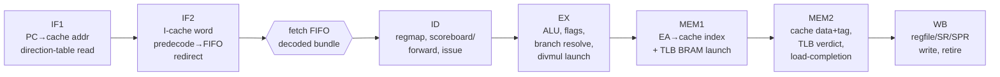

# Penumbra/3 — Overview

> **Applies to:** Penumbra/3 · pipelined in-order core.

Penumbra/3 is a **fresh redo of the gen2 in-order pipeline**,
re-architected to clear the timing floor that capped gen2. It is **not**
superscalar and **not** out-of-order — it is the same single-issue,
in-order, classic-RISC machine, rebuilt so that every inter-block
boundary is a registered handshake and no cross-module combinational cone
survives to become a structural ceiling. It is the default core.

This document is the entry point for gen3: why it exists, what it is,
the structural changes it rests on, the pipeline shape, the fork
boundary against the shared system, what it builds, the levers it took
and left, what it reached, and the order it was built in.

Companion: [`timing-outline.md`](./timing-outline.md) is the
structural-rules research (Rule Zero and the per-subsystem design points)
the design follows. This overview does not restate its rules in full.

## Why a third generation

gen2/2.5 is [abandoned](./../penumbra2/overview.md). It reaches **37.5 MHz**
on the ULX3S ECP5 only after a closure round stripped it back, with no
headroom left for its own remaining features. The limiter is not placement
— it is the **D-side memory-hit cone**: an in-order pure-stall machine
requires the cache hit verdict to gate commit *the same cycle*, so
`D-cache tag compare → busy → stall network → commit` is one combinational
path spanning the die (~29 ns, ~34 MHz floor), and the same cone reappears
on the MMU verdict and the load-use freeze. Floorplanning cannot shorten a
cross-module combinational path.

**What gen3 does differently.** gen2 wired those boundaries
combinationally as "register them later," built the whole machine on
top, and only discovered at closure that the cone was a *structural*
floor — unfixable without rewriting the pipeline that depended on it.
gen3 registers every one of them, and it proved each load-bearing
boundary closes at the target clock, on realistic context, before
anything was built on it ([how it was built](#how-it-was-built)).

## What gen3 is — and is not

| | |
|---|---|
| **Is** | Single-issue, in-order, 7-stage pipelined RISC. Same ISA, ABI, exception model, and bus contracts as gen1/gen2. Boots the same NetBSD binary (CPUID-discriminated). |
| **Is not** | Superscalar, out-of-order, multi-issue, or speculative beyond fetch-time branch prediction. Issuing two instructions a cycle is [Penumbra/4](../penumbra4/overview.md)'s territory. |
| **Clock** | Designed to a **reliable** 37.5 MHz on the −6 ULX3S ECP5: the full top closing across a seed sweep, with headroom left for the levers outside the core. 50 MHz is not a goal; a board with faster fabric runs the same RTL at whatever its full top closes at, 80 MHz on the Artix-7 Nexys Video. Performance comes from cycles — memory latency first, then prediction ([what it builds](#what-it-builds)). |

The discrete-logic constraint does **not** apply: like gen2, gen3 is
FPGA-only (BRAM caches, wide registered datapaths). Only gen1 and the ISA
honor 74xx feasibility. What gen3 still honors is the externally-visible
ISA contracts — bus protocol, autoconfig, the device sysreg interface —
because those are ISA-level, shared by every generation.

## The four structural changes

From the [timing outline](./timing-outline.md); everything else is
hygiene around these:

1. **Registered load-completion back-end.** The pipeline gate moves from
   the live cache `busy` to a registered `mem_pending` flop; a miss parks
   the load in a one-entry hold buffer and completes on a registered event
   (`{data}` or `{fault}`). This deletes the gen2 floor cone — both the
   load-use freeze and the MMU-verdict path, which are the same cone.
   Faults stay precise by the in-order single-outstanding invariant.
2. **Registered decode→issue boundary.** The fetch FIFO presents a
   *pre-decoded control bundle*, not a raw word — the heavy word→bundle
   decode runs at FIFO enqueue (fetch-domain slack), so ID's cone starts
   from registered fields. The hazard/forward compare then runs on
   already-registered register numbers (the shape every surveyed core uses;
   never a 25 ns path). Regmap stays in ID on live supervisor mode.
3. **CPU↔bus transaction decouple (Amiga model).** A registered
   line-transaction request out, streamed response back through a fill
   buffer; the cache hides bus latency and the CPU clock is independent of
   bus speed. Memory stays a first-class autoconfig bus device — the async
   4-phase protocol is preserved *for peripherals*.
4. **Split MEM1/MEM2 + duplicated BRAM TLB + L2 burst fill.** Pipelines
   loads (kills gen2's ~0.35 CPI per-op bubble), gives the sync BRAM TLB
   the cycle it needs (launch in MEM1, verdict in MEM2), and makes L2 fills
   cost per-line not per-word — all interlocking.

## Pipeline shape

7 stages; pre-decode folds into the fetch-FIFO enqueue (no extra stage).

| Property | gen3 |
|---|---|
| Stages | 7 (IF1, IF2, ID, EX, MEM1, MEM2, WB) + elastic fetch FIFO |
| Hazards | Full operand forwarding (EX→EX, MEM2→EX, WB→EX) + NZCV flag forwarding; scoreboard interlock for the residual cases |
| Branches | Resolve in EX; the IF2 pre-decode redirects with a 1K bimodal table and an 8-deep return-stack ring → 1 bubble on a correct taken prediction, 4 on a mispredict redirected from EX ([branch prediction](./branch-prediction.md)) |
| Load-use | 2 cycles: a load forwards from the MEM2/WB register, never from MEM2's cache read ([memory completion](./memory-completion.md#load-hit--a-registered-load-use-hazard)) |
| Loads | Single-outstanding, hold-and-complete (no per-op MEM bubble) |
| divmul | Side FU (`common/divmul.sv`), registered completion, dual-write sequenced over two WB cycles |
| Serializing ops (WRSYS/ERET) | Serialize + registered flush/redirect at commit; every `WRSYS` serializes |

## Fork boundary

gen3 is a full `CORE=penumbra3` generation (like gen2 forked from gen1),
**not** a `penumbra2_5`-style composition sub-variant. It has its own core
*and its own on-chip memory hierarchy*, because registering every
inter-block boundary is the whole thesis — and those boundaries are exactly
the L1/MMU/arbiter/fill/L2 modules gen2 *shares*. gen1 and gen2 stay
byte-frozen and re-synthesizable; gen3 only adds files.

The fork is **deeper than gen2's**: gen2 forked only the pipeline + L1 and
shared L2/MMU storage; gen3 forks the entire machine guts down to the
registered bus master. The seam is the **machine layer** — `machine_penumbra3`
keeps `machine_penumbra2`'s external port list byte-identical (a generic
master bus + IRQ + trace + program-end), so the board top is a near-verbatim
copy and the board never learns gen3 exists.

| Disposition | Modules |
|---|---|
| **Shared, generation-neutral leaves** | `common/penumbra_pkg.sv` (ISA/system contract), `common/divmul.sv` (MUL/DIV peer FU), `common/cond_eval.sv`, `common/byte_ext.sv`, `common/byte_rep.sv`, `common/tlb_pinned.sv` (the MMU's pinned entries) |
| **Shared bus devices and board** | `soc/`: `boot_rom`, `busctl`, `cpuid`, `machid`, `timer`, `autoconfig_dev`, `bus_devsel`, `cache_perfctr`. All of `io/` (UART, SPI, the **SDRAM stacks**, video, …). Each board's clocking and shell. |
| **gen3's pipeline (`penumbra3/`)** | core, spine; IF1, IF2, fetch buffer, fetch replay, pre-decode, ID, issue, EX, MEM1, MEM2, WB; decode, regmap, ALU, regfile, scoreboard, flag bypass, memory completion; the branch predictor, its direction table and return stack; SPR file, scratch file, IRQ, vector fetch, perfctr, pkg |
| **gen3's memory hierarchy (`penumbra3/`)** | The MMU and its duplicated BRAM TLB (translate, TLB store, verdict, invalidation; MEM1 launch, MEM2 verdict); the write-through L1s (L1, match, store, requester); the [uncore](./uncore.md): the I/D select, the write-through L2 over its store, the store buffer, the stream buffers and the registered bus master |
| **Thin wrappers** | `machine/machine_penumbra3.sv` (port list identical to gen2), `fpga/ulx3s/ulx3s_penumbra3_top.sv` and `fpga/nexysvideo/nexysvideo_penumbra3_top.sv` (copies of the gen2 tops, the machine instance swapped) |

**The SDRAM adapter's gapped-read hazard.** Registering gen2's L2↔bus
boundary with a slice tripped a suspected deadlock in
`sdram_bus_adapter` on gapped reads (`doc/TODO/hw-core.md`, "Hardware:
SDRAM adapter may deadlock on a non-back-to-back read stream"). gen3's
bus master holds `re` and advances word to word across a line, the
stream the adapter handles, which probe P0.4 proved against the real
adapter before the machine was built on it.

## What it builds

**Forwarding and prediction are designed in.** They are *not* additive:
the gen2 post-mortem is explicit that forwarding + branch prediction
reshape the EX/MEM/stall/commit region, which is exactly the floor. So
the core carries full operand forwarding, flag forwarding and the
registered load-completion back-end, and fetch carries the IF2
pre-decode redirect, a 1K bimodal table and an 8-deep return-stack
ring. Direct transfers need no target buffer: the IF2 redirect closes
in its cycle ([branch prediction](./branch-prediction.md#design)).

**The memory hierarchy's shapes.** The largest measured costs are TLB
refills and L1 fills
([memory-performance](./memory-performance.md)), and what removes them
is the shape of storage the L1, L2 and TLB fix when they are written:

- **The line-wide L2→L1 transfer with fill-through, in one uncore
  pipeline.** One L2 access returns the whole line and L1 installs it
  in a cycle; on an L2 miss, L1 takes the line the bus delivered. An
  L2-hit fill adds 4 cycles to a line's reads and one from memory 24.1
  on the ULX3S, against gen2.5's 16 and 38
  ([transfer rates](./memory-performance.md#transfer-rates-by-block-size-on-hardware)).
  The L2's first stage accepts a lookup every cycle, and it serves a
  hit while its bus port carries a posted write-through, which the
  store buffer's drains depend on
  ([the uncore](./uncore.md)).
- **The main TLB at 256×2.** It removes 92–98 % of refills, the
  largest single cost measured, and costs no block RAM over 32×2
  ([TLB sets](./memory-performance.md#tlb-sets-and-a-cheaper-refill)).
  It comes with `MMU_CONFIG` version 2 and invalidation done in the MMU
  ([timing outline](./timing-outline.md#5-mmu--tlb)); without that, the
  kernel's invalidation sweep would grow with the TLB.
- **8 KB 2-way L1s on both boards,** which the line-wide array shape
  gives for the block RAM of 4 KB.
- **Read/write exclusivity written into every array,** so no BRAM
  output carries a synthesized bypass.

**Outside the core cones.** Two levers reshape none of the core's
critical cones, so they followed the booting core:

1. **The store buffer** — [the store path](#the-store-path).
2. **Stream prefetch beside the L2.** Two stream buffers follow the
   L2's memory fills; once two land on consecutive lines, the buffer
   following them reads the next line within the page in the
   background ([the stream buffers](./uncore.md#the-stream-buffers)).
   It serves data streaming through the L2 — Doom, the streaming demos
   and bulk copies.

On the Nexys Video the L2 is 256 KB, four times the ULX3S's 64 KB.
The levers gen3 analysed and left are in [not built](./not-built.md).

### The store path

Store performance has two distinct costs:

- **Write latency** — how long the pipe waits on each store. In an
  in-order machine a store produces no register result, so only a
  blocking store path or a full buffer makes the core wait.
- **Write throughput** — the sustained rate the memory side absorbs
  stores. It binds only when stores arrive faster than they drain.

Measured on gen2.5 hardware, the binding cost was latency. Dhrystone spent
26 % of its cycles waiting on stores (5 cycles each), while draining the
same stores in the background would have kept the write path busy about a
quarter of the time. Below gen2.5's arbiter a store took 3 cycles whether
it hit L2 or not: the SDRAM adapter releases a write as soon as its CDC
accepts it, so the SDRAM leg is already posted. The measurements and the
analysis are in [`memory-performance.md`](./memory-performance.md).

So gen3 takes the latency off the core and leaves the write policy
write-through:

- **A store buffer.** Cacheable stores retire into a sixteen-entry
  FIFO between the L1-D and the uncore and drain in the background
  ([the store buffer](./uncore.md#the-store-buffer)). It needs no load
  disambiguation: L1-D is updated in place at commit on a hit, so only
  a fill searches the buffer, waiting for the entries up to the
  youngest holding its line, and every uncached access waits for the
  buffer to drain. L2 posts its write-through, so a fill L2 serves
  never waits for the bus. Waiting for every entry before every fill
  instead would cost 3–8 cycles per 1000 instructions at CPI 2 and
  14–31 at CPI 1
  ([measured](./memory-performance.md#line-or-word-entries)). It meets
  the core only through registered signals (`full` into the freeze), so
  it lives outside the core timing cones. Its entries are words, one
  store each, written as single-beat writes, and a run of posted
  stores goes out with the bus strobe held from the first write to the
  last. Line entries, which merge a line's stores and drain them as
  one burst, would wait about 4 cycles per 1000 instructions less at
  CPI 2, and need a merge, a bus burst over a run of words and
  line-wide writes into L2
  ([line or word entries](./memory-performance.md#line-or-word-entries)).
- **Write-through, no allocate, at both levels.** A write-back L2 hit
  completes at the L2 tag verdict, about as late as the posted
  write-through it would replace, so it does little for store latency.
  It reduces SDRAM write traffic, which matters only if stores are
  throughput-bound, and it adds dirty/eviction logic in the L2 miss
  path plus kernel flush/invalidate work around other hardware's memory
  accesses. On the final builds stores never wait, so write-back has
  nothing to earn ([not built](./not-built.md#staged-levers)). L1-D
  write-allocate puts its allocation logic in the most critical timing
  cones, a real fmax risk for a gain nothing measured.

The ordering contract rides existing ops: an uncached store, to a
device or any other memory with side effects, is ordered after every
earlier store (the store buffer drains ahead of it), so no new ISA
barrier is introduced. Sysreg writes stay outside that ordering, so a
sysreg-driven copy engine would need an explicit drain.

## Levers ranked by measured benefit

The ECP5 cannot take every lever. It is routing-bound far below its LUT
count, its 208 block RAMs are shared with the peripherals (gen2.5's
full top uses 142), and every block added is a timing cost somewhere on
the full top. So the levers were ranked by what they save, measured on
the same three workloads, beside what each costs the ECP5.

Cycles saved per 1000 instructions on the shell loop / `pbench kernel`
/ Doom `demo3`. The counts come from the ISS's shadow models at gen3's
geometries
([fills and refills](./memory-performance.md#fills-and-refills-at-gen3s-geometries),
[store buffer](./memory-performance.md#line-or-word-entries));
the costs they are priced at are listed below the table. The levers
overlap, so they do not add.

| Lever | Saves | ECP5 cost | Built |
|---|---|---|---|
| Main TLB 32×2 → 256×2 | 810–1000 / 570–700 / 350–440 | no block RAM; invalidation in the MMU; `MMU_CONFIG` version 2 | yes |
| Line-wide L2→L1 transfer, fill-through, one uncore pipeline | ~750 / ~700 / ~230 | block RAM as word-wide; a 128-bit fill path in place of the word walk | yes |
| Store buffer: word entries, line search, L2 posting | ~340 / ~510 / ~355 | ~1.1 kbit of entries, 16 line compares; outside the core cones | yes |
| Branch prediction: IF2 pre-decode, 1K bimodal table, 4–8-deep return ring | ~205 / ~205 / ~200 | a block RAM for the table, a ring of return addresses, the IF2 redirect into the next PC | yes, an 8-deep ring |
| L1 4 KB → 8 KB 2-way | ~140 / ~110 / ~40 | none in the line-wide shape | yes |
| L1 8 KB → 16 KB 4-way | ~135 / ~155 / ~30 | ~10 more block RAMs; two more tag compares in IF2 | no; an Artix-7 lever |
| Next-line prediction buffer, L1-I | ~100 / ~105 / ~10 | a line register, a tag compare, a second L2 look-up per fill | no |
| Stream prefetch beside L2 | ~55 / ~31 / ~63 | two line buffers and stream detection; a third request into the bus master | yes |
| L2 64 KB → 128 KB | ~131 / ~53 / ~38 | ~35 more block RAMs | no |
| L2 64 KB → 256 KB | ~185 / ~95 / ~151 | ~52 more block RAM tiles on an Artix-7; beyond the ECP5 | on the Nexys Video |
| Selective `WRSYS`, behind a 256×2 TLB | ~15 / ~10 / ~2 | a serialize bit on the MMU's responses | no |
| Write combining, L2 posting | ~6 / ~4 / ~7 | a line buffer in the SDRAM adapter and a wider CDC, where placement is tight | no |
| Native port for on-board RAM | ~3 | a second memory port and stack front end | no |
| Merging from the store buffer | under 0.5 | an entry read and byte merge on the fill path | ruled out |

- **Fills** are priced at gen2.5's measured 16 cycles from L2 and 37
  from memory against the line-wide transfer's estimated ~5 and ~24;
  L1 sizes at the line-wide costs, over the 8 KB L1 where it matters.
  L2 sizes and stream prefetch are counted at gen3's geometry and
  priced at gen3's measured 4.0 and 24.1
  ([L2 size and stream buffers](./memory-performance.md#l2-size-and-stream-buffers-at-gen3s-geometry)).
- **Refills** at the 137–170 cycles gen2.5's handler takes, its own
  fills included. On Doom the as-built shadow undercounts refills, so
  its larger layouts may read optimistic.
- **The store buffer** against a blocking store at gen2.5's 5 cycles,
  less the model's waits at 1 cycle an instruction — an upper bound on
  the waits, so the saving is a floor.
- **The prediction buffer** at ~3 cycles a served miss; unused
  look-ups can take back up to ~30 on the kernel paths.
- **Stream prefetch** at ~10 cycles for each memory fill the cache
  model's two stream buffers serve behind a 64 KB L2, the low end of
  the 10–20 a timely prefetch saves, which Doom's measured gain bears
  out ([next-line prefetch](./memory-performance.md#next-line-prefetch-into-stream-buffers)).
  Behind a larger L2 they serve fewer of Doom's.
- **Selective `WRSYS`** at the ~38 cycles of serialization in each
  refill a 256×2 TLB still takes.
- **Branch prediction** against resolving every transfer in EX, with
  fetch and IF2 redirects at 1 cycle and EX at 4
  ([branch prediction](./branch-prediction.md)). A registered IF2
  redirect would cost it ~60–70 of that unless a target buffer takes
  the direct transfers.

How the ranking set what was built:

1. **The three shapes lead and cost almost no block RAM:** the 256×2
   TLB, the line-wide transfer with fill-through and posting, and the
   8 KB L1. They were written into the memory hierarchy from the start.
2. **The store buffer is the largest lever outside the core.**
3. **Branch prediction is cheap for what it recovers:** a 1K bimodal
   table and a plain 4–8-deep ring behind the IF2 pre-decode; gshare,
   bigger tables and deeper rings buy nothing. The IF2 redirect closes
   in its cycle (P0.5), so direct transfers need no target buffer.
4. **Everything else saves about 150 per 1000 or less,** and the
   workloads disagree on the order: the prediction buffer serves the
   kernel paths, stream prefetch serves Doom's data, and a 128 KB L2
   costs a sixth of the block RAM. A 16 KB L1 and a 256 KB L2 are
   Artix-7 levers; the Nexys Video builds the L2
   ([measured](./memory-performance.md#l2-size-and-stream-buffers-at-gen3s-geometry)).
5. **The levers were taken in order, a full-top seed sweep read after
   each,** to stop adding when the sweep stopped closing 37.5 MHz with
   margin. gen3 stopped after stream prefetch; what it left is in
   [not built](./not-built.md).

## Performance targets

The targets the design was built to, and what the built machine
reached.

| Metric | gen3 target | Reference | Built |
|---|---|---|---|
| Fmax | ULX3S: reliable 37.5 MHz across a seed sweep, with headroom for the levers outside the core; Artix-7: whatever the full top closes at | gen2 topped at barely-37.5 | ULX3S: 37.5 MHz on most seeds of a full-top sweep, not all ([sweep](#where-the-build-stopped)); Nexys Video: 80 MHz ([Ruled out](../../TODO/hw-nexysvideo.md#ruled-out)) |
| CPI, cache-hot tight loop | ~1.1–1.3 (forwarding from day one) | gen2 ~2.5–3.0 unforwarded | met on Dhrystone; above it on CoreMark, whose multiplies stall it most ([final builds](./memory-performance.md#the-final-builds-on-hardware)) |
| CMP+Bcc heavy | ~1.0–1.1 (flags forwarded, branch prediction) | — | not measured |
| L1 size | per board: ECP5 8 KB 2-way (gen2's hit logic); Artix-7 16 KB, with 4 ways on the fetch side if MEM2 cannot take them ([geometry data](./memory-performance.md#l1-geometry)) | gen2 4 KB (then 2-way) | 8 KB 2-way on both boards ([Ruled out](../../TODO/hw-nexysvideo.md#ruled-out)) |
| Main TLB | 256×2 in BRAM ([refill data](./memory-performance.md#tlb-sets-and-a-cheaper-refill)) | gen2 32×2 | as targeted |
| L2-hit fill | ~5 cycles ([line-wide transfer](./memory-performance.md#the-line-wide-transfer)) | gen2.5 16 | met ([transfer rates](./memory-performance.md#transfer-rates-by-block-size-on-hardware)) |
| L2-miss fill | ~20–25 cycles ([design target](./memory-performance.md#design-target-memory-latency-in-cpu-cycles)) | gen2.5 38 with the line stack | met on the ULX3S; more cycles on the Nexys Video, its DDR3 slower in nanoseconds ([transfer rates](./memory-performance.md#transfer-rates-by-block-size-on-hardware)) |
| Load-use stall | 1 (forwarded) | gen2 4 | 2: the load completes through a register ([memory completion](./memory-completion.md#load-hit--a-registered-load-use-hazard)) |
| Taken-branch bubbles | 1 predicted at IF2 / 4 mispredicted | gen2 3; gen2.5 1 predicted | met ([instruction timing](../../system/instruction-timing.md#control-transfers)) |

## How it was built

The order was the point. Each structural prerequisite was proven before
anything was built on it, and fmax was always read on the **full top**,
never on a bare-core probe (a bare cone over-reports — the project has
measured ~55 vs ~31 MHz between the two).

**The deferral principle.** The anti-dead-end rule applies to *timing
cones* — combinational boundaries that set fmax. Those were proven first
and never deferred. It does **not** apply to *cycle-count* perf that
lives outside the core cones (store throughput, L2 policy): that is
always safe to defer, because improving it later never forces a core
rewrite. gen2's fatal error was conflating the two — it deferred a
*structural boundary* as if it were a perf knob. gen3 keeps them
separate: defer freely outside the cones, never inside them.

**1. Structural feasibility probes (Phase 0).** Four load-bearing claims
were each proven on a bare cone, wired with realistic fanout on both sides
of the boundary, before any core RTL depended on them. Per-probe specs and
results are in [`phase0-probes.md`](./phase0-probes.md). The bars were
50 MHz ones, a margin heuristic rather than a gate: they kept a cone from
being marginal at 37.5 MHz before the rest of the machine shared the die,
given the probe-to-full drop gen2 measured (~55 vs ~31 MHz). A probe short
of a bar was read as slack at 37.5 MHz.

| Probe | What it proves |
|---|---|
| P0.1 registered load-completion | `MEM2 hit/miss → registered mem_pending → issue/scoreboard gate` is short; the gen2 busy→issue and busy→MMU floor cones are gone |
| P0.2 registered decode→issue | `pre-decoded FIFO slot → regmap → scoreboard/forward compare → issue` starts from flops and fits |
| P0.3 split MEM + BRAM TLB | MEM1-launch / MEM2-verdict absorbs the 5.8 ns BRAM Tco + tag/permission compare in the period |
| P0.4 CPU↔bus burst + SDRAM survival | registered line-transaction into the **real `sdram_bus_adapter`** streams without the gapped-read deadlock |
| P0.5 physical-tag compare *(added after exit)* | the L1's tag compare at the board's associativity, chained behind the BRAM TLB verdict, closes in MEM2 and IF2 with 13–19 % slack at 37.5 MHz |

A probe structurally short of its bar was decided at that probe —
redesign the boundary, add a stage, or take the structure down (fewer
ways, a smaller array) — never wired up to be fixed later. A path that
only closes on 1-of-N seeds is not a close.

**2. The skeleton.** The 7-stage pipeline on the proven boundaries:
registered load-completion, decode-on-enqueue, full operand + flag
forwarding, single-outstanding hold-buffer loads, static-not-taken
branches resolved in EX, the memory hierarchy in its
[shapes](#what-it-builds), and a blocking write-through store path. It
passed `isa/` conformance on the gen3 RTL runner. The machine landed in
`0d7e47c` and its board tops in `94682ef` and `09e8433`.

**3. Branch prediction:** the IF2 pre-decode, the direction table
trained from EX and the return stack, in `e52f1d1`, `82df95c` and
`b97050e`.

**4. NetBSD.** The same kernel binary, CPUID-discriminated, booted on the
feature-complete core before any performance work.

**5. The store buffer,** in `dd116d6` and the commit after it, which
retires cacheable stores into it.

**6. Stream prefetch** beside the L2, in `96b778f`; the bus master holds
its strobe across a run of posted stores since `0cb08b8`.

On the Nexys Video the top runs at 80 MHz (`0841a60`) with a 256 KB L2
(`d92e4de`). No floorplan pass was made: the full top closes on most
seeds without one, and the RTL is settled. What was analysed and left
is in [not built](./not-built.md).

### Where the build stopped

The last full-top sweep is of the ULX3S top at `0cb08b8`, with the
line SDRAM stack and no floorplan, the placement choices taken over
from gen2. 7 of 10 seeds close every domain, and on the other three
only the CPU clock falls short, at 36.68 to 37.25 MHz. Its median is
38.40 MHz, the USB clock's 60 MHz closes on all ten, and the pinned
seed, 8, closes at 38.30 MHz. The sweep before it, which differed only
by the held strobe, closed 5 of 10 at a median of 37.75: nothing points
to the strobe costing timing.

In that sweep before, the CPU clock was the worst domain on 9 seeds,
and the USB clock's 60 MHz on the tenth (`doc/TODO/hw-core.md`,
"Hardware: the USB receive path is a placement lottery"). The CPU
clock's critical path was the fetch side's on 6: the L1-I's data into
the predictor (3) or the fetch buffer (1), or the I-TLB's word through
the TLB match into IF1's PC (1) or the predictor (1). On 4 it was the D
side's: the D-TLB's word through the TLB match into the L1-D's busy,
request or held flag (3), or on through the L1-D's data into MEM2's
writeback payload (1). The stream buffers, ID's scoreboard and EX's
forwarding loop were the worst path on none. The sweep before that,
which differed only by the USB host's line capture, had a median of
38.63 MHz and closed every domain on all ten: removing the capture
bought neither clock any margin.

## Reading guide

1. **This document** — the overview (you are here).
2. [`timing-outline.md`](./timing-outline.md) — the structural
   rules (Rule Zero, per-subsystem design points) the design follows.
3. Per-area gen3 specs:
   - [`mem-stage.md`](./mem-stage.md) — the MEM1/MEM2 memory stage and the
     duplicated BRAM TLB.
   - [`memory-completion.md`](./memory-completion.md) — the registered
     back-end stall and the load/store completion + fault-precision contract.
   - [`l1-cache.md`](./l1-cache.md) — the two L1s as their clients see
     them: lookups, stores, and the accesses each L1 carries past it.
   - [`uncore-port.md`](./uncore-port.md) — the port between the core and
     the uncore: the L1s' three transactions, the store side, handshake
     and faults.
   - [`uncore.md`](./uncore.md) — the uncore behind that port: the L2's
     geometry and pipeline, the store buffer, the bus transaction, and
     the L2's cache device.
   - [`machine.md`](./machine.md) — how the core, MMU, L1s, uncore and
     sysreg devices compose into the machine, and the program-end pulse.
   - [`memory-performance.md`](./memory-performance.md) — measured
     memory-path costs, the gen2.5 workload profiles the uncore was
     sized on, the levers they point to, and the final builds on
     hardware.
   - [`branch-prediction.md`](./branch-prediction.md) — each prediction
     component measured on real workloads, and the front-end design it
     points to.
4. [`phase0-probes.md`](./phase0-probes.md) — the probes that proved
   the structural claims before the core was built on them.
5. [`not-built.md`](./not-built.md) — what gen3 analysed and left, with
   the evidence each has, for a later generation.

For the system the gen3 core attaches to but does not change — ISA, ABI,
exception model, bus protocol, autoconfig, peripherals — the
[documentation index](../../README.md) (system reference + shared
internals) remains the source of truth.
