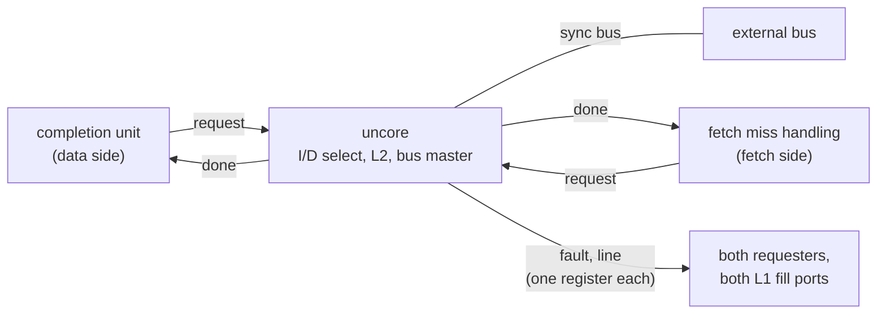

# Penumbra/3 — The core-to-uncore port

> **Applies to:** Penumbra/3 · pipelined core (in design).

Every memory access the core cannot finish in its own L1 goes to the
uncore: a load or fetch that missed, any access to an uncacheable
page, and every store's write to memory. This document specifies the
port they cross: the four transactions it carries, its signals and
handshake, and what each end may assume about the other.

Three terms:

- The **uncore** is everything between this port and the external bus:
  the choice between the two sides' requests, the L2, and the
  [bus master](./overview.md#fork-boundary).
- A **requester** is the part of the core that holds a request up.
  There are two, one per **side**: the
  [completion unit](./memory-completion.md) in MEM2 for data, and the
  fetch stages' miss handling for instructions. Each side has its own
  copy of the request fields and at most one request up at a time.
- A **line** is 16 bytes at a 16-byte-aligned physical address, four
  words: the unit every cache level stores.

The port is the
[sync bus handshake](../../hardware/bus-protocol.md#sync-handshake)
carried one level inward, a request held until a one-cycle completion,
with two additions: a read can return a whole line, and the request
says whether its page is cacheable. It is the registered boundary
[Rule Zero](./timing-outline.md#rule-zero--the-only-rule-that-actually-matters)
asks for between the core and its memory hierarchy.

## The four transactions

`we` and `cacheable` name a request's transaction.

| Transaction | `we` | `cacheable` | Issued for | On the bus | Returns |
|---|:-:|:-:|---|---|---|
| **Line read** | 0 | 1 | a cacheable load or fetch that missed L1 | nothing if L2 holds the line; else its four words, read in address order | the line |
| **Word read** | 0 | 0 | an uncacheable load or fetch | exactly one read | one word |
| **Cacheable write** | 1 | 1 | every cacheable store, whether or not it hit L1 | one write | nothing |
| **Word write** | 1 | 0 | an uncacheable store | exactly one write | nothing |

The fetch side issues only the two reads.

**`cacheable` is the translation's verdict and nothing else.** An
access is cacheable only when the MMU is on and its page is mapped
with `C=1`. With the MMU off every access is uncacheable
([`MMUCR`](../../system/mmu.md#mmucr-layout)), as is the vector-table
read, which bypasses translation. So a machine running with the MMU
off, as the boot ROM does, issues only word reads and word writes,
whatever its cache enables say, and a device is never read as a line:
its pages are mapped with `C=0`
([uncached access](../../system/mmu.md#uncached-access)).

**A requester does not fold its L1's enable into `cacheable`.** With
the MMU on and the L1 disabled, a load or fetch on a `C=1` page is
still a line read, and the requester takes its word from the line and
installs nothing. That is the disabled cache passing its accesses to
the next level ([`CTRL`](../../system/sysregs.md#ctrl-reg-1)), so an
enabled L2 still serves them. With both levels disabled, each such
access reads four words from memory and uses one.

**Line read.** The uncore ignores `addr[3:0]` and returns the line
holding `addr`. A sub-word load is a line read like any other. The
uncore may keep the line, and may read other lines beside it; neither
shows at the port.

**Word read and word write.** The access reaches the bus exactly once,
as itself: `addr` is the access's byte address and `byte_en` its byte
lanes, both passed to the bus unchanged, so a device sees the access
the bus protocol's
[access width](../../hardware/bus-protocol.md#access-width) rules
describe. L2 neither serves it nor keeps it. The bus sees it after
every write requested before it.

**Cacheable write.** One write of the lanes `byte_en` marks, in the
word holding `addr`. Its `done` promises that every later read on the
port, from either side, returns the written bytes. It promises nothing
about when the write reaches the bus, and it never reports a fault
([Faults](#faults)).

## Signals

A request's fields, all driven from flip-flops in the requester:

| Field | Width | Side | Meaning |
|---|:-:|---|---|
| `valid` | 1 | both | a request is up |
| `cacheable` | 1 | both | the page's cacheable attribute |
| `addr` | 32 | both | the access's physical byte address |
| `we` | 1 | data | 1 = write |
| `byte_en` | 4 | data | the access's byte lanes; unused by a line read |
| `wdata` | 32 | data | a write's data, each byte in its bus lane |

The fetch side reads whole words, so the uncore takes its `we` as 0
and its `byte_en` as all four lanes.

The response, all driven from flip-flops in the uncore:

| Field | Width | Side | Meaning |
|---|:-:|---|---|
| `done` | 1 | one each | this side's request has completed; one cycle |
| `fault` | 1 | shared | the bus faulted the transaction; valid with either `done` |
| `line` | 4 × 32 | shared | read data; valid with either `done` of a read that did not fault |
| `store_fault` | 1 | data | the bus faulted a cacheable write; one cycle, in any cycle |

`fault` and `line` are one register each. The uncore never raises both
sides' `done` in one cycle, so whichever side sees its `done` owns
them in that cycle.

## Handshake

| Cycle | `valid` | Request fields | `done` | `fault`, `line` |
|------:|:-------:|:--------------:|:------:|:---------------:|
| 0     | 1       | A              | 0      | —               |
| 1 … n−1 | 1     | A              | 0      | —               |
| n     | 1       | A              | 1      | A's result      |
| n+1   | 0, or 1 | —, or B        | 0      | —               |

1. **Presentation.** A requester raises `valid` with every request
   field driven.
2. **Hold until `done`.** It holds `valid` and every field unchanged
   through the cycle of its `done` inclusive. It may not withdraw or
   change a request: the uncore may have started the bus access, and
   nothing can recall that. A fetch that a redirect has made unwanted
   completes like any other.
3. **`done` is a registered one-cycle pulse,** exactly one for each
   request, and never in the cycle `valid` rises (n ≥ 1). Every request
   gets one: the bus answers every access, with a fault if no device
   does.
4. **After `done`.** `valid` in the cycle after a `done` is a new
   request, whose fields may differ. A requester with nothing to ask
   has dropped it by then.
5. **Two sides.** Both sides may have a request up at once. When both
   wait, the uncore serves the data side first: its access is older
   than any instruction the fetch side is fetching.

How long a transaction takes is not part of the contract. A requester
waits for `done` and assumes no bound; the cycle counts the uncore
aims for are in
[memory performance](./memory-performance.md#design-target-memory-latency-in-cpu-cycles).

## Read data

- **A line read** returns the line's four words in address order:
  word `k` of `line` holds the bytes at the line's address plus `4k`.
  The requester takes the word `addr[3:2]` selects.
- **A word read** returns the bus's 32 bits in word 0, each byte in
  its bus lane. The requester extracts its bytes by `addr[1:0]` and
  the access size, as it does from a word its L1 hit.
- `line` is defined only in the `done` cycle of a read that did not
  fault.

## Faults

`fault`, valid with `done`, says the bus faulted an access of the
transaction: no device answered, or the device reported an error
([access faults](../../hardware/bus-protocol.md#access-faults-bus_fault)).
Translation and alignment faults are resolved in the core and never
reach the port.

- **A line read** faults if any of its four reads did. The uncore
  keeps nothing of the line and the requester installs nothing, so the
  fault belongs to the access that asked and nothing remembers it.
- **A word read or a word write** reports its one access's fault,
  which the requester delivers
  [precisely](./memory-completion.md#fault-precision).
- **A cacheable write** completes with `fault` low whatever the bus
  said. Its bus fault is asynchronous by the same contract: the uncore
  reports it with a `store_fault` pulse, in whatever cycle the bus
  reported it.

## Timing

Both directions of the port run from registers.

- **Requests leave flip-flops.** `valid` and every request field come
  straight from registers in the requester. A miss sets a flop and the
  flop raises `valid`; no hit, miss or translation verdict reaches the
  port in the cycle it forms.
- **Responses leave flip-flops.** `done`, `fault`, `line` and
  `store_fault` come straight from registers in the uncore, and no
  path runs from a request field to a response within a cycle.
- **What may sit between.** The uncore may select between the two
  sides' requests ahead of its first register. A requester may gate
  `done` with its own flops ahead of its registers and its L1's write
  enable, and `line` may drive both L1 fill ports directly.

## What stays off the port

- **The L1's decisions** are the requester's: whether an access hit,
  which way a line goes to, whether to install it at all, and the
  sub-word extract.
- **L2's cache device** (its enable, invalidation and counters) is
  reached through the sysreg sideband, like every sysreg device.
- **How the uncore gets a line** shows only as latency: L2, a line
  taken from the bus as it fills L2, prefetch
  ([one uncore pipeline](./memory-performance.md#one-uncore-pipeline)).
- **A store buffer,** where the core has one, takes a cacheable store
  as it commits and issues the write itself, so the completion unit
  issues no cacheable write. The port's other three transactions are
  unchanged: the uncore holds a line read or a word access back until
  the buffered writes it must follow have left the buffer
  ([store buffer](./memory-performance.md#store-buffer-at-the-core-boundary)).
