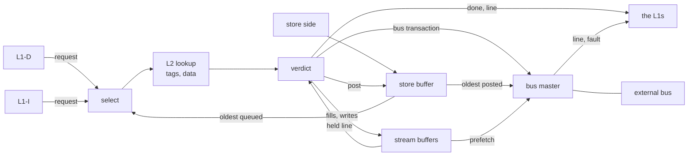

# Penumbra/3 — The uncore

> **Applies to:** Penumbra/3 · pipelined core.

The uncore serves both L1s and the store side on the
[core-to-uncore port](./uncore-port.md) and drives the external bus.
It is one pipeline: the choice between the two sides' requests and
the store buffer's, the L2's lookup, and the
[bus master](./overview.md#fork-boundary), with the store buffer and
the stream buffers beside it. This document specifies the L2 and the
pipeline around it: the geometry and storage, what each stage does,
what each transaction does, the store buffer, the stream buffers,
replacement, and the L2's cache device.

Seven terms:

- An **operation** is a request the uncore has taken into its
  pipeline. It **issues** in the cycle the uncore takes it.
- A **lookup** is an operation that reads the L2: a cacheable one,
  issued while the L2 is enabled and no invalidation walk runs. Every
  other operation **passes through**: it reads nothing and installs
  nothing.
- The **bus transaction** is the one the uncore runs on the bus at a
  time on a side's behalf: a line read neither the L2 nor a stream
  buffer could serve, or a word read or word write. It is **in
  flight** from the cycle after the bus master takes it through its
  `done`. A line read a stream buffer serves runs as one that never
  reaches the bus.
- A **fill** is a line read that looks up and misses, whether the bus
  or a stream buffer serves it.
- The **store buffer** holds the cacheable stores that have entered on
  the store side, from their entry until the bus master has written
  them.
- A **post** is the operation that issues for the store buffer's
  oldest queued store. It writes the store's bytes into the L2 on a
  hit, a **write hit**, and leaves the store owing its bus write.
- A **prefetch** is a stream buffer's read of a line no side has asked
  for. It runs on the bus master but is not a bus transaction: the
  pipeline goes on while it runs.

## Geometry

The line is the port's, 16 bytes. How many sets and ways the L2 has is
the build's choice, so a board sizes it to the block RAM it has, and
software reads the geometry from `INFO`
([cache devices](../../system/sysregs.md#cache-devices-2--l1_dcache-3--l1_icache-9--l2_cache)).

| Property | |
|---|---|
| Line | 16 bytes |
| Sets | a power of two |
| Ways | a power of two, at least two |
| Addressing | physical: the port's addresses are physical |
| Writes | write-through, no allocate: `WRITE_BACK` and `WRITE_ALLOC` read 0 |
| Replacement | an invalid way first, else tree-PLRU |

The L2 keeps four arrays, each in block RAM:

| Array | Holds | Read | Written |
|---|---|---|---|
| Data | each way's line, a row of 16 bytes a set, written by byte | at issue, every way's row | a write hit's bytes; an install's line |
| Tags | each way's tag | at issue, every way's | at an install |
| Valid | a bit a way, a set's in one row | at issue | at an install; by the invalidation walk |
| Replacement | one bit fewer a set than there are ways, each bit written on its own | when a line read takes the bus | at every hit and install |

The data array holds every byte the L2 does, so it sets the L2's block
RAM; the others hold a tag, a valid bit and under one replacement bit
for each line.

## The pipeline

An operation passes three stages:

| Cycle | Stage | What happens |
|---|---|---|
| i | issue | the select takes one request; a lookup reads its set in every array but the replacement bits |
| i+1 | verdict | a lookup compares the tags: hit, and the hit way. The operation completes, takes the bus, or is dropped |
| i+2 | update | a side's requester sees `done`. The arrays take what the verdict decided: a write hit's bytes, the replacement touch |

A side's request can issue every cycle. With both sides' requests up,
they issue in consecutive cycles and, when neither needs the bus,
complete in consecutive cycles, one `done` a cycle. A post holds issue
in the cycle it is at the verdict, and a write hit's update holds it a
cycle more: posts that miss issue at most every other cycle, and posts
that hit every third.

### Issue

There are three requesters: the two sides, and the store buffer, whose
request is up while it holds a queued store. A request issues when all
of these hold:

- it is up and not already in the pipeline: a side's request is in
  the pipeline from its issue through its `done`, or until it is
  dropped, and a post only at its verdict;
- no bus transaction is in flight, so no install writes the arrays;
- the update stage writes no write hit's bytes in this cycle;
- no post is at the verdict: an operation issued then would read the
  L2 before the post's bytes reach it, and find the store no longer
  queued ([the store buffer](#the-store-buffer));
- no invalidation waits to start.

The select takes the data side's request first, as the port requires,
then the fetch side's, then the post. The post goes first instead
while a side **yields**: from the cycle a side's operation is dropped
for the store buffer's order until a post completes. Without it, a
side that keeps issuing and being dropped would take every slot the
stores ahead of it need. The enable is taken at issue: a `CTRL` write
changes the operations that issue after it, never one in the pipeline.

### The verdict

| Operation | Outcome | When it can |
|---|---|---|
| Post | completes; on a hit the update stage writes its bytes into the line | always |
| Line read that hits | completes with the hit way's line | no queued store holds its line |
| Line read that misses, its line in a stream buffer | is served from the buffer | no queued store holds its line |
| Line read that misses, or passes through | takes the bus | no queued store holds its line, no stream buffer is fetching it, no store is posted, and the bus master is idle |
| Word read, word write | takes the bus | the store buffer is empty and the bus master idle |

An operation that cannot is **dropped**: its request stays up, and it
issues again. Every operation at the verdict is also dropped while a
bus transaction is in flight, which keeps the transaction's `done` the
only one in its cycle: the L2 serves no hit under a miss
([ruled out](./memory-performance.md#hit-under-miss-in-the-l2--ruled-out)).

A dropped operation leaves nothing behind: it counts no event, and
when it issues again it reads the arrays afresh, seeing whatever they
took meanwhile. A dropped post leaves its store queued.

### The update stage

The update stage writes what the verdict decided, from registers: a
hit reaches a register's input and never a block RAM's write enable.
A write hit's bytes go into the hit way's row, at the word its address
names and in its byte lanes. Every hit touches the replacement bits
for its way.

## Transactions

| Transaction | Lookup that hits | Lookup that misses, or pass-through |
|---|---|---|
| Line read | `done` at i+2, with the hit way's line | a bus transaction: four reads from the line's address. `done` with the bus's line, which a lookup without a fault installs. A miss a stream buffer serves: `done` at i+3 with the buffer's line, which it installs |
| Post | the store posted at i+1; its bytes written into the line at i+2 | the store posted at i+1; nothing installed |
| Word read | — | a bus transaction: one read, its address and byte lanes as they are, the bus's 32 bits in word 0 |
| Word write | — | a bus transaction: one write, likewise; `done` once the bus has taken it, with its fault |

A pass-through line read reads four words and the requester uses one,
as the port has it for a disabled L2. The fetch side's requests carry
no byte lanes, so a fetch's word read reads all four.

## The store buffer

The store buffer holds the stores that have entered on the
[store side](./uncore-port.md#the-store-side), in the order they
entered, each in an entry of its own: its word's physical address,
its data and its byte lanes. It has sixteen entries
([depth](./memory-performance.md#store-buffer-at-the-core-boundary)).
A store passes two states before its entry is free:

| State | From | Until |
|---|---|---|
| Queued | it enters | its post completes |
| Posted | its post completes | the bus master completes its write |

A store is registered as it enters and reaches its entry a cycle
later, so the store side's fields reach nothing but that register. It
counts as queued from the cycle it enters.

The oldest queued store is the buffer's request at the select, and
its post completes at the first verdict it reaches with no bus
transaction in flight. A posted store is **unsent** until the bus
master takes it, then **sent** until its write completes. The bus
master takes the oldest unsent store whenever it is ready, ahead of
any bus transaction or prefetch: the posted stores are older than
every operation behind them. It takes one while idle, and one behind a
store it is writing, which goes on the bus the cycle after that
store's ack: a run of posted stores goes out with the strobe held from
the first write to the last. A posted store's write and a bus
transaction are never on the bus master at once, as a post completes
only while no transaction is in flight, and a transaction that takes
the bus starts only while no store is posted.

The sides' operations keep the buffer's order at the verdict, so each
sees every store that entered before it:

- **A line read** waits while a queued store holds its line. When the
  L2 serves it, every older store to the line has posted, and the
  write hits have put their bytes in the line.
- **A bus transaction** starts only once no store is posted. Memory
  then holds every older store's bytes when a line read reaches it.
- **A word access** waits for the buffer to be empty, so it reaches
  the bus after every store that entered before it, as the port
  requires.

**Full and empty** come from registers and are exact, counting a
store from the cycle it enters: while full is low, a store may enter
whatever else the cycle does.

**Storage.** The entries are LUT RAM, with a copy for each store the
buffer offers, the oldest queued and the oldest unsent, since LUT RAM
reads one address; both offers come from registers. Each queued
store's line sits in a register as well, so a line read's line is
compared against every one at once.

The bus faulting a posted store's write is a `store_fault` with the
store's address, in the cycle after the bus master completes it
([faults](./uncore-port.md#faults)). The address is the one the bus
master completed, since by then it may be writing the next store. The
entry frees with the write, faulted or not.

## The bus transaction

An operation that takes the bus goes from its verdict straight into
the bus master, whose request register is the uncore's record of the
transaction: the verdict adds no register of its own on the way to the
bus. The bus master runs one transaction at a time, a line as four
back-to-back reads from the line's address.

The transaction's `done` comes a cycle after the bus master completes
it, with the bus master's fault and, for a read, its line. The line
reaches the requester and the L2 at once: a line read that looked up
and did not fault installs the line in that `done`'s cycle, writing the
victim way's row, tag and valid bit and touching its replacement bits.
A read that faulted installs nothing, and leaves the set as it was.

**The victim** is an invalid way of the set, the lowest, or else the
way the replacement bits name. The valid bits come from the lookup;
the replacement bits are read in the cycle after the bus master takes
the read, long before the line arrives, or after a served read's
verdict.

## The stream buffers

Two stream buffers beside the L2 each follow one stream of fills and
keep its **expected line**: the line after the stream's latest fill,
the one the stream reads next if it goes on. The expected line is the
only one a buffer wants fetched, fetches or holds. At a fill of line
X:

- **A buffer holding X serves it,** and X + 1 becomes its expected
  line, which it wants fetched.
- **Otherwise a buffer expecting X** has seen two fills to consecutive
  lines: X + 1 becomes its expected line, which it wants fetched.
- **Otherwise the buffer used less recently** gives up its stream, and
  what it held or was fetching, for a new one: X + 1 becomes its
  expected line, and it wants nothing yet, as one fill alone shows no
  walk.

A buffer never wants a line in another page than its stream's latest
fill, since the next physical page is unrelated. With the L2 disabled
nothing looks up, so nothing fills and no stream goes on.

**A served read** is a bus transaction that never reaches the bus. It
is in flight from the cycle after its verdict through its `done` at
i+3, a cycle after an L2 hit's, with the buffer's line, and the line
installs as a bus read's would. A read whose line a buffer is fetching
is dropped until the fetch completes, and is then served.

**A prefetch** goes on the bus master only when the bus has nothing
else to do: no store posted, no operation at the verdict and no bus
transaction in flight. Of two buffers wanting one, the lower-numbered
goes first. While it runs the pipeline goes on, hits completing and
posts posting, and an operation that needs the bus is dropped until
the bus master is ready, since a read on the bus cannot be abandoned:
a prefetch delays a side's bus transaction by at most one line read.
The bus master records what it takes, so its completion goes to the
posted store, the bus transaction or the prefetch it ran.

**Order.** A prefetch starts only with no store posted, so it reads
memory after every store older than it. A post or a word write to a
line a buffer holds drops the line, and one to a line a buffer is
fetching marks the fetch to be discarded when it arrives: either read
memory before the write. Fills and writes reach the buffers a cycle
after their verdict, from registers, which is in time for the next
verdict: a fill and a word write are transactions, so nothing at the
verdict acts before their `done`, and nothing issues while a post is
at the verdict.

**Faults.** A prefetch the bus faults is discarded. No side asked for
it, so no side hears of it; a read of its line then takes the bus and
faults on its own.

**Storage.** Each buffer is registers: its expected line's address, a
line of 16 bytes, and its state. The verdict compares the read's line
with both expected lines from registers, so the check needs no tag
compare and stays off the late hit.

How often the buffers serve, and what they save on hardware:
[next-line prefetch](./memory-performance.md#next-line-prefetch-into-stream-buffers).

## Replacement

Tree-PLRU: a binary tree over a set's ways, with a bit at each of its
nodes, one fewer than the ways. Each bit names the half below it that
was used less recently, and the victim is the way reached by following
the bits from the root. A touch of a way writes only the bits on the
way's path, each to name the half the way is not in. It never reads
the old bits, so a touch needs no read and no read waits for one, and
each bit is an array of its own.

## Read and write exclusivity

No array is read and written in one cycle, by construction:

- **Data, tags and valid bits** are read only at issue. Issue waits out
  the update stage's data write and an install, and an invalidation
  walk writes valid bits only while nothing looks up.
- **The replacement bits** are read only in the cycle after a line
  read takes the bus or is served, when no operation is at the update
  stage to touch them.

## The cache device

The L2 is sysreg device 9, with the layout every cache device shares
([cache devices](../../system/sysregs.md#cache-devices-2--l1_dcache-3--l1_icache-9--l2_cache)).
A read answers a cycle after it, from the register it latched, as the
L1s do.

- **`INFO`** reports the geometry above.
- **`CTRL.ENABLE`** is 0 at reset. It is taken at issue.
- **`INVAL_ALL`** clears every set's valid bits, a set a cycle, as many
  cycles as there are sets. The walk starts once nothing is in the
  pipeline and no bus transaction is in flight, and nothing issues
  while it waits to start. While it runs, operations issue and pass
  through, which keeps every read and write correct: the L2 is
  write-through, so every byte a line holds is in memory or owed to it
  by a posted store, which a bus transaction waits for. The walk's
  start also ends every stream buffer's stream, dropping the lines
  they hold and discarding a running prefetch. Software need not wait
  for the walk: no line can hit from the write on.
- **`STATUS.BUSY`** is high from the `INVAL_ALL` write until the walk
  ends.
- **The counters** count each lookup once, at the verdict where it
  completes, takes the bus or is served: a line read as a read hit or
  miss, a served one as a miss, and a post as a write hit or miss. A
  dropped operation and a pass-through count nothing.

The same walk runs after reset, so a line left from before a reset
never hits.

## Latency

From the cycle a request issues, with the pipeline free:

| Operation | `done` |
|---|---|
| Line read, L2 hit | i+2 |
| Line read, served by a stream buffer | i+3 |
| Bus transaction | the bus master takes it at the end of i+1; `done` a cycle after the bus master completes |

An L2-hit fill then takes the L1 four cycles from its request to its
own completion, a served one five, and an L2 miss adds the bus
master's transaction to that. A post completes at its verdict, i+1,
with no `done`, and a write hit's bytes are in the line at i+2.
