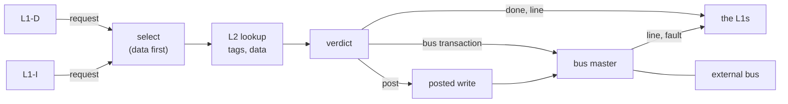

# Penumbra/3 — The uncore

> **Applies to:** Penumbra/3 · pipelined core (in design).

The uncore serves both L1s on the
[core-to-uncore port](./uncore-port.md) and drives the external bus.
It is one pipeline: the choice between the two sides' requests, the
L2's lookup, and the
[bus master](./overview.md#fork-boundary), with one posted write
beside it. This document specifies the L2 and the pipeline around it:
the geometry and storage, what each stage does, what each transaction
does, posting, replacement, and the L2's cache device.

Four terms:

- An **operation** is a request the uncore has taken into its
  pipeline. It **issues** in the cycle the uncore takes it.
- A **lookup** is an operation that reads the L2: a cacheable one,
  issued while the L2 is enabled and no invalidation walk runs. Every
  other operation **passes through**: it reads nothing and installs
  nothing.
- The **bus transaction** is the one the uncore runs on the bus at a
  time on an operation's behalf: a line read the L2 could not serve,
  or a word read or word write. It is **in flight** from the cycle
  after the bus master takes it through its `done`.
- The **posted write** is a cacheable write the uncore has completed
  on the port and has yet to write to the bus.

## Geometry

The line is the port's, 16 bytes. How many sets and ways the L2 has is
the build's choice, so a board sizes it to the block RAM it has, and
software reads the geometry from `INFO`
([cache devices](../../system/sysregs.md#cache-devices-2--l1_dcache-3--l1_icache-9--l2_cache)).

| Property | |
|---|---|
| Line | 16 bytes |
| Sets | a power of two |
| Ways | a power of two, at least two |
| Addressing | physical: the port's addresses are physical |
| Writes | write-through, no allocate: `WRITE_BACK` and `WRITE_ALLOC` read 0 |
| Replacement | an invalid way first, else tree-PLRU |

The L2 keeps four arrays, each in block RAM:

| Array | Holds | Read | Written |
|---|---|---|---|
| Data | each way's line, a row of 16 bytes a set, written by byte | at issue, every way's row | a write hit's bytes; an install's line |
| Tags | each way's tag | at issue, every way's | at an install |
| Valid | a bit a way, a set's in one row | at issue | at an install; by the invalidation walk |
| Replacement | one bit fewer a set than there are ways, each bit written on its own | when a line read takes the bus | at every hit and install |

The data array holds every byte the L2 does, so it sets the L2's block
RAM; the others hold a tag, a valid bit and under one replacement bit
for each line.

## The pipeline

An operation passes three stages:

| Cycle | Stage | What happens |
|---|---|---|
| i | issue | the select takes one request; a lookup reads its set in every array but the replacement bits |
| i+1 | verdict | a lookup compares the tags: hit, and the hit way. The operation completes, posts, takes the bus, or is dropped |
| i+2 | update | the requester sees `done`. The arrays take what the verdict decided: a write hit's bytes, the replacement touch |

A request can issue every cycle. With both sides' requests up, they
issue in consecutive cycles and, when neither needs the bus, complete
in consecutive cycles, one `done` a cycle.

### Issue

A request issues when all of these hold:

- it is up and not already in the pipeline: a side's request is in
  the pipeline from its issue through its `done`, or until it is
  dropped;
- no bus transaction is in flight, so no install writes the arrays;
- the update stage writes no write hit's bytes in this cycle;
- no invalidation waits to start.

When both sides' requests can issue, the data side's does, as the port
requires. The enable is taken at issue: a `CTRL` write changes the
operations that issue after it, never one in the pipeline.

### The verdict

| Operation | Outcome | When it can |
|---|---|---|
| Line read that hits | completes with the hit way's line | always |
| Cacheable write | posted, and completes; on a hit the update stage writes its bytes into the line | the posted write is free |
| Line read that misses, or passes through | takes the bus | the bus master is idle and the posted write free |
| Word read, word write | takes the bus | likewise |

An operation that cannot is **dropped**: its request stays up, and it
issues again. Every operation at the verdict is also dropped while a
bus transaction is in flight, which keeps the transaction's `done` the
only one in its cycle: the L2 serves no hit under a miss
([ruled out](./memory-performance.md#hit-under-miss-in-the-l2--ruled-out)).

A dropped operation leaves nothing behind: it counts no event, and
when it issues again it reads the arrays afresh, seeing whatever they
took meanwhile.

### The update stage

The update stage writes what the verdict decided, from registers: a
hit reaches a register's input and never a block RAM's write enable.
A write hit's bytes go into the hit way's row, at the word its address
names and in its byte lanes. Every hit touches the replacement bits
for its way.

## Transactions

| Transaction | Lookup that hits | Lookup that misses, or pass-through |
|---|---|---|
| Line read | `done` at i+2, with the hit way's line | a bus transaction: four reads from the line's address. `done` with the bus's line, which a lookup without a fault installs |
| Cacheable write | posted; `done` at i+2; its bytes written into the line at i+2 | posted; `done` at i+2; nothing installed |
| Word read | — | a bus transaction: one read, its address and byte lanes as they are, the bus's 32 bits in word 0 |
| Word write | — | a bus transaction: one write, likewise; `done` once the bus has taken it, with its fault |

A pass-through line read reads four words and the requester uses one,
as the port has it for a disabled L2. The fetch side's requests carry
no byte lanes, so a fetch's word read reads all four.

## The posted write

The uncore holds one cacheable write for later delivery. The write is
posted at its verdict and completes in the next cycle, and the bus
master takes it as soon as it is idle, ahead of any bus transaction:
the posted write is older than every operation behind it. So every
later bus access follows it. A line read the L2 cannot serve reads
memory that already holds the written bytes, and a word access reaches
the bus after every write requested before it, as the port requires.
A line read the L2 serves sees the bytes in the line, which the
write's update stage wrote.

A second cacheable write waits, dropped at its verdict, until the
first has left the posted write, once the bus master has completed it.

The bus faulting the posted write is a `store_fault` with the write's
address, in the cycle after the bus master completes it
([faults](./uncore-port.md#faults)). A cacheable write's `done` never
carries a fault.

## The bus transaction

An operation that takes the bus goes from its verdict straight into
the bus master, whose request register is the uncore's record of the
transaction: the verdict adds no register of its own on the way to the
bus. The bus master runs one transaction at a time, a line as four
back-to-back reads from the line's address.

The transaction's `done` comes a cycle after the bus master completes
it, with the bus master's fault and, for a read, its line. The line
reaches the requester and the L2 at once: a line read that looked up
and did not fault installs the line in that `done`'s cycle, writing the
victim way's row, tag and valid bit and touching its replacement bits.
A read that faulted installs nothing, and leaves the set as it was.

**The victim** is an invalid way of the set, the lowest, or else the
way the replacement bits name. The valid bits come from the lookup;
the replacement bits are read in the cycle after the bus master takes
the read, long before the line arrives.

## Replacement

Tree-PLRU: a binary tree over a set's ways, with a bit at each of its
nodes, one fewer than the ways. Each bit names the half below it that
was used less recently, and the victim is the way reached by following
the bits from the root. A touch of a way writes only the bits on the
way's path, each to name the half the way is not in. It never reads
the old bits, so a touch needs no read and no read waits for one, and
each bit is an array of its own.

## Read and write exclusivity

No array is read and written in one cycle, by construction:

- **Data, tags and valid bits** are read only at issue. Issue waits out
  the update stage's data write and an install, and an invalidation
  walk writes valid bits only while nothing looks up.
- **The replacement bits** are read only in the cycle after a line
  read takes the bus, when no operation is at the update stage to
  touch them.

## The cache device

The L2 is sysreg device 9, with the layout every cache device shares
([cache devices](../../system/sysregs.md#cache-devices-2--l1_dcache-3--l1_icache-9--l2_cache)).
A read answers a cycle after it, from the register it latched, as the
L1s do.

- **`INFO`** reports the geometry above.
- **`CTRL.ENABLE`** is 0 at reset. It is taken at issue.
- **`INVAL_ALL`** clears every set's valid bits, a set a cycle, as many
  cycles as there are sets. The walk starts once nothing is in the
  pipeline and no bus transaction is in flight, and nothing issues
  while it waits to start. While it runs, operations issue and pass
  through, which keeps every read and write correct: the L2 is
  write-through, so memory holds every byte a line holds. Software
  need not wait for the walk:
  no line can hit from the write on.
- **`STATUS.BUSY`** is high from the `INVAL_ALL` write until the walk
  ends.
- **The counters** count each lookup once, at the verdict where it
  completes or takes the bus: a line read as a read hit or miss, a
  cacheable write as a write hit or miss. A dropped operation and a
  pass-through count nothing.

The same walk runs after reset, so a line left from before a reset
never hits.

## Latency

From the cycle a request issues, with the pipeline free:

| Operation | `done` |
|---|---|
| Line read, L2 hit | i+2 |
| Cacheable write | i+2 |
| Bus transaction | the bus master takes it at the end of i+1; `done` a cycle after the bus master completes |

An L2-hit fill then takes the L1 four cycles from its request to its
own completion, and an L2 miss adds the bus master's transaction to
that.
