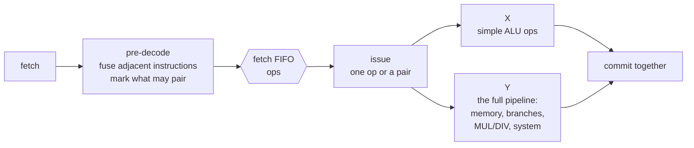

# Penumbra/4 — Overview

> **Applies to:** Penumbra/4 · in-order dual-issue core (ideas and
> measurements; nothing is built).

Penumbra/4 is the generation after gen3: the same ISA, the same
in-order machine with precise exceptions, issuing **two instructions a
cycle** where gen3 issues one. It is not out-of-order. This directory
collects the ideas for it and the measurements behind them, so that the
design starts from numbers when it starts.

- [`issue-pairing.md`](./issue-pairing.md) — what fusing and pairing
  instructions is worth on real workloads, measured with the ISS's
  pairing model, and the issue stage the numbers point to.
- [`load-use.md`](./load-use.md) — what the two-cycle wait behind a
  load costs, and what a second ALU behind the memory stages would
  take back.
- [`regfile.md`](./regfile.md) — the structures that give a register
  file four read ports and two write ports, compared on the ECP5 and
  the Artix-7, and the one chosen.
- [`front-end.md`](./front-end.md) — how many instructions a cycle
  fetch has to supply, what the cycle after a taken transfer costs,
  and how far the fuser has to see.

## Why dual issue

gen3 removes the cycles an in-order core loses to memory and to
redirects ([gen3 overview](../penumbra3/overview.md)). What stays is the
cycle every instruction takes to issue, and a single-issue core cannot
go below it. The ISA is fixed, so the instruction count is too: the
copies a two-operand format needs and the two instructions a 32-bit
constant takes are in every program
([architecture](../../system/architecture.md)).

Two things reach those cycles without changing the ISA:

- **Fusion** in the front end: two adjacent instructions issue as one
  op. It needs no second execution pipeline, but it does need a front
  end that reads two instructions a cycle.
- **A second issue slot:** two ops issue together when the second does
  not depend on the first.

On `pbench kernel` and Doom, the two together bring the 1000 issue
cycles that 1000 instructions take down to 668–681, and to 617–635
with a second load port and one more fusion
([measured](./issue-pairing.md#fusion-and-dual-issue-together)).

## The shape

Two pipelines in lockstep, the design point of the Pentium and the
68060: an op pair issues together, stalls together and commits
together.

| | |
|---|---|
| **Slots** | X issues simple ALU ops, shifts and moves. Y is a full pipeline. A pair holds at most one branch, one MUL/DIV and, to start with, one memory access. |
| **Order** | Either op of a pair may be the older one. Fixing the older op to X costs 44–70 issue cycles per 1000 instructions once ops are fused. |
| **Lockstep** | Both ops move together, and a pair commits as a unit. Next to a MUL, a DIV or a miss, the other op waits; it would have waited behind it in a single-issue core too, so lockstep never loses against one. |
| **Exceptions** | Precise, as in every generation. A simple ALU op cannot fault, so the only case is the full pipeline's op faulting: the older op of the pair commits and the younger does not. |
| **Flags** | Nearly every ALU op writes them. The flag state takes the write of the pair's youngest flag writer, a mux whose select is known at decode. |
| **Dependencies** | A pair's younger op takes nothing the older op produces that cycle, with one exception: a constant the older op loads, known at decode. The idioms that would need more are fused instead. |
| **System instructions** | Issue alone and serialize, as in gen3. |

Whether two adjacent ops may pair, and whether two adjacent
instructions fuse, depend only on the instructions themselves. Both can
be decided when they enter the fetch FIFO and stored as bits, so the
issue stage's "one op or two" starts from registers. That keeps the
decision off the kind of combinational path that bounded gen2
([gen3 timing outline](../penumbra3/timing-outline.md)).

## What it takes from gen3

The uncore, the store buffer, the split memory stage, branch prediction
and the pre-decoded fetch FIFO carry over. Dual issue changes what sits
around them:

- **Fetch has to supply two instructions a cycle,** and the fuser has
  to see across fetches ([front end](./front-end.md)). Issue takes 1.5
  to 1.6 a cycle on average.
- **The register file needs two write ports** and four read ports
  ([register file](./regfile.md)).
- **Forwarding** reaches four operands from the results of two
  pipelines.
- **Branch redirects and stalls cost two slots a cycle,** so prediction
  and the memory path matter more than they do for gen3, not less.

## Fusion belongs to gen4

The three fusions remove 134–161 issue cycles per 1000 instructions
with a single issue slot
([measured](./issue-pairing.md#fusion-on-one-issue-slot)), but a fused
op saves its cycle only when fetch delivered both of its instructions
in one. gen3's front end reads one instruction a cycle, and its work is
removing the global stall and shortening the fetch, load and store
paths ([gen3 overview](../penumbra3/overview.md)). Fusion therefore
arrives with the two-wide front end that dual issue needs anyway.

## Open

- **Stalls.** The pairing measurements count issue slots, and the
  load-use wait is measured for a single-issue core
  ([load-use](./load-use.md)). How waits, misses and redirects interact
  with pairing needs one pipeline model.
- **Fetch after a misprediction or a miss,** when the queue is empty
  ([front end](./front-end.md#open)).
- **The cost side:** the two-write-port register file, the forwarding
  network and the fused compare-and-branch's path, each to be timed on
  the full top before anything is built on it, as gen3's
  [build plan](../penumbra3/overview.md#build-plan) does.
