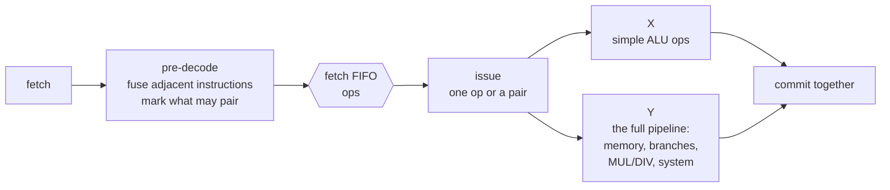

# Penumbra/4 — Overview

> **Applies to:** Penumbra/4 · in-order dual-issue core (ideas and
> measurements; nothing is built).

Penumbra/4 is the generation after gen3: the same ISA, the same
in-order machine with precise exceptions, issuing **two instructions a
cycle** where gen3 issues one. It is not out-of-order. This directory
collects the ideas for it and the measurements behind them, so that the
design starts from numbers when it starts.

- [`issue-pairing.md`](./issue-pairing.md) — what fusing and pairing
  instructions is worth on real workloads, measured with the ISS's
  pairing model, and the issue stage the numbers point to.
- [`load-use.md`](./load-use.md) — what the two-cycle wait behind a
  load costs, and what a second ALU behind the memory stages would
  take back.
- [`regfile.md`](./regfile.md) — the structures that give a register
  file four read ports and two write ports, compared on the ECP5 and
  the Artix-7, and the one chosen.
- [`front-end.md`](./front-end.md) — how many instructions a cycle
  fetch has to supply, what the cycle after a taken transfer costs,
  and how far the fuser has to see.
- [`structure.md`](./structure.md) — the modules gen4 is built from,
  the boundaries between them, and the order the machine comes up in.

## Why dual issue

gen3 removes the cycles an in-order core loses to memory and to
redirects ([gen3 overview](../penumbra3/overview.md)). What stays is the
cycle every instruction takes to issue, and a single-issue core cannot
go below it. The ISA is fixed, so the instruction count is too: the
copies a two-operand format needs and the two instructions a 32-bit
constant takes are in every program
([architecture](../../system/architecture.md)).

Two things reach those cycles without changing the ISA:

- **Fusion** in the front end: two adjacent instructions issue as one
  op. It needs no second execution pipeline, but it does need a front
  end that reads two instructions a cycle.
- **A second issue slot:** two ops issue together when the second does
  not depend on the first.

On `pbench kernel` and Doom, the two together bring the 1000 issue
cycles that 1000 instructions take down to 668–681
([measured](./issue-pairing.md#fusion-and-dual-issue-together)).
Fusing an add into the load or store it addresses, the base-plus-index
access the ISA has no encoding for, takes them to 653 and 521 behind
gen3's TLB ([measured](./issue-pairing.md#address-and-shift-fusions)).
The design's stage, with a fused op paired only beside one that is not
fused, takes 706 and 551
([measured](./issue-pairing.md#what-a-fused-op-pairs-with)).

The two reach different cycles. Fusion takes adjacent instructions
that depend on each other, a second slot adjacent ones that do not:
together they take 92–98 % of what each takes alone, added
([measured](./issue-pairing.md#fusion-and-the-second-slot-add-up)).

## Targets

- **CPI near 1.0, not below it.** A feature is weighed by how far it
  moves the cycles an instruction takes toward one, against what it
  costs in timing.
- **The Artix-7 first.** gen4 is designed for the Artix-7 and larger
  parts. It also runs on the ECP5, well enough that a ULX3S alone is
  enough to try the project and experiment with it. Keeping gen3's
  37.5 MHz there is wanted, but gives way to the design.
- **Fuse or pair, at the least.** A cycle issues one fused op, two
  ops, or one. A fused op paired with a simple ALU op is the design
  wanted, where its timing allows; the ECP5 is where it is least
  likely to. Two fused ops never pair. The aim is a pair or a fused
  op on most cycles, not the best schedule of them: a rule that finds
  a better one costs issue logic for little.
- **A native port for on-board RAM.** The uncore reaches the board's
  own memory through a burst port beside the Penumbra bus, and sends
  every other address to the bus, which keeps serving the devices and
  RAM on add-on boards as it does for gen3. Software sees the same
  machine: on-board RAM keeps its addresses, and the ROM's probe still
  finds its top by a bus fault. gen3 leaves the port unbuilt, since a
  single-issue core is bound by its pipeline and the port is worth ~3
  cycles per 1000 instructions there
  ([gen3's levers](../penumbra3/overview.md#levers-ranked-by-measured-benefit)).
  At 1.4–1.8 instructions a cycle the loads, stores and fills come that
  much closer together, and memory binds again. The port moves a word a
  cycle, or a wider transfer, where the bus's handshake moves a word
  every two cycles at best
  ([the bus floor](../penumbra3/memory-performance.md#a-miss-on-the-line-stack-gen25-machine-hardware-checked)).

## The shape

Two pipelines in lockstep, the design point of the Pentium and the
68060: an op pair issues together, stalls together and commits
together.

| | |
|---|---|
| **Slots** | X issues simple ALU ops, shifts and moves, and no fused op, so two fused ops never pair. Y is a full pipeline. A pair holds at most one branch, always its younger op, one MUL and one memory access; a second access would double the TLB's and the L1-D's data reads ([ruled out](./issue-pairing.md#ruled-out)). A DIV issues alone. |
| **Order** | Either op of a pair may be the older one, but a branch is always the younger. Fixing the older op to X costs 26 / 18 issue cycles per 1000 instructions at the design's stage, since an older fused op could then never pair ([measured](./issue-pairing.md#what-a-fused-op-pairs-with)). |
| **Lockstep** | Both ops move together, and a pair commits as a unit. Next to a MUL or a miss, the other op waits; it would have waited behind it in a single-issue core too, so lockstep never loses against one. |
| **Exceptions** | Precise, as in every generation. X's ops cannot trap, a pair holds one memory access and a DIV issues alone, so at most one op of a pair traps, and the other commits when it is the older. A branch is its pair's younger op, so a redirect never splits a pair ([branches last](./issue-pairing.md#branches-last-and-two-reads-an-op)). A fault in a fused access commits the add and saves the access's PC ([precise exceptions](./issue-pairing.md#precise-exceptions)). |
| **Flags** | Nearly every ALU op writes them. The flag state takes the write of the pair's youngest flag writer, a mux whose select is known at decode. |
| **Dependencies** | A pair's younger op takes nothing the older op produces that cycle, with one exception: a constant the older op loads, known at decode. The idioms that would need more are fused instead. |
| **Addressing** | An add fuses into the load or store it addresses: a base plus an index, and the sum written back when a load does not overwrite it. A fused op that writes two registers pairs only with one that writes none. |
| **System instructions** | Issue alone and serialize, as in gen3. |

Whether two adjacent ops may pair, and whether two adjacent
instructions fuse, depend only on the instructions themselves. Both can
be decided when they enter the fetch FIFO and stored as bits, so the
issue stage's "one op or two" starts from registers. That keeps the
decision off the kind of combinational path that bounded gen2
([gen3 timing outline](../penumbra3/timing-outline.md)).

## What it takes from gen3

gen4 is a new implementation, and none of gen3's RTL carries over.
What carries over is design, where gen3 measured it: the uncore, the
store buffer, stream prefetch beside the L2, the split memory stage,
branch prediction and the pre-decoded fetch FIFO, each built again in
gen4's own modules. Dual issue changes what sits around them:

- **Fetch has to supply a line a cycle into a 16-entry queue,** or two
  instructions a cycle with no bubble after a taken transfer, and the
  fuser has to see across fetches ([front end](./front-end.md)). Issue
  takes 1.5 to 1.9 a cycle on average.
- **An address adder for the fused accesses** in EX, ahead of the
  registered address the TLB and the cache read, taking two registers
  ([the address adder](./issue-pairing.md#the-address-adder)). The
  access's offset as a third input, for a pre-incremented access, is
  tried once the baseline runs
  ([beyond the baseline](./structure.md#beyond-the-baseline)).
- **The MMU and the L1-D keep one data port each:** a pair makes one
  access ([ruled out](./issue-pairing.md#ruled-out)).
- **The register file needs two write ports** and four read ports
  ([register file](./regfile.md)): no op reads more than two registers,
  since an add of two fuses into no store of a third
  ([two reads an op](./issue-pairing.md#branches-last-and-two-reads-an-op)),
  and no cycle writes more than two.
- **Forwarding** reaches four operands from the results of two
  pipelines.
- **Branch redirects and stalls cost two slots a cycle,** so prediction
  and the memory path matter more than they do for gen3, not less.
- **On-board RAM gets a port of its own** beside the bus
  ([targets](#targets)).

## Fusion belongs to gen4

The three fusions remove 134–161 issue cycles per 1000 instructions
with a single issue slot
([measured](./issue-pairing.md#fusion-on-one-issue-slot)), but a fused
op saves its cycle only when fetch delivered both of its instructions
in one. gen3's front end reads one instruction a cycle, and its work is
removing the global stall and shortening the fetch, load and store
paths ([gen3 overview](../penumbra3/overview.md)). Fusion therefore
arrives with the two-wide front end that dual issue needs anyway.

## Open

- **Whether a fused op takes a partner.** One beside an op that is not
  fused is worth 12 / 51 issue cycles per 1000 instructions over one
  that issues alone
  ([measured](./issue-pairing.md#what-a-fused-op-pairs-with)); its
  timing, on the ECP5 above all, decides.
- **Stalls.** The pairing measurements count issue slots, and the
  load-use wait is measured for a single-issue core
  ([load-use](./load-use.md)), so how waits, misses and redirects
  interact with pairing, the refill of an empty queue after a
  misprediction or a miss among them, and the CPI they give, is
  unmeasured. No
  decision ahead of RTL waits on it: gen4's own counters measure it.
  Where a forward source has to go, the pairing model gains a ready
  time for each register to price the stalls, and nothing more.
- **The native port's shape,** which what routes and closes on both
  boards decides, the ULX3S at 25 MHz if need be. gen3's ~3 cycles per
  1000 instructions is its worth at one instruction a cycle; the
  store-buffer model can price drains at gen4's rate
  (`+sbmodel_cpi=`), but a gain says nothing of what is feasible.
- **The memory stack behind the port.** The line stack keeps one
  request outstanding ([line
  stack](../sdram-controller.md#line-stack-a-held-line)), and gen3's
  stream buffers prefetch only when the bus is idle, so a prefetch can
  hold a demand read back by a line read ([stream
  buffers](../penumbra3/uncore.md#the-stream-buffers)). Reaching most
  of the RAM's throughput for speculative reads, without delaying the
  reads and writes the core waits on, may take several requests in
  flight. One shape: a second, low-priority port through the CDC,
  which the stream buffers drive and the RAM's side serves only when
  the primary port has nothing pending, so the RAM runs back to back.
  Its feasibility, its cost in timing and complexity, and what it
  gains are all open.
- **The cost side:** the two-write-port register file, the forwarding
  network, the fused compare-and-branch's path and the fused access's
  address adder, each to be timed on
  the full top before anything is built on it, as gen3's were
  ([how gen3 was built](../penumbra3/overview.md#how-it-was-built)).
