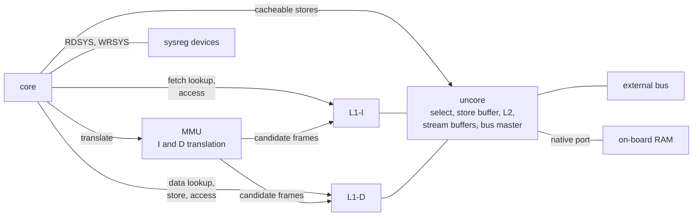
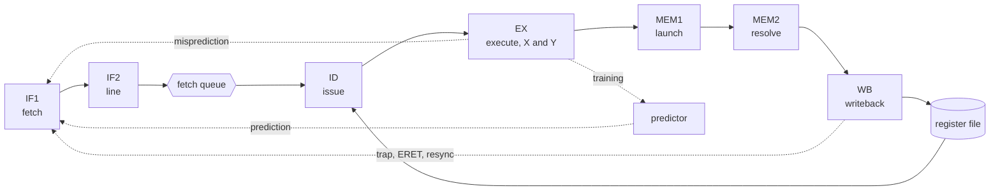

# Penumbra/4 — Structure: modules, boundaries and bring-up

> **Applies to:** Penumbra/4 · the core's and the machine's modules
> (a sketch; nothing is built).

This sketches the modules gen4 is built from: what each is for and
owns, the signals at each boundary and when they settle in the cycle,
the smallest form of each that keeps its contract, and the order in
which the machine comes up. The design it divides is the
[overview](./overview.md)'s.

All of it is a proposal. A module, a boundary or a cell taken from
earlier work changes when the board's timing or a measurement shows a
problem with it.

## Rules

- **A module is a part of the machine, with one purpose.** A stage is
  named for its place in the pipeline (`penumbra4_stage_ex`), any other
  part for what it is: the predictor, the fetch queue. A behaviour that
  crosses parts, such as a miss or the entry to an exception, is a
  contract between the parts it crosses, each carrying its share
  ([behaviours](#behaviours-and-the-parts-that-carry-them)), never a
  module of its own. A module that cannot name the part of the
  machine it is, is a behaviour, and belongs to the parts it touches.
- **A module owns its state, and its clients see a contract:** a
  request, busy and done; a verdict; a payload. Its arrays, its policy
  and which cycle it does its work in stay inside.
- **A part that only predicts never steers.** The predictor says where
  the line goes; IF1 chooses the address. A predictor that
  also steered would have two purposes, and every change to one would
  reach the other.
- **Every output has a timing class**, stated in its contract
  ([timing classes](#timing-classes)).
- **One term per stage gates every effect**
  ([the stage contract](#the-stage-contract)).
- **Hazards are read from the pipeline registers.** No module keeps a
  copy of what an op in flight will write.
- **Each operand has one stage that captures it,** named in that
  stage's contract.
- **ID chooses each operand's source.** It compares every register
  an op reads against the writers in flight for its hazards anyway, so
  it registers with the pair which input each operand takes: the file,
  a result in either slot of a pipeline register, or WB's write.
  EX's operand mux then has registered selects, and an operand
  whose pair holds in EX takes its value as it arrives.
- **The core module only connects.** It instantiates the stages and
  units and wires them; every decision belongs to one of them.
- **Smallest first.** Each module first exists in the smallest form
  that keeps its contract, and the machine runs code on the board with
  it. The full form then replaces it behind the same ports, one module
  at a time ([bring-up](#bring-up)). Nothing selects between the two
  forms: the smallest is the module's first version, not a mode of it.
- **What fits starts as it is.** The devices and the shared cells
  that fit a boundary here unchanged are instantiated as they are, in
  their own style, until timing or a measurement asks for more. Every
  module written for gen4 follows the
  [rules for new modules](../coding-standards.md#rules-for-new-modules).

## The machine

The machine keeps the gen2 machine's external port list ([the machine
layer](../build-system.md#the-machine-layer)), so a board top and a
sim wrapper attach devices to gen4 as they do to gen3, and the
machine's first build can be flashed with the board's devices, memory
stack and shell as they are. The one port it adds is the native port
to the board's own RAM ([targets](./overview.md#targets)), and it
comes last: until then RAM is on the bus, as it is for gen3. Inside
the machine, the timer and the CPU and machine identity devices are
the shared ones, the MMU's pinned TLB is the shared `tlb_pinned`, and
each cache keeps its counters in the shared `cache_perfctr`.

| Module | Purpose | Owns |
|---|---|---|
| `penumbra4_mmu` | translates fetch and data addresses | the main and pinned TLBs, the invalidation sweep, the fault registers, sysreg device 0 |
| `penumbra4_icache` | answers fetch lookups with a line, carries the fetch side's accesses | its arrays, replacement, enable, its side's request on the port |
| `penumbra4_dcache` | answers data lookups with a word, takes stores that hit, carries the data side's accesses | the same, for the data side |
| `penumbra4_uncore` | serves the L1s' accesses and the cacheable stores from the L2, on-board RAM and the external bus | the select, the store buffer, the L2, the stream buffers, the bus master, the native port's master, sysreg device 9 |

The two L1s are separate modules over one storage leaf. The fetch side
reads a line and never stores; the data side reads a word and takes
stores. A module serving both would tie off half its ports on each
side.

The L1s and the uncore start from gen3's designs: the
[L1s' contract with their clients](../penumbra3/l1-cache.md), the
[core-to-uncore port](../penumbra3/uncore-port.md), whose store side
carries a cacheable store from MEM2 into the uncore, and the
[uncore](../penumbra3/uncore.md) with its
[store buffer](../penumbra3/uncore.md#the-store-buffer) and
[stream buffers](../penumbra3/uncore.md#the-stream-buffers).
What changes is the fetch side's lookup, which answers with the hit
way's line, and the uncore's native port beside its bus master.

## The core

**Stages.** Each owns its output register.

| Stage | Module | Purpose |
|---|---|---|
| IF1 | `penumbra4_stage_if1` | chooses the address fetch reads next and launches its lookup |
| IF2 | `penumbra4_stage_if2` | turns the line the L1-I returns into instructions for the queue |
| — | `penumbra4_fetch_queue` | holds fetched instructions until ID takes them |
| ID | `penumbra4_stage_id` | decides which ops issue and in which slots, and reads their registers |
| EX | `penumbra4_stage_ex` | computes both ops' results and the access's address, and resolves the transfer |
| MEM1 | `penumbra4_stage_mem1` | launches the access's translation and lookup |
| MEM2 | `penumbra4_stage_mem2` | takes the access's verdicts and finishes the access or hands it to the L1-D |
| WB | `penumbra4_stage_wb` | makes the pair's effects architectural, or takes its trap |

**Units** hold no state; a stage instantiates them.

| Unit | Purpose | Where |
|---|---|---|
| `penumbra4_predecode` | an instruction's transfer kind and direct target | IF2, one a word of each way |
| `penumbra4_decode` | an instruction's fields | IF2 or the queue's read side ([open](#open)) |
| `penumbra4_fuser` | forms ops from adjacent instructions | IF2 or the queue's read side ([open](#open)) |
| `penumbra4_alu` | one op's result and flags | EX, one a slot |
| `penumbra4_operands` | each of the four operands and the flags, from the register file or a result in flight, by the sources ID chose | EX |
| `penumbra4_resolve` | whether a transfer went where fetch predicted, and where it goes | EX, slot Y |
| `cond_eval` | whether a condition holds for the flags | EX, in resolve |
| `byte_ext`, `byte_rep` | a loaded sub-word extended, a stored one placed in its lanes | MEM2, MEM1 |

`cond_eval`, `byte_ext` and `byte_rep` are the shared cells, taken as
they are to start.

**Storage and peers.**

| Module | Purpose | Owns |
|---|---|---|
| `penumbra4_predictor` | predicts where each fetched line goes | the direction table, the return stack |
| `penumbra4_regfile` | the general registers | four read ports, two write ports |
| `penumbra4_status` | the status and save state | SR, EPC, ESR, the scratch registers |
| `divmul` | multiplies and divides; the shared unit, taken as it is to start | its sequence |
| `penumbra4_perfctr` | counts what the core does | the CPU device's counters |

## Behaviours and the parts that carry them

| Behaviour | Carried by | Between them |
|---|---|---|
| A fetch the L1-I has no word for | the L1-I takes the access; IF1 launches the address again when it is done | busy, done |
| A prediction | the predictor predicts the line's exit; IF1 steers by it | the predicted exit word and target |
| A misprediction | EX's resolve finds it; IF1 steers; each younger stage clears | redirect, flush |
| A load the L1-D has no word for | MEM2 hands the access to the L1-D as the pair leaves; the pair waits at WB until the L1-D is done, and retires whole with the word | busy, done, word, fault |
| Entry to an exception | WB decides it and saves the state; IF1 reads the vector and fetches from it | WB's redirect and its vector |
| `ERET`, and a resync after a system write | WB redirects | WB's redirect |
| An interrupt | ID injects an op in place of the queue's head; WB takes it as a trap | SR.I, the lines, the injected op |
| A cacheable store's bus fault | the uncore holds it until its trap; ID injects an op that carries it; WB takes it as a deferred bus fault | fault and address |
| A system write with a lasting effect | the device raises busy; IF1 launches nothing while it is up | busy |

IF1 is the one place that steers. Its sources, in priority: WB's
redirect, MEM1's for a fused branch resolved there ([open](#open)),
EX's, the vector read, a relaunch after a miss, the prediction for the
line in IF2, and the next line.

**A missed load holds its pair at WB.** The pair is the oldest in
flight, so nothing older is left to drain around it. Its hold reaches
MEM2, MEM1, EX and ID in the same cycle, as any hold does, and fetch
goes on filling the queue. The L1-D's word enters the load's slot in
the register WB decides from, so a dependent takes it as it takes a
hit's value, and the pair retires as a unit through its own write
ports: a pair writes at most two registers, since a fused op that
writes two pairs only with one that writes none. Retiring the pair
before its load completes, so that only a use waits, is
[ruled out](./load-use.md#ruled-out) for gen4.

**A trap holds the pair behind it.** WB's flush lands a cycle after
WB decides it, and in that cycle the pair behind the trap could leave
MEM2 and hand the L1-D an access, which nothing can recall. So WB
holds while it decides a flush: the pair behind stays in MEM1's
register, makes no access, and the flush clears it with the rest.

**An interrupt is an op.** When an interrupt is pending and SR.I lets
it in, ID puts an op of its own in place of the queue's head. The
op carries the head's PC, makes no access and writes no register, and
issues alone and serializes, as a system instruction does; WB takes
it as a trap and saves that PC, so the head runs after `ERET`.
It reuses the trap path whole:

- **The saved PC is real.** An older trap or misprediction flushes the
  op as it flushes any younger one, so by WB every op older than it
  has resolved, and none younger has reached MEM.
- **SR.I is read as committed.** Only instructions that serialize
  change it, so ID never sees a write to it in flight. The op that
  issues right after `EI` is never replaced, which keeps `EI`'s
  one-instruction delay
  ([`EI`](../../system/architecture.md#ei--enable-interrupts)); a
  fused op or a pair there runs masked whole, which the delay allows.
- **It waits for a head,** so it has a PC to carry; an empty queue
  delays it a cycle or two.
- **WB takes it whatever the line does meanwhile.** A device holds
  its request until software clears it, and either outcome of a
  request withdrawn in flight is within the ISA.

A cacheable store's bus fault rides the same op, with its address,
ahead of any interrupt and whatever SR.I and `EI`'s delay say
([deferred bus faults](../../system/architecture.md#deferred-bus-faults)).

## The stage contract

- **A pair moves as one.** A stage's output register holds two slots
  and which of them is older. A stage takes or holds the pair, never
  one slot.
- **A hold is never late.** A stage holds while its successor holds or
  while it waits on something of its own: a registered busy, or a
  compare of a few fields of the register it decides from. A late
  signal, such as a hit, a translation verdict or a result, never
  joins a hold ([timing classes](#timing-classes)), as in
  [gen3](../penumbra3/memory-completion.md#the-rule). A stage that
  waits on nothing passes its successor's hold on unchanged, so every
  stage behind the source holds in the same cycle, and the hold is one
  OR of early terms wherever they are added. No module computes
  another's hold.
- **ID adds no hold of its own.** An op it cannot issue leaves a
  bubble in its register, and the queue's room is registered, so
  neither the hazard check nor the pairing reaches another stage or
  fetch in the same cycle.
- **A flush clears the stages younger than its redirect** and never
  waits on a hold.
- **An empty slot is a clear valid bit.** A stage loads its slots'
  fields whenever it is not held, and only the valid bits take its
  decisions: whether the pair leaves, whether ID issues, a flush and the
  reset. A decision then drives one flop a slot, never the enable or
  reset of every flop in the register. An empty slot's fields are
  whatever the stage last loaded, so whatever reads a slot reads its
  valid bit first.
- **One term says the pair leaves the stage,** and every effect the
  stage has, a write, a request or a count, is gated by it.

## Timing classes

- **R:** straight from a flop.
- **E:** early, a few LUT levels after flops, such as a mux or a
  compare of registered fields.
- **L:** late, behind a block RAM's output, a carry chain or a wide
  compare.

A late signal ends in a register of the module that takes it, or in a
block RAM's address. It never passes through that module into a third
one's decision in the same cycle, as a translation verdict reaching
another stage's operand mux would.

| From → to | Carries | Class |
|---|---|---|
| fetch → L1-I, MMU | the next fetch address | L, ending in the block RAMs' address registers |
| L1-I, MMU → IF2 | each way's line, the hit, the candidate frames, the fault, cacheability | L |
| predictor → fetch | the line's predicted exit, its word and target | L, ending in the fetch address |
| IF2 → queue | up to four instructions and their count | L, ending in the queue |
| queue → IF2 | room for a line | R |
| queue → ID | the three instructions at the head, with their fuse and pair bits | E |
| ID → queue | the instructions taken | E |
| ID ↔ register file | four read indices, four values | E |
| stage registers → ID | the writers in flight and when each result can be forwarded | R |
| ID → EX | the pair, and each operand's source | R |
| EX → IF1, queue, ID | a misprediction's redirect and flush | L ([open](#open)), ending in the fetch address, the queue's pointers and count, and ID's valid bit |
| MEM1 → IF1, queue, ID, EX | a fused branch's redirect and flush, when it resolves there | E |
| EX → predictor | the transfer's PC, outcome and target, for training | R |
| EX → MEM1 | the pair and the access's address | R |
| MEM1 → MMU, L1-D | the access's launch | R |
| MMU, L1-D → MEM2 | the translation verdict, the hit and the word | L |
| MEM2 → L1-D, uncore | a store's write, on the L1-D and the store side; an access | L, ending in the receivers' registers |
| uncore → MEM2 | the store buffer is full | R |
| MEM2 → WB | the pair, its results and faults, whether it waits on an access | R |
| L1-D → WB | busy, done, the access's word and fault | R |
| WB → register file, status | two register writes, the flags, the save state | R |
| WB → IF1, every stage | a trap's, `ERET`'s or a resync's redirect, and its flush | R |
| a stage → every stage behind it | its hold | E |
| WB → MMU | the fault that carries an address, for the fault registers | R |
| uncore → ID | a store's bus fault and its address, held until its trap | R |
| status → ID | SR.I | R |
| interrupt lines → ID | the requests, registered at the machine | R |
| L1s ↔ uncore | the [core-to-uncore port](../penumbra3/uncore-port.md) | R |
| MEM1 → sysreg device → MEM2 | an `RDSYS`'s read, and its data a cycle later | R |
| EX ↔ `divmul` | start; busy, done and the results | R |

## Payloads

The package holds one type for each thing that crosses a stage:

- **An instruction** in the queue: the word or its decoded fields, its
  PC, what fetch did after it (went on, or took a predicted target),
  and its fetch fault.
- **An op:** one instruction or two fused, or the op ID injects
  for an interrupt or a deferred bus fault. Its class, up to two
  registers read and two written, its flag reads and writes, its
  immediate, its first PC, its prediction and its fault.
- **A slot:** an op in a stage, a valid bit, and what the stages so
  far have computed for it.
- **A pair:** slots X and Y, which share the type, and which is older.
  The fields only Y uses, such as a fault, an access or a second
  register written, stay constant in X, where synthesis can drop them.

Each is a packed struct, and the values inside them have types of
their own: a virtual and a physical address, a register number, an
instruction word, a translation's fault. The boundary tables above are
written in that vocabulary, and so are the ports.

The fetch queue carries its entries as an opaque payload, so where
decode and the fuser sit changes the front end's wiring and not the
queue.

## Smallest forms

| Module | Smallest form | Full form |
|---|---|---|
| predictor | predicts no exit | direct targets, the direction table, the return stack |
| L1-I | no arrays: every lookup misses, and each fetch is an access | the cache |
| L1-D | no arrays: every load is an access, every store is written through | the cache |
| fetch queue | one line | sixteen entries |
| fuser | fuses nothing | the four fusions, `addmem`, `addwb` |
| ID | one op a cycle, in Y, once nothing in flight writes its sources | pairs, and issues through the forwards |
| operands | the register file's values | forwards from both pipelines |
| register file | flops | [XOR banks over distributed RAM](./regfile.md#design) |
| EX, slot X | nothing: ID never fills it | simple ALU ops, shifts and moves |
| MMU | the full sysreg interface over a small TLB | the board's geometry |
| store buffer | one entry, held until memory has it | the buffer |
| uncore | the select, the store buffer and the bus master | with the L2, the stream buffers and the native port |
| perfctr | cycles and retirements | the pairing and wait counters |

The other modules have one form. The smallest machine is single-issue
and slow, but every boundary in it is the full design's.

## Bring-up

Each step ends with the whole machine flashed and running code on both
boards: the Nexys Video, whose Artix-7 the design is for, and the
ULX3S, where it has to run reasonably. Both already carry the machine
layer.

1. **The smallest machine.** Every module in its smallest form. It
   passes `isa/` conformance on the RTL runner and runs the ROM
   monitor and the bare-metal benchmarks on the board. The ISS's
   `+core=penumbra4` reports its name and geometry.
2. **The caches and the TLB.** Their full forms, so NetBSD boots on the
   board at a speed worth working at.
3. **The cones dual issue rests on.** Each is a module's full form on
   the running machine, read on the full top of both parts: the
   register file with the forwards, ID with X filled, the fused
   compare-and-branch's resolve, the address adder, and the line
   through IF2 with decode and the fuser. A full form that misses the
   clock changes its contract here, before the modules around it take
   their full forms.
4. **The rest outside the cones:** the predictor, the queue's depth,
   the store buffer, the L2, the stream buffers. These change cycle
   counts, not boundaries.
5. **The native port.** The machine's one new port, and on each board
   a front end on its memory stack beside the bus adapter. It is
   outside the cones, but it changes the boundary between the machine
   and the board top, so it comes once the machine behind it is whole.

## Beyond the baseline

The bring-up builds the smallest gen4 the targets accept. What may be
worth more is tried on the running machine after it, and kept where
it costs no fmax:

- **`incmem`, with a third input to the address adder:** an `ADD` or
  `SUB #imm` fused into the access through its register, worth about
  11 / 3 issue cycles per 1000 instructions on `pbench kernel` / Doom
  ([measured](./issue-pairing.md#address-and-shift-fusions)). Nearly
  every such access has an offset, so the adder takes it as a third
  input, and the `ADD`'s flags need an add of their own beside the
  address. The baseline's adder has two inputs, and its one sum is
  both the address and the flags. Nearly every such access is a
  prologue's save behind `SUB SP, #frame`, so a second variant keeps
  the two inputs: the compiler places one callee-saved register's slot
  at `[SP + 0]`, where the save slots now sit at the frame's far end,
  and each prologue fuses its allocation with that save.

## Open

- **Where decode and the fuser sit:** in IF2, with the L1-I's fill
  bits, or at the queue's read side
  ([room for the fuser](./front-end.md#open)). If none meets the
  clock, a stage of their own comes next, and an aligned fuser only
  after that ([front end](./front-end.md#design)).
- **ID's window:** three instructions when a fused op pairs with a
  simple one, two when it issues alone. Whether the head fuses with
  the instruction behind it, and which of those shapes pair, depend
  only on the instructions, so each can be a bit in the queue entry,
  made before ID: within a line at IF2 or at the L1-I's fill, across
  lines when the next line arrives. ID then chooses by registered bits,
  beside its hazard compares. The third instruction is worth 12 / 51
  issue cycles per 1000 instructions
  ([measured](./issue-pairing.md#what-a-fused-op-pairs-with)). The
  queue presents three entries for now, so the choice stays inside
  issue; that width is itself provisional.
- **The fused compare-and-branch's resolve.** The design resolves it
  in EX. The path runs from the carry chain through the condition and
  the misprediction to IF1's address select, ending in the L1-I's
  block-RAM address, and the probe decides whether it fits. Before any
  fallback, it can be made shorter:
    - **The condition from the operands, not the flags:** equality for
      `EQ`/`NE`, the subtract's carry-out and top bits for the
      less-than conditions. A compare's Z is the equality of its
      operands, and an add's or a subtract's has a test that needs no
      carry propagation.
    - **`BEQ`/`BNE` in EX and the other conditions in MEM1.**
    - **Only the select late:** the redirect's targets, the predicted
      path and the fall-through, are known early, so the late signal
      picks between inputs settled a cycle before.

  The fallback resolves a fused branch in MEM1, the cycle it would
  resolve unfused. Its issue slot is still saved; what it gives up is
  a cycle on each mispredicted fused branch, at most the 11 / 6 EX
  redirects per 1000 instructions gen3's predictor leaves on
  `pbench kernel` / Doom, since 86–88 % of conditional branches are
  fused. IF1 has a redirect input from MEM1 for it from the start. Registering every EX redirect instead is ruled out: it costs
  about as much and slows the branches that never needed it. A
  shift's Z comes after the shifter, so the measured `opbr` fuses no
  shift with its `Bcc`.
- **Another stage between IF1 and EX,** an ID1 for decode and the
  fuser, or a later resolve. Either adds a cycle to each redirect from
  EX or WB, and none to a predicted taken branch, which IF2
  redirects ahead of the queue. With gen3's predictor that is about
  11 / 6 cycles per 1000 instructions on `pbench kernel` / Doom, plus
  trap entries and `ERET`s: in gen3's
  [redirect counts](../penumbra3/branch-prediction.md#the-target-buffer-depends-on-the-if2-redirect),
  registering the IF2 redirect adds one cycle for each IF2 redirect,
  and what is left of each row is the EX redirects at four cycles
  each. A stage ahead of ID holds no op in flight, so adding one
  changes only which stages a flush clears.
- **The native port's contract,** which has to move a word a cycle or
  a wider transfer ([targets](./overview.md#targets)). Two shapes:
    - **Two requests outstanding,** on channels with a valid and a
      ready each: the RAM's side releases the request channel once it
      has latched a request, the uncore drives the next while the last
      is served, and a held line's words follow one a cycle.
    - **A burst of known length,** a strobe a word, with one request
      at a time. Within a line it serves the same rate, but each line
      still waits the ~10 cycles the line stack takes from a request to
      its first word
      ([a miss on the line stack](../penumbra3/memory-performance.md#a-miss-on-the-line-stack-gen25-machine-hardware-checked))
      unless the next request is already in flight.

  Beside it, the front end each board's memory stack needs next to its
  bus adapter, the ULX3S's SDRAM line stack and the Nexys Video's
  DDR3. The stack itself may change, to keep several requests in
  flight ([the memory stack](./overview.md#open)).
- **How `MUL` and `DIV` retire,** whichever is simplest in RTL: they
  are 2–3 per 1000 instructions on the measured workloads, so every
  option costs at most a cycle or two each. A pair waits for `divmul`
  in EX or at WB beside a missed load, and either:
    - **the op issues alone,** and WB writes `Rd` and `Rdh` through
      both pipelines' write ports; or
    - **it pairs,** and WB takes a cycle more for `Rdh` when the
      pair has more than two registers to write.
