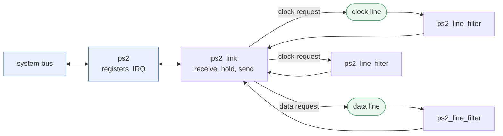

# Penumbra PS/2 Port — FPGA Microarchitecture

How the `CLASS_PS2` device is built. The programming interface is
[`doc/system/devices/ps2.md`](../system/devices/ps2.md); this document
covers the RTL behind it: how the two lines are read, how the port
tells the device's clock edges from its own pull on the clock, and
the receiver and the sender built on that.

## Overview

The device is one PS/2 link between the system bus and two open-drain
lines. It has one clock domain, the bus clock. The link's own clock is
the attached device's, tens of microseconds to a level, and the port
samples it as it samples the data line: nothing is clocked by it.

The port never clocks the link. All it does to the clock line is hold
it low, which makes the device wait, and everything else follows from
that one lever: a port not in use, a byte software has not taken, and
the claim ahead of a byte to send are all the clock held low.

## Block Diagram

## Module Decomposition

| Module | Role |
|--------|------|
| `ps2` | Register block: the bus handshake, `CTRL.EN`, the two interrupt conditions. A read of `RX_DATA` and a write of `TX_DATA` become the link's take and start pulses |
| `ps2_link` | The wire protocol: frames in, the hold, frames out, and the two timeouts |
| `ps2_line_filter` | One line in: two synchroniser flops and a filter. Three instances |

`ps2` takes the rate of the bus clock as `CLK_HZ`, with no default,
and `ps2_link` turns every time it keeps into cycles of that clock,
rounded up. Elaboration checks refuse a filter too long for a PS/2
clock, a claim shorter than a device is owed, and a transmit limit
that gives a device too little time or overruns the interface's
20 ms.

`ps2_link` has no reset. While `CTRL.EN` is clear it holds the clock
low and keeps nothing, and the register block's reset clears
`CTRL.EN`.

## The Lines

Each line leaves the device as the level the port asks for (1 lets
the line go, 0 pulls it low) and comes back as the level the line
carries. A board makes an open-drain pad of the pair. Both requests
leave from flops, and the clock request is 0 from configuration on,
so a device is held off before software has touched the port.

Coming in, a line passes two synchroniser flops and then a filter
that follows it only once it has stood at a new level for
`FILTER_NS`, 1 µs. A PS/2 line rises through a pull-up, slowly enough
to cross an input's threshold more than once, and a pulse shorter
than the filter is not a clock edge.

Both lines go through the same cell with the same parameter, so a
change on either reaches the logic the same number of cycles later
(two, and the filter's length). That keeps the timing the lines had
beside each other at the pins. A device gives the data line only a
few microseconds of setup and hold around the falling clock edge
(5 µs each on the Nexys Video's bridge), so a filter on the clock
alone, or a longer one on the clock, would take the next bit for
this one.

## Whose Clock Edge

The clock line is low while either end pulls it, and only the
device's pull is a clock edge. The port's own request for the clock
therefore goes through a third instance of the filter cell, and comes
out beside its own effect on the pin. A fall of the filtered clock
counts as a clock edge only where that copy is high.

The copy can lead the pin, by the delay through the pads, and cannot
trail it. A lead makes the port ignore a fall, which is the safe
side.

Testing the request as it stands in the same cycle is not enough. A
pull about as long as the filter's delay has ended by the time its
fall comes out of the filter, so the fall finds the request high
again and reads as a start bit. The delay is the filter and a few
flops, whatever the clock's rate, so `tb_ps2` clears `CTRL.EN` for
every length within a margin of cycles either side of the filter's,
and sends a byte straight after each.

## Receive

While it listens, the port takes the data line's level on each clock
edge into an eleven-bit shift register and counts the edges. The
eleventh sets the waiting-byte flag, and that flag pulls the clock
low: the hold begins on the edge that carries the stop bit. By then
the device counts the byte as sent, so it does not send it again, and
what it has next waits in the device. The port keeps one byte, the
least the interface allows, and needs no queue for it.

The byte and its error flag are read off the frame as it stands: the
byte is bits 1 to 8, and the frame is well formed when bit 0 is 0,
bit 10 is 1 and bits 1 to 9 hold an odd number of ones. Judging the
frame there, and not as its bits arrive, makes taking a bit the same
one move for all eleven, and leaves nothing to restart: the count
guarantees eleven shifts between frames, which push out whatever an
unfinished frame left. The frame stands still for as long as the byte
waits, because the hold keeps further edges away. The price is a
nine-input parity in front of the register block's read-data
register. A receiver that folded the parity in as bits arrived would
keep it off that path, with a case for each kind of bit.

A frame in flight with no clock edge for `FRAME_GAP_US`, 1 ms, is
given up: the count returns to zero, so the device's next frame is
taken from its first bit. Nothing is reported for it.

## Send

A write of `TX_DATA` starts a send whatever the receiver was doing.
Bits of a frame in flight are dropped, since the claim makes the
device send that frame again. A byte already waiting stays, and the
hold resumes behind the send.

| Phase | Clock request | Data request | Ends |
|-------|:-------------:|--------------|------|
| Claim | 0 | 1 | `CLAIM_US`, 100 µs, after the write |
| Request | 0 | 0, the start bit | `REQUEST_US`, 5 µs, later |
| Bits | 1 | The frame, a bit to each clock edge | The eleventh edge, or `TX_LIMIT_US` after the write |

Data low under a free clock is the request to send. The device
answers with eleven clock edges. The port moves the frame on one
place at each, so the data line changes as the clock falls and the
device takes it as the clock rises. After the stop bit the port's
request is 1, and on the eleventh edge the device itself holds data
low for a byte it has taken; the level the port reads there is
`TX_DATA.ERR`.

`TX_LIMIT_US` is 18 ms. A device may take 15 ms to start clocking a
byte in and 2 ms over the byte, and the interface promises software
an end inside 20 ms. A device that has not finished by the limit is
given up on, with `ERR` set, which is also what a port with nothing
attached does.

## Verification

`tb_ps2` reaches the port through its registers alone, and puts a
device model (`hw/sim/ps2_device.h`) on the two lines. Its harness
(`ps2_test`) names the bus clock's rate, as a machine top does, and
the testbench reads the rate back and keeps every time of its own to
it, so the same checks run at any rate. The regression runs a slow
one: the synchroniser and the output flops are the same few cycles at
every rate, and count for most where a cycle is longest.

The model clocks bytes both ways as a keyboard does. It starts
a frame only after both lines have stood high, and one that meets a
held clock before its stop bit is clocked is sent again from the
start. It can also send a malformed or unfinished frame, withhold its
acknowledgement, stop clocking partway, or be absent.

A monitor in the testbench watches what the port does to the lines:
the claim lasts 100 µs, data is low before the clock is let go, and
data moves only under a low clock.
