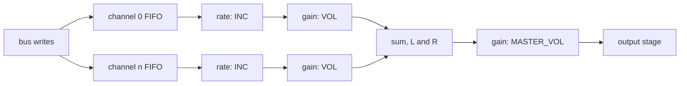

# Audio Device — Programmer's Reference

An audio output device for the Penumbra bus (`CLASS_AUDIO`). The device
accepts PCM frames pushed into per-channel FIFOs, mixes the active
channels, and drives one stereo output. It is the sound analog of the
[Display Adapter](display.md): generic firmware or the OS can drive any
conformant device with no device-specific driver.

This document defines the **`CLASS_AUDIO` minimum protocol**: the
registers every device of the class implements, and the state it powers
up in, after reset. The mandatory core is deliberately small — one
channel accepting 16-bit signed stereo frames at the device's native
rate. Everything else — additional channels, per-channel pitch, volume
control, narrower sample formats, interpolation — is an optional feature
advertised through a capability flag. A device may add any of them, but
must always present this interface after reset. Pushed-frame playback is
the class's identity: a device that synthesizes internally but accepts no
PCM frames is not a `CLASS_AUDIO` device.

The device holds no sample memory the consumer can address. Frames are
written to a data port and consumed; nothing is stored for replay. This
keeps the contract independent of how an implementation buffers, and lets
a device with its own memory, a codec behind a serial link, and a small
FPGA FIFO all present the same interface.

## Register Interface

A global register block followed by one block per channel. Base address
assigned by autoconfig.

**Access.** All registers are accessed with 32-bit aligned loads and
stores only (`LDW`/`STW`); the device implements no byte-lane enables.
Every register is *word-strided* — it occupies a full word regardless of
how many bits it defines.

### Global registers

| Offset  | Name         | R/W   | Description                                  |
|---------|--------------|-------|----------------------------------------------|
| `0x000` | `CAP`        | R     | Version, channel count, optional features    |
| `0x004` | `RATE`       | R     | Output sample rate in Hz                     |
| `0x008` | `CTRL`       | R/W   | Output-stage enable                          |
| `0x00C` | `CHAN_EN`    | R/W   | Per-channel active bits                      |
| `0x010` | `IRQ_STATUS` | R/W1C | Per-channel watermark flags                  |
| `0x014` | `IRQ_ENABLE` | R/W   | Interrupt mask, `IRQ_STATUS` layout          |
| `0x018` | `UNDERRUN`   | R/W1C | Per-channel underrun flags                   |
| `0x01C` | `MASTER_VOL` | R/W   | Master volume, left and right (optional)     |
| `0x100…`| `CHAN[n]`    | R/W   | Per-channel block, `0x20` stride             |

### Per-channel block (`0x100 + n * 0x20`)

| Offset  | Name    | R/W | Description                                      |
|---------|---------|-----|--------------------------------------------------|
| `+0x00` | `CTRL`  | R/W | Sample format, interpolation, FIFO flush         |
| `+0x04` | `INC`   | R/W | Phase increment, 16.16 fixed point (optional)    |
| `+0x08` | `VOL`   | R/W | Channel volume, left and right (optional)        |
| `+0x0C` | `DEPTH` | R   | FIFO capacity in frames                          |
| `+0x10` | `LEVEL` | R   | FIFO free space in frames                        |
| `+0x14` | `WM`    | R/W | Free-space watermark for interrupt               |
| `+0x18` | `FIFO`  | W   | Frame data port                                  |

## Register Details

### CAP (0x000)

- Bits [7:0]: Version (`1`)
- Bit [8]: `PITCH` — `INC` is writable, so a channel plays at a rate
  other than `RATE`. When clear, `INC` reads `0x00010000` and ignores
  writes.
- Bit [9]: `VOLUME` — `VOL` and `MASTER_VOL` are writable. When clear,
  both read unity and ignore writes.
- Bit [10]: `FMT8` — 8-bit signed samples are accepted, selected by
  `CHAN[n].CTRL.FMT8`.
- Bit [11]: `MONO` — mono channels are accepted, selected by
  `CHAN[n].CTRL.MONO`.
- Bit [12]: `INTERP` — the device interpolates between source frames when
  `INC` is not unity, selected by `CHAN[n].CTRL.INTERP`.
- Bits [23:16]: `CHANNELS` — number of channels, at least 1 and at most
  32. Channel 0 is the mandated default and is always present. The
  ceiling is what a per-channel bit in a single word allows; the field
  itself is wider so a later revision can raise it without moving.

Remaining bits reserved (read 0); further capabilities are advertised
through `CFG_ID`.

A consumer that reads no capability bits at all still behaves correctly:
the unsupported registers read their unity values, so playback happens at
`RATE` and full volume rather than at a wrong pitch or in silence.

### RATE (0x004)

- Bits [31:0]: output sample rate in Hz.

The rate at which the device consumes frames from a channel whose `INC`
is unity. A device presents one output rate; a consumer that needs
another either sets `INC` (when `CAP.PITCH`) or resamples.

### CTRL (0x008)

- Bit [0]: `ENABLE` — output stage active. Resets to `0`, so a device
  powers up silent rather than emitting whatever its FIFOs hold. While
  clear the device produces no output and channel FIFOs do not drain.

### CHAN_EN (0x00C)

- Bit *n*: channel *n* consumes frames and contributes to the mix.

Resets to `0`. Writing the register sets every channel's state in one
access, so several channels start on the same output frame. A consumer
that starts channels one at a time would stagger their onsets by the
duration of its register writes; making the enable a single global word
makes simultaneity a property of the device rather than of how fast the
consumer runs.

Setting a bit that was clear starts the channel from its current FIFO
contents. Clearing a bit stops consumption but does not discard queued
frames — see [`CHAN[n].CTRL`](#chanctrl-0x00).

### IRQ_STATUS (0x010) / IRQ_ENABLE (0x014)

- Bit *n*: channel *n* free space has reached `CHAN[n].WM`

Sticky, cleared by writing 1 to the bit. `IRQ_ENABLE` uses the same
layout and masks which flags assert the device's interrupt output; flags
accumulate in `IRQ_STATUS` whether or not they are enabled.

The device drives the shared bus interrupt line, so a handler must
determine from `IRQ_STATUS` whether this device is asserting, and must
not assume it is — see [Interrupt Model](../bus.md#interrupt-model).

### UNDERRUN (0x018)

- Bit *n*: channel *n* was enabled with an empty FIFO

Sticky, cleared by writing 1 to the bit. Reporting underruns in their own
register rather than alongside the watermark flags keeps one per-channel
bit per word, so the channel ceiling is set by what a consumer can
service rather than by how two flags pack together.

This register does not assert the interrupt output. A channel underruns
only when its consumer was already late, so the condition is discovered
on the next refill pass without a wakeup of its own, and the interrupt
path stays a single register read. The flag exists so that consumer can
distinguish "the audio sounds wrong" from "the device ran out of data",
which is otherwise invisible and intermittent.

### MASTER_VOL (0x01C)

- Bits [15:0]: left gain
- Bits [31:16]: right gain

Unsigned, `0x0000` silent and `0xFFFF` unity. Applied to the summed mix.
Present only when `CAP.VOLUME = 1`; reads unity and ignores writes
otherwise. Resets to unity.

### CHAN[n].CTRL (+0x00)

- Bit [0]: `FMT8` — source frames are 8-bit signed rather than 16-bit.
  Present only when `CAP.FMT8 = 1`; reads 0 and is ignored otherwise.
- Bit [1]: `MONO` — source frames are one sample rather than a
  left/right pair, fed to both output sides. Present only when
  `CAP.MONO = 1`; reads 0 and is ignored otherwise.
- Bit [2]: `INTERP` — interpolate between source frames. Present only
  when `CAP.INTERP = 1`; reads 0 and is ignored otherwise.
- Bit [8]: `FLUSH` — write 1 to discard every queued frame and reset the
  channel's phase accumulator. Reads 0.

`FLUSH` takes effect between two output frames: the output stage never
observes a partially flushed FIFO. A device that cleared its FIFO over
several cycles could emit a fragment of the discarded stream at the
newly programmed rate.

Format bits are meaningful only while the FIFO is empty. Changing one
with frames queued leaves the interpretation of those frames undefined;
a consumer changing format flushes first.

### CHAN[n].INC (+0x04)

- Bits [31:0]: source frames consumed per output frame, 16.16 unsigned
  fixed point. `0x00010000` is one source frame per output frame.

Every implementation supports at least `0x00000100` through
`0x00040000` (1/256× through 4×). Present only when `CAP.PITCH = 1`;
reads `0x00010000` and ignores writes otherwise. Resets to
`0x00010000`.

`INC` takes effect immediately, on the frame the device is consuming, and
does not disturb queued data. The position within a stream at any instant
is the integral of `INC` over elapsed time, so a consumer that changes
pitch continuously — a vibrato, a portamento — gets the same result it
would from a device with no FIFO at all. Only a change of *source
material* invalidates queued frames, and that is what `FLUSH` is for.

### CHAN[n].VOL (+0x08)

- Bits [15:0]: left gain
- Bits [31:16]: right gain

Unsigned, `0x0000` silent and `0xFFFF` unity. Present only when
`CAP.VOLUME = 1`; reads unity and ignores writes otherwise. Resets to
unity. Like `INC`, a change applies to the frame being consumed and does
not disturb queued data.

### CHAN[n].DEPTH (+0x0C) / CHAN[n].LEVEL (+0x10)

- `DEPTH`: total FIFO capacity in frames
- `LEVEL`: currently free space in frames

Both in frames of the channel's selected format, so both change when a
format bit changes. `DEPTH` is per channel rather than global because an
implementation may reasonably give a channel intended for a continuous
high-rate stream more buffering than one intended for short sounds; a
consumer discovers the split rather than being told out of band.

`LEVEL` is the number of frames a consumer may write without overrunning.
Frames written beyond `LEVEL` are discarded.

### CHAN[n].WM (+0x14)

- Bits [31:0]: free-space threshold in frames

The channel's `IRQ_STATUS` bit sets while `LEVEL >= WM`. Resets to `0`,
which disables the flag. A consumer sets it to the amount of data it
intends to write per refill, so it is woken when a whole refill fits.

### CHAN[n].FIFO (+0x18)

Write-only frame data port. Each write enqueues one word of frames; the
frames per word depend on the channel's format:

| Format          | Frames/word | Word layout (low bits first)      |
|-----------------|-------------|------------------------------------|
| 16-bit stereo   | 1           | L, R                               |
| 16-bit mono     | 2           | frame 0, frame 1                   |
| 8-bit stereo    | 2           | L0, R0, L1, R1                     |
| 8-bit mono      | 4           | frame 0, 1, 2, 3                   |

Earlier frames always occupy lower bit lanes, so a consumer copying
little-endian sample data into the port needs no reordering — the obvious
implementation is the correct one. `LEVEL` and `DEPTH` are consequently
always multiples of the frames per word.

Reads return 0.

## Mixing and Output

Each enabled channel is consumed at its own `INC`, scaled by its `VOL`,
and summed with the others; the sum is scaled by `MASTER_VOL` and
saturated to the output range.

The summing stage carries enough width that no intermediate overflow
occurs — saturation happens once, after `MASTER_VOL`. Wrapping instead of
saturating turns a loud passage into broadband noise rather than into
distortion, so it is a required behavior and not an implementation
choice. `MASTER_VOL` is how a consumer buys headroom for a mix whose
channels are individually near unity.

## Underrun Behavior

An enabled channel whose FIFO is empty holds its last consumed sample
value and sets its bit in [`UNDERRUN`](#underrun-0x018).

Holding is required rather than substituting silence: a step to zero is a
discontinuity, which is audible as a click at exactly the moment
something has already gone wrong. Holding degrades to a brief flat note
instead. The channel resumes from its held value when frames arrive, and
its phase accumulator is unaffected.

## Driver Flow

### Single stream — the class minimum

1. Read `RATE` and `CHAN[0].DEPTH`.
2. Set `CHAN[0].WM` to the intended refill size.
3. Write the first frames to `CHAN[0].FIFO` while `CHAN[0].LEVEL`
   allows.
4. Set `IRQ_ENABLE` bit 0, `CHAN_EN` bit 0, then `CTRL.ENABLE`.
5. On interrupt: read `IRQ_STATUS`, write back the bits handled, write
   `CHAN[0].LEVEL` further frames.

No capability bit is consulted. A device with one channel, no pitch
control and no volume control serves this flow unchanged.

### Multiple channels

1. Read `CAP.CHANNELS`; use as many channels as are present.
2. Per channel, set `CTRL` format bits, `INC`, `VOL`, and `WM`, then
   push frames.
3. Start every channel in one write to `CHAN_EN`.
4. To change a channel's *source material*, write `CTRL.FLUSH`, set the
   new `INC`, and push frames from the new source. To change only pitch
   or volume, write `INC` or `VOL` and leave the FIFO alone.

A consumer that finds fewer channels than it wants mixes the remainder
itself and pushes the result to one channel, so the same code runs on
any conformant device and differs only in how much work it does.
